---
genpdf:
  format: book
  title: Anker Layout User Guide
  subtitle: Using XmForm-style attachment layouts with Qt Widgets
  author: Anker Layout Project
  version: 0.1.0
  date: 2026-06-30
  font_size: 11pt
  page_numbers: true
---

# Anker Layout User Guide

Anker Layout is a `QLayout` implementation that provides form layouts similar to Motif's `XmForm` for Qt Widgets. It positions each widget by attaching its `left`, `right`, `top`, and `bottom` edges to the form, other widgets, proportional positions, or its own initial position.

## Requirements

- Qt 6 Widgets
- C++20
- CMake 3.16 or later

This project uses C++20 designated initializers.

```cpp
layout->addWidget(editor, {
    .left = attachWidget(label, 8),
    .right = attachForm(),
    .top = attachOppositeWidget(label),
});
```

## Building

Build the entire project:

```bash
cmake -S . -B build
cmake --build build
```

If a Qt License Service lock error occurs in this environment, run the following command. The environment variable shown here and in subsequent examples is specific to that situation.

```bash
QTFRAMEWORK_BYPASS_LICENSE_CHECK=1 cmake --build build
```

Run the tests:

```bash
QTFRAMEWORK_BYPASS_LICENSE_CHECK=1 ctest --test-dir build --output-on-failure
```

## Basic Usage

Set a `FormLayout` on the parent widget and pass `FormConstraints` as the second argument to `addWidget()`.

```cpp
#include "AnkerFormLayout.h"

#include <QApplication>
#include <QLabel>
#include <QLineEdit>
#include <QPushButton>
#include <QWidget>

using namespace Anker;

int main(int argc, char *argv[])
{
    QApplication app(argc, argv);

    QWidget window;
    auto *layout = new FormLayout(&window);
    layout->setContentsMargins(12, 12, 12, 12);

    auto *nameLabel = new QLabel("Name:");
    auto *nameEdit = new QLineEdit;
    auto *okButton = new QPushButton("OK");

    layout->addWidget(nameLabel, {
        .left = attachForm(),
        .top = attachForm(),
    });

    layout->addWidget(nameEdit, {
        .left = attachWidget(nameLabel, 8),
        .right = attachForm(),
        .top = attachOppositeWidget(nameLabel),
    });

    layout->addWidget(okButton, {
        .right = attachForm(),
        .bottom = attachForm(),
    });

    window.resize(420, 160);
    window.show();
    return app.exec();
}
```

## Understanding Constraints

`FormConstraints` is a structure that holds attachments for the four edges.

```cpp
struct FormConstraints
{
    FormAttachment left;
    FormAttachment right;
    FormAttachment top;
    FormAttachment bottom;
};
```

An unspecified edge is treated as `attachNone()`. If only one side is specified, the widget is positioned using `sizeHint()` and `minimumSize()`. If both sides are specified, the widget stretches or shrinks between those two edges.

The following diagram shows the basic model.

!dot{align=center scale=0.9}
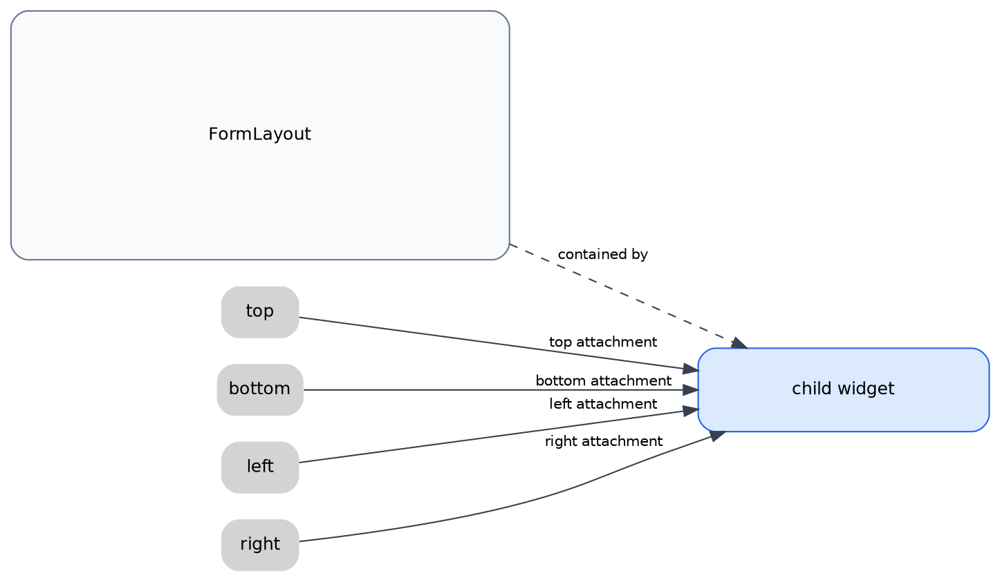

Only the specified edges are resolved through attachments.

!dot{align=center scale=0.9}
```dot
digraph OneAndTwoSided {
  graph [rankdir=LR, bgcolor="transparent", margin=0.05, nodesep=0.35, ranksep=0.5]
  node [shape=box, style="rounded,filled", fontname="Helvetica", fontsize=11]
  edge [fontname="Helvetica", fontsize=10, color="#374151"]

  oneTitle [label="one side: left = attachForm(12)", shape=plaintext]
  oneForm [label="Form left edge", fillcolor="#f8fafc", color="#64748b"]
  oneChild [label="child\nsizeHint width", fillcolor="#dbeafe", color="#2563eb"]

  twoTitle [label="two sides: left/right = attachForm(12)", shape=plaintext]
  twoLeft [label="left form edge", fillcolor="#f8fafc", color="#64748b"]
  twoChild [label="child stretches", fillcolor="#dcfce7", color="#16a34a", width=1.8]
  twoRight [label="right form edge", fillcolor="#f8fafc", color="#64748b"]

  oneTitle -> oneForm [style=invis]
  oneForm -> oneChild [label="12px", color="#2563eb"]
  oneChild -> twoTitle [style=invis]
  twoTitle -> twoLeft [style=invis]
  twoLeft -> twoChild [label="12px", color="#16a34a"]
  twoChild -> twoRight [label="12px", color="#16a34a"]
}
```

## Attachment Reference

### attachNone()

Leaves the edge unconstrained.

```cpp
.left = attachNone()
```

Omitting the edge normally has the same effect.

### attachForm(offset)

Attaches to the corresponding edge of the form.

```cpp
layout->addWidget(child, {
    .left = attachForm(12),
    .right = attachForm(12),
    .top = attachForm(12),
});
```

For `left` and `top`, the offset is added inward from the form edge. For `right` and `bottom`, the offset is subtracted inward from the form edge.

!dot{align=center scale=0.85}
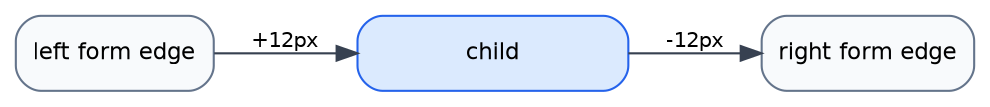

### attachWidget(target, offset)

Attaches to the opposite edge of the target widget.

```cpp
layout->addWidget(edit, {
    .left = attachWidget(label, 8),
    .top = attachOppositeWidget(label),
});
```

`.left = attachWidget(label, 8)` places the left edge of `edit` 8 px to the right of the right edge of `label`.

!dot{align=center scale=0.85}
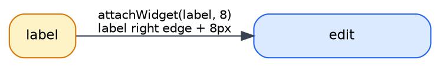

If the offset is omitted, the spacing configured in `FormLayout` is used.

```cpp
layout->setHorizontalSpacing(12);

layout->addWidget(rightPanel, {
    .left = attachWidget(leftPanel),
});
```

### attachOppositeWidget(target, offset)

Attaches to the corresponding edge of the target widget.

```cpp
layout->addWidget(edit, {
    .left = attachOppositeWidget(reference),
    .right = attachOppositeWidget(otherReference),
    .top = attachWidget(reference),
});
```

Use this to align the top edges of a label and an input field, or to align the left edges across multiple rows.

!dot{align=center scale=0.85}
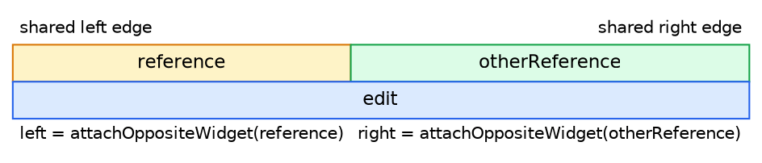

### attachPosition(position, offset)

Attaches to a proportional position within the form.

```cpp
layout->setFractionBase(100);

layout->addWidget(leftPane, {
    .left = attachForm(),
    .right = attachPosition(50, 6),
});

layout->addWidget(rightPane, {
    .left = attachPosition(50, 6),
    .right = attachForm(),
});
```

When `fractionBase` is 100, `attachPosition(50)` corresponds to 50% of the form's width or height.

!dot{align=center scale=0.85}
```dot
digraph AttachPosition {
  graph [rankdir=LR, bgcolor="transparent", margin=0.05]
  node [shape=plain, fontname="Helvetica", fontsize=11]

  layout [
    label=<
      <TABLE BORDER="0" CELLBORDER="0" CELLSPACING="0" CELLPADDING="4">
        <TR>
          <TD ALIGN="LEFT"><FONT POINT-SIZE="10">form left</FONT></TD>
          <TD ALIGN="CENTER" COLSPAN="2"><FONT POINT-SIZE="10">50%</FONT></TD>
          <TD ALIGN="RIGHT"><FONT POINT-SIZE="10">form right</FONT></TD>
        </TR>
        <TR>
          <TD BGCOLOR="#dbeafe" COLOR="#2563eb" BORDER="1" WIDTH="150">leftPane</TD>
          <TD BGCOLOR="#fef9c3" COLOR="#ca8a04" BORDER="1" WIDTH="34">6px</TD>
          <TD BGCOLOR="#fef9c3" COLOR="#ca8a04" BORDER="1" WIDTH="34">6px</TD>
          <TD BGCOLOR="#dcfce7" COLOR="#16a34a" BORDER="1" WIDTH="150">rightPane</TD>
        </TR>
        <TR>
          <TD ALIGN="LEFT"><FONT POINT-SIZE="10">left = attachForm()</FONT></TD>
          <TD ALIGN="RIGHT"><FONT POINT-SIZE="10">right = attachPosition(50, 6)</FONT></TD>
          <TD ALIGN="LEFT"><FONT POINT-SIZE="10">left = attachPosition(50, 6)</FONT></TD>
          <TD ALIGN="RIGHT"><FONT POINT-SIZE="10">right = attachForm()</FONT></TD>
        </TR>
      </TABLE>
    >
  ]
}
```

### attachOppositeForm(offset)

Attaches to the opposite edge of the form.

```cpp
layout->addWidget(panel, {
    .left = attachOppositeForm(-320),
    .right = attachForm(),
});
```

When used for `left`, the reference is the right edge of the form. When used for `right`, the reference is the left edge of the form. This allows positions outside the form or positions offset back from the opposite edge.

!dot{align=center scale=0.85}
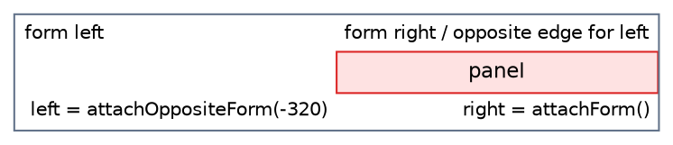

### attachSelf(offset)

Uses the widget's own initial geometry, before it comes under layout management, as the reference.

```cpp
selfPanel->setGeometry(420, 300, 220, 72);

layout->addWidget(selfPanel, {
    .left = attachSelf(),
    .top = attachSelf(),
});
```

Combined with `setRubberPositioning(true)`, this moves the widget proportionally to its initial position when the form is resized.

```cpp
layout->setRubberPositioning(true);
```

!dot{align=center scale=0.85}
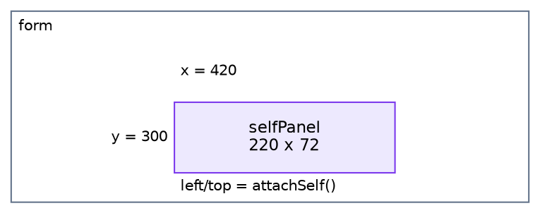

## FormLayout Settings

### fractionBase

The base value for `attachPosition()`. The default is `100`.

```cpp
layout->setFractionBase(100);
```

### rubberPositioning

Scales the reference position for `attachSelf()` proportionally with the form size. The default is `false`.

```cpp
layout->setRubberPositioning(true);
```

### spacing

Used when the offset is omitted in `attachWidget(target)`.

```cpp
layout->setHorizontalSpacing(12);
layout->setVerticalSpacing(10);
```

An explicitly specified offset takes precedence.

```cpp
.left = attachWidget(label, 8)
```

## Changing Constraints

Use `setConstraints()` to change the constraints of a widget that has already been added.

```cpp
layout->setConstraints(panel, {
    .left = attachForm(12),
    .right = attachForm(12),
    .top = attachPosition(50),
});
```

Use `constraintsFor()` to retrieve the current constraints.

```cpp
FormConstraints constraints = layout->constraintsFor(panel);
```

## Examples

All examples can be built together from the project root.

```bash
cmake -S . -B build
QTFRAMEWORK_BYPASS_LICENSE_CHECK=1 cmake --build build
```

Each example can also be built separately.

```bash
cmake -S examples/basic_form -B build-basic_form
QTFRAMEWORK_BYPASS_LICENSE_CHECK=1 cmake --build build-basic_form
```

### examples/basic_form

A basic form with a label, an input field, and buttons.

!dot{align=center scale=0.8}
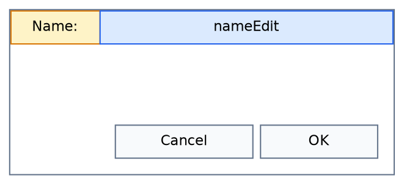

### examples/relative_widgets

Arranges multiple labels and input fields using attachments to other widgets.

!dot{align=center scale=0.8}
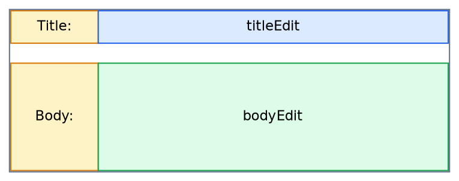

### examples/position_anchors

Divides the form proportionally using `attachPosition()` and `fractionBase`.

!dot{align=center scale=0.8}
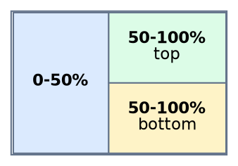

### examples/opposite_edges

Aligns the edges of multiple widgets using `attachOppositeWidget()`.

!dot{align=center scale=0.8}
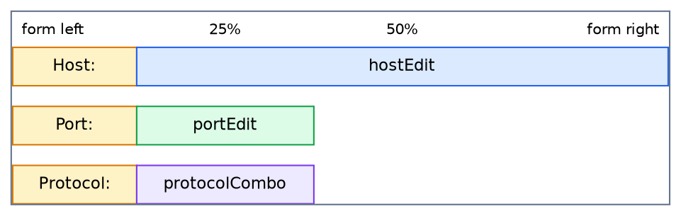

### examples/resizable_dialog

Arranges a list, a details area, and buttons in a resizable dialog.

!dot{align=center scale=0.8}
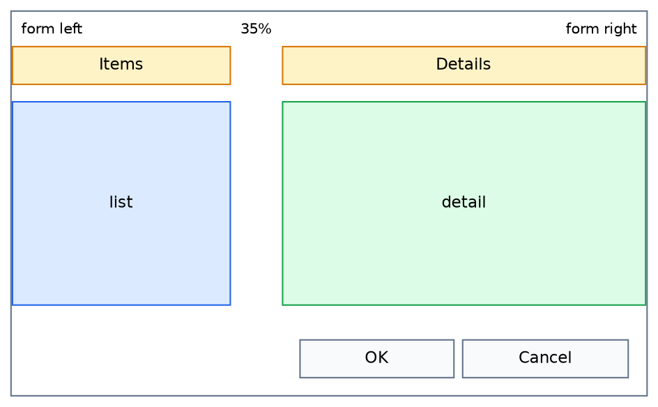

### examples/full_attachments

An example demonstrating the additional features together.

!dot{align=center scale=0.8}
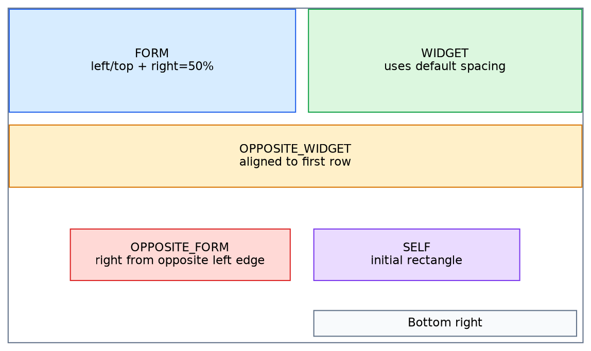

- `attachOppositeForm()`
- `attachSelf()`
- `setRubberPositioning(true)`
- `setHorizontalSpacing()`
- `setVerticalSpacing()`
- `attachWidget(target)` with the offset omitted

## Notes

- Avoid attachments with circular dependencies. The layout is resolved in multiple passes, but circular constraints may produce unintended positions.
- `attachSelf()` uses the `geometry()` from before the widget comes under layout management. To specify an initial position, call `setGeometry()` before `addWidget()`.
- `attachOppositeForm()` uses the opposite edge of the form as its reference, so the sign of the offset can place the widget outside the form.
