---
genpdf:
  format: book
  title: Anker Layout 利用ガイド
  subtitle: Qt Widgets で XmForm 風の attachment レイアウトを使う
  author: Anker Layout Project
  version: 0.1.0
  date: 2026-06-30
  font_size: 11pt
  page_numbers: true
---

# Anker Layout 利用ガイド

Anker Layout は、Qt Widgets で Motif の `XmForm` に近いフォーム型レイアウトを使うための `QLayout` 実装です。各ウィジェットの `left`、`right`、`top`、`bottom` をフォーム、他のウィジェット、位置割合、または自身の初期位置に attachment して配置します。

## 要件

- Qt 6 Widgets
- C++20
- CMake 3.16 以上

このプロジェクトは C++20 の designated initializer を前提にしています。

```cpp
layout->addWidget(editor, {
    .left = attachWidget(label, 8),
    .right = attachForm(),
    .top = attachOppositeWidget(label),
});
```

## ビルド

プロジェクト全体をビルドします。

```bash
cmake -S . -B build
cmake --build build
```

この環境で Qt License Service のロックエラーが出る場合は、次のように実行します。

```bash
QTFRAMEWORK_BYPASS_LICENSE_CHECK=1 cmake --build build
```

テストを実行します。

```bash
QTFRAMEWORK_BYPASS_LICENSE_CHECK=1 ctest --test-dir build --output-on-failure
```

## 基本的な使い方

`FormLayout` を親ウィジェットに設定し、`addWidget()` の第 2 引数で `FormConstraints` を渡します。

```cpp
#include "AnkerFormLayout.h"

#include <QApplication>
#include <QLabel>
#include <QLineEdit>
#include <QPushButton>
#include <QWidget>

using namespace Anker;

int main(int argc, char *argv[])
{
    QApplication app(argc, argv);

    QWidget window;
    auto *layout = new FormLayout(&window);
    layout->setContentsMargins(12, 12, 12, 12);

    auto *nameLabel = new QLabel("Name:");
    auto *nameEdit = new QLineEdit;
    auto *okButton = new QPushButton("OK");

    layout->addWidget(nameLabel, {
        .left = attachForm(),
        .top = attachForm(),
    });

    layout->addWidget(nameEdit, {
        .left = attachWidget(nameLabel, 8),
        .right = attachForm(),
        .top = attachOppositeWidget(nameLabel),
    });

    layout->addWidget(okButton, {
        .right = attachForm(),
        .bottom = attachForm(),
    });

    window.resize(420, 160);
    window.show();
    return app.exec();
}
```

## 制約の考え方

`FormConstraints` は 4 辺の attachment を持つ構造体です。

```cpp
struct FormConstraints
{
    FormAttachment left;
    FormAttachment right;
    FormAttachment top;
    FormAttachment bottom;
};
```

指定しない辺は `attachNone()` と同じ扱いです。片側だけを指定した場合、ウィジェットは `sizeHint()` と `minimumSize()` を基準に配置されます。両側を指定した場合、その 2 辺の間に伸縮します。

基本モデルは次の図のようになります。

!dot{align=center scale=0.9}
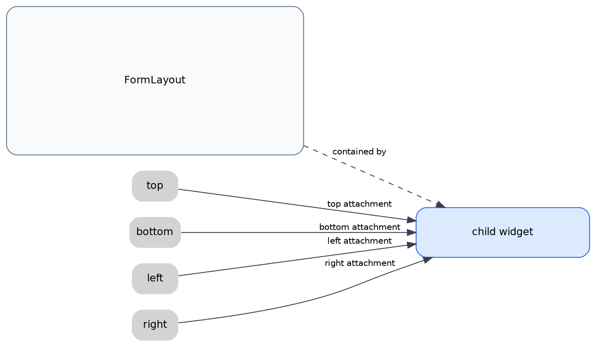

4 辺のうち、指定した辺だけが attachment で解決されます。

!dot{align=center scale=0.9}
```dot
digraph OneAndTwoSided {
  graph [rankdir=LR, bgcolor="transparent", margin=0.05, nodesep=0.35, ranksep=0.5]
  node [shape=box, style="rounded,filled", fontname="Helvetica", fontsize=11]
  edge [fontname="Helvetica", fontsize=10, color="#374151"]

  oneTitle [label="one side: left = attachForm(12)", shape=plaintext]
  oneForm [label="Form left edge", fillcolor="#f8fafc", color="#64748b"]
  oneChild [label="child\nsizeHint width", fillcolor="#dbeafe", color="#2563eb"]

  twoTitle [label="two sides: left/right = attachForm(12)", shape=plaintext]
  twoLeft [label="left form edge", fillcolor="#f8fafc", color="#64748b"]
  twoChild [label="child stretches", fillcolor="#dcfce7", color="#16a34a", width=1.8]
  twoRight [label="right form edge", fillcolor="#f8fafc", color="#64748b"]

  oneTitle -> oneForm [style=invis]
  oneForm -> oneChild [label="12px", color="#2563eb"]
  oneChild -> twoTitle [style=invis]
  twoTitle -> twoLeft [style=invis]
  twoLeft -> twoChild [label="12px", color="#16a34a"]
  twoChild -> twoRight [label="12px", color="#16a34a"]
}
```

## Attachment 一覧

### attachNone()

辺を固定しません。

```cpp
.left = attachNone()
```

通常は省略すれば同じ意味になります。

### attachForm(offset)

フォームの同じ側の辺へ attachment します。

```cpp
layout->addWidget(child, {
    .left = attachForm(12),
    .right = attachForm(12),
    .top = attachForm(12),
});
```

`left` と `top` の offset は内側へ加算されます。`right` と `bottom` の offset は内側へ減算されます。

!dot{align=center scale=0.85}


### attachWidget(target, offset)

対象ウィジェットの反対側の辺へ attachment します。

```cpp
layout->addWidget(edit, {
    .left = attachWidget(label, 8),
    .top = attachOppositeWidget(label),
});
```

`.left = attachWidget(label, 8)` は、`edit` の左辺を `label` の右辺から 8 px 右へ置きます。

!dot{align=center scale=0.85}
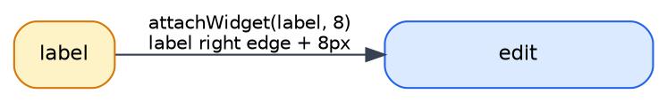

offset を省略した場合は `FormLayout` の spacing を使います。

```cpp
layout->setHorizontalSpacing(12);

layout->addWidget(rightPanel, {
    .left = attachWidget(leftPanel),
});
```

### attachOppositeWidget(target, offset)

対象ウィジェットの同じ側の辺へ attachment します。

```cpp
layout->addWidget(edit, {
    .left = attachOppositeWidget(reference),
    .right = attachOppositeWidget(otherReference),
    .top = attachWidget(reference),
});
```

ラベルと入力欄の上端を揃える、複数行の左端を揃える、といった用途に使います。

!dot{align=center scale=0.85}
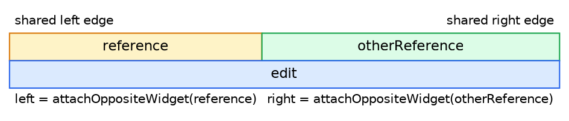

### attachPosition(position, offset)

フォーム内の割合位置へ attachment します。

```cpp
layout->setFractionBase(100);

layout->addWidget(leftPane, {
    .left = attachForm(),
    .right = attachPosition(50, 6),
});

layout->addWidget(rightPane, {
    .left = attachPosition(50, 6),
    .right = attachForm(),
});
```

`fractionBase` が 100 の場合、`attachPosition(50)` はフォーム幅または高さの 50% 位置です。

!dot{align=center scale=0.85}
```dot
digraph AttachPosition {
  graph [rankdir=LR, bgcolor="transparent", margin=0.05]
  node [shape=plain, fontname="Helvetica", fontsize=11]

  layout [
    label=<
      <TABLE BORDER="0" CELLBORDER="0" CELLSPACING="0" CELLPADDING="4">
        <TR>
          <TD ALIGN="LEFT"><FONT POINT-SIZE="10">form left</FONT></TD>
          <TD ALIGN="CENTER" COLSPAN="2"><FONT POINT-SIZE="10">50%</FONT></TD>
          <TD ALIGN="RIGHT"><FONT POINT-SIZE="10">form right</FONT></TD>
        </TR>
        <TR>
          <TD BGCOLOR="#dbeafe" COLOR="#2563eb" BORDER="1" WIDTH="150">leftPane</TD>
          <TD BGCOLOR="#fef9c3" COLOR="#ca8a04" BORDER="1" WIDTH="34">6px</TD>
          <TD BGCOLOR="#fef9c3" COLOR="#ca8a04" BORDER="1" WIDTH="34">6px</TD>
          <TD BGCOLOR="#dcfce7" COLOR="#16a34a" BORDER="1" WIDTH="150">rightPane</TD>
        </TR>
        <TR>
          <TD ALIGN="LEFT"><FONT POINT-SIZE="10">left = attachForm()</FONT></TD>
          <TD ALIGN="RIGHT"><FONT POINT-SIZE="10">right = attachPosition(50, 6)</FONT></TD>
          <TD ALIGN="LEFT"><FONT POINT-SIZE="10">left = attachPosition(50, 6)</FONT></TD>
          <TD ALIGN="RIGHT"><FONT POINT-SIZE="10">right = attachForm()</FONT></TD>
        </TR>
      </TABLE>
    >
  ]
}
```

### attachOppositeForm(offset)

フォームの反対側の辺へ attachment します。

```cpp
layout->addWidget(panel, {
    .left = attachOppositeForm(-320),
    .right = attachForm(),
});
```

`left` に指定するとフォーム右端側を基準にします。`right` に指定するとフォーム左端側を基準にします。フォーム外側を基準にした配置や、反対側エッジから戻す配置を表現できます。

!dot{align=center scale=0.85}
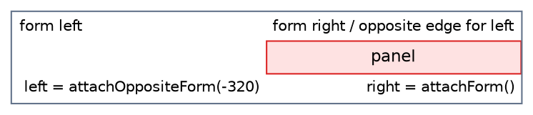

### attachSelf(offset)

レイアウト管理に入る前の自身の初期ジオメトリを基準にします。

```cpp
selfPanel->setGeometry(420, 300, 220, 72);

layout->addWidget(selfPanel, {
    .left = attachSelf(),
    .top = attachSelf(),
});
```

`setRubberPositioning(true)` と組み合わせると、フォームサイズ変更時に初期位置の比率を保つように移動します。

```cpp
layout->setRubberPositioning(true);
```

!dot{align=center scale=0.85}
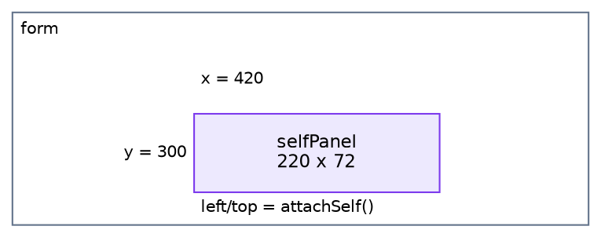

## FormLayout の設定

### fractionBase

`attachPosition()` の基準値です。デフォルトは `100` です。

```cpp
layout->setFractionBase(100);
```

### rubberPositioning

`attachSelf()` の基準位置をフォームサイズに合わせて比率移動させます。デフォルトは `false` です。

```cpp
layout->setRubberPositioning(true);
```

### spacing

`attachWidget(target)` の offset を省略した場合に使われます。

```cpp
layout->setHorizontalSpacing(12);
layout->setVerticalSpacing(10);
```

明示的に offset を指定した場合は、その値が優先されます。

```cpp
.left = attachWidget(label, 8)
```

## 制約の変更

追加済みウィジェットの制約は `setConstraints()` で変更できます。

```cpp
layout->setConstraints(panel, {
    .left = attachForm(12),
    .right = attachForm(12),
    .top = attachPosition(50),
});
```

現在の制約は `constraintsFor()` で取得できます。

```cpp
FormConstraints constraints = layout->constraintsFor(panel);
```

## サンプル

各サンプルはルートからまとめてビルドできます。

```bash
cmake -S . -B build
QTFRAMEWORK_BYPASS_LICENSE_CHECK=1 cmake --build build
```

サンプルごとの単体ビルドもできます。

```bash
cmake -S examples/basic_form -B build-basic_form
QTFRAMEWORK_BYPASS_LICENSE_CHECK=1 cmake --build build-basic_form
```

### examples/basic_form

ラベル、入力欄、ボタンを使った基本的なフォームです。

!dot{align=center scale=0.8}
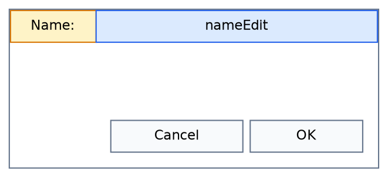

### examples/relative_widgets

複数のラベルと入力欄を、他ウィジェットへの attachment で並べます。

!dot{align=center scale=0.8}
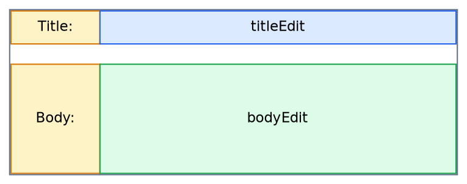

### examples/position_anchors

`attachPosition()` と `fractionBase` を使って、フォームを比率で分割します。

!dot{align=center scale=0.8}
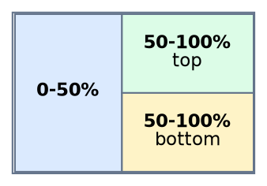

### examples/opposite_edges

`attachOppositeWidget()` で複数ウィジェットの辺を揃えます。

!dot{align=center scale=0.8}
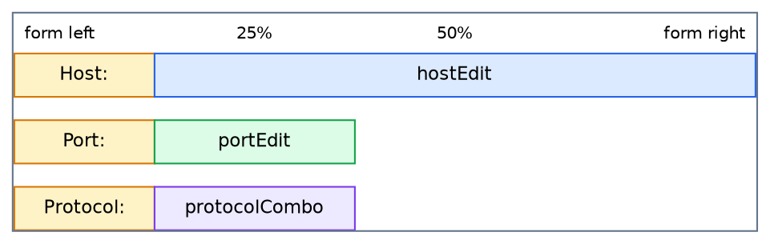

### examples/resizable_dialog

リサイズ可能なダイアログで、リスト、詳細欄、ボタンを配置します。

!dot{align=center scale=0.8}
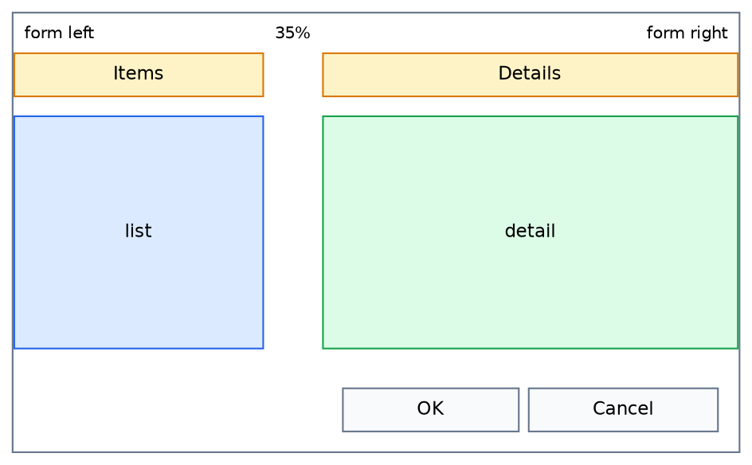

### examples/full_attachments

追加機能をまとめて確認するサンプルです。

!dot{align=center scale=0.8}
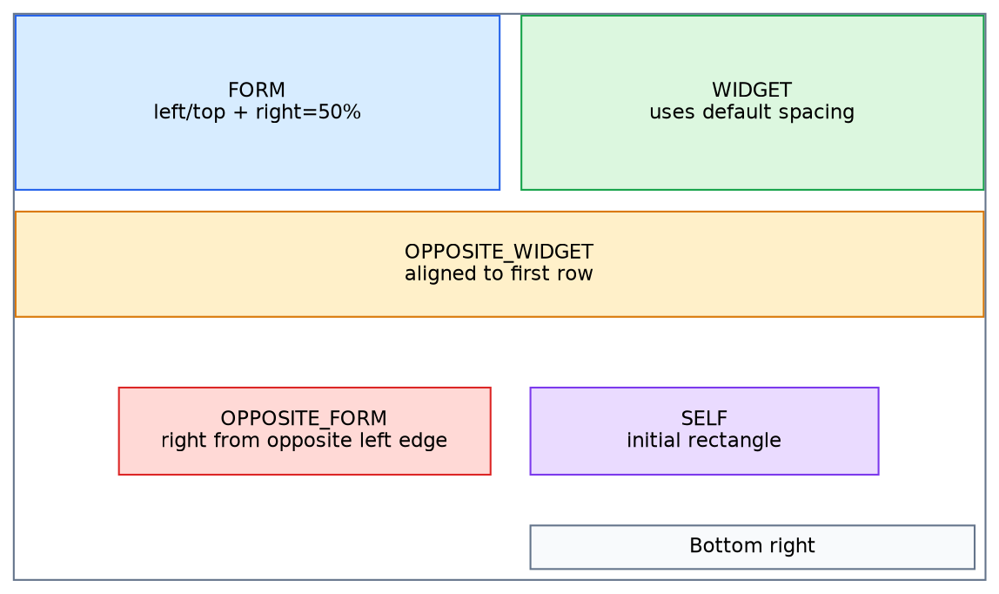

- `attachOppositeForm()`
- `attachSelf()`
- `setRubberPositioning(true)`
- `setHorizontalSpacing()`
- `setVerticalSpacing()`
- offset 省略時の `attachWidget(target)`

## 注意点

- 依存関係が循環する attachment は避けてください。レイアウトは複数パスで解決しますが、循環した制約は意図しない配置になる可能性があります。
- `attachSelf()` は、レイアウト管理に入る前の `geometry()` を基準にします。初期位置を指定したい場合は、`addWidget()` の前に `setGeometry()` を呼んでください。
- `attachOppositeForm()` はフォームの反対側エッジを基準にするため、offset の符号によってフォーム外へ配置されます。
