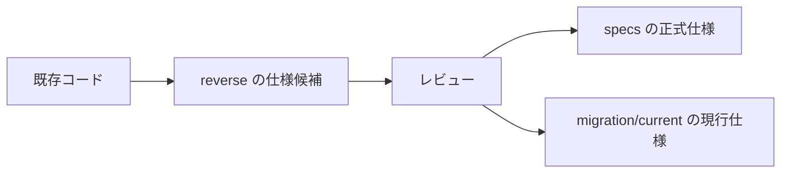

---
genpdf:
  format: book
  title: 大規模システム適用時のファイル構成ガイド
  subtitle: 分割適用を前提に三点セットを管理する
  author: ""
  version: 0.1
  date: 2026-05-27
  font_size: 11pt
  page_numbers: true
  table:
    header_background: "#e8f1ff"
    header_color: "#1f2937"
    border_color: "#cbd5e1"
    border_width: "1px"
    stripe: true
    stripe_background: "#f8fafc"
    cell_padding: "0.45em 0.65em"
    font_size: "0.95em"
    compact: false
    align: left
    header_align: center
    cell_align: left
---

!toc

<div class="page-break"></div>

# 1. このガイドの目的

このガイドは、大規模システムへ三点セットを適用するときのファイル構成を説明する。

三点セットを大規模システムへ適用する場合、システム全体を1つの仕様として扱うのではなく、業務領域、アプリケーション、画面、機能、バッチ、外部連携などに分けて扱う。分割適用では、仕様化前ノート、5分割仕様化前ノート、三点セット、プロンプト、生成結果、レビュー記録、判断記録の対応関係を保つことが重要になる。

このガイドでは、次の3つの手法について、実際にプロジェクトへ適用するときのファイル構成を示す。

- 三点セットからコードを生成する
- 既存コードから三点セットを作成する
- 三点セットを使ってマイグレーションする

3つの解説書は、それぞれの手法の進め方を説明する。このガイドは、それらの手法をプロジェクト内でどのように配置し、どの単位で管理するかを説明する。

## このガイドで扱う範囲

このガイドは、実装そのもののディレクトリー構成を決めるものではない。対象は、仕様、調査結果、プロンプト、レビュー記録、移行記録などの作業資産である。

実装コードの構成は、対象言語、フレームワーク、既存プロジェクトの制約に合わせて決める。ただし、仕様側の分割単位と実装側の対応関係を追えるようにしておく。

<div class="page-break"></div>

# 2. ファイル構成を決める基本方針

大規模システムでは、最初から完璧な構成を決めるよりも、分割適用を前提にして、対応関係が崩れない構成にすることが重要である。

## 分割適用を前提にする

三点セットは、レビュー可能な単位で作る。システム全体、業務全体、巨大なアプリケーション全体を1つの三点セットにすると、レビュー、修正、再生成が難しくなる。

基本の単位は次のように考える。

| 対象 | 推奨される分割 |
| --- | --- |
| UIがある機能 | 画面、画面群、操作フロー |
| 業務処理 | 業務機能、業務ルール群 |
| バッチ | ジョブ、入力ファイル、出力ファイル |
| 外部連携 | 連携先、連携データ、連携操作 |
| 移行作業 | 移行対象機能、移行元と移行先の対応 |

## 仕様単位と実装単位を混同しない

仕様単位は、人が理解し、レビューできる単位である。実装単位は、プログラムの構造に合わせた単位である。

両者は一致することもあるが、常に一致するとは限らない。例えば、1つの画面仕様が複数のクラスに展開されることもある。逆に、1つの共通クラスが複数画面から使われることもある。

仕様側では、実装都合よりもレビューしやすさを優先する。

## 生成物、レビュー記録、判断記録を分ける

同じディレクトリーにすべてを置くと、正式仕様、作業中のメモ、生成物、判断履歴の区別がつきにくくなる。

少なくとも次の種類は分ける。

- 仕様化前ノート
- 三点セット
- プロンプト
- 生成結果
- レビュー記録
- 未確認事項
- 判断記録

## 小さく始めて必要に応じて分割する

画面が1つか2つであれば、単一の仕様化前ノートで十分な場合が多い。ファイルを増やしすぎると、かえってレビューしにくくなる。

最初から大きいことが分かっている場合、または単一の仕様化前ノートが読みにくくなった場合は、5分割仕様化前ノートを使う。

<div class="page-break"></div>

# 3. 共通のトップレベル構成

3つの手法を扱うプロジェクトでは、トップレベルで作業の種類を分ける。

```text
project/
  shared/
  specs/
  reverse/
  migration/
  generated/
  reviews/
  prompts/
```

すべてのプロジェクトで全ディレクトリーが必要になるわけではない。小さく始める場合は、必要なものだけを置く。

## `shared/` に置く共通情報

`shared/` には、3つの手法で共通して使う情報を置く。

```text
shared/
  system_overview.md
  terminology.md
  domain_list.md
  application_list.md
  screen_list.md
  external_systems.md
```

共通情報を各所に重複して置くと、更新漏れが起きる。用語、業務領域、画面一覧、外部システム一覧などは、できるだけ `shared/` に寄せる。

## `specs/` に置くもの

`specs/` には、これから作る正式仕様を置く。三点セットからコード生成する場合の主な作業場所である。

```text
specs/
  applications/
  domains/
  batches/
  integrations/
```

## `reverse/` に置くもの

`reverse/` には、既存コードから仕様を復元するための調査結果と仕様候補を置く。

```text
reverse/
  legacy-system-a/
  legacy-system-b/
```

ここに置く三点セットは、正式仕様ではなく、コードから復元した仕様候補である。レビュー後に正式仕様へ昇格させる。

## `migration/` に置くもの

`migration/` には、移行元、移行先、差分、移行計画、比較テストを置く。

```text
migration/
  motif-to-qt/
  mfc-to-qt/
  qt-major-upgrade/
```

## `generated/` に置くもの

`generated/` には、プロンプトから生成されたコードや中間成果物を置く。正式な実装リポジトリーへ反映した後も、生成元を追跡するために必要な範囲で残す。

## `reviews/` に置くもの

`reviews/` には、複数の分割単位をまたぐレビュー記録を置く。分割単位ごとのレビューは、それぞれのディレクトリー内に置いてよい。

## `prompts/` に置くもの

`prompts/` には、複数箇所で使う共通プロンプトを置く。個別のプロンプトは、対象の分割単位の下に置く。

<div class="page-break"></div>

# 4. 分割単位の決め方

分割単位は、三点セットを作る単位である。大きすぎるとレビューできず、小さすぎると対応関係の管理が煩雑になる。

## 業務領域単位

販売、在庫、請求、認証、顧客管理など、業務のまとまりで分ける。

業務領域単位は、システム全体の見取り図を作るのに向いている。ただし、三点セットを直接この単位だけで作ると大きくなりやすい。下位に画面単位、機能単位、バッチ単位を置く。

## アプリケーション単位

管理画面、利用者向け画面、社内ツール、バッチ群など、アプリケーションごとに分ける。

UIがあるシステムでは、アプリケーション単位の下に画面単位を置くと整理しやすい。

## 画面単位

UI仕様を作る場合の基本単位である。1画面、または密接に連動する2画面程度で1つの仕様化前ノートにする。

## 機能単位

画面を持たない処理や、複数画面から使われる業務機能は、機能単位で分ける。

## バッチ・外部連携単位

バッチはジョブ単位、外部連携は連携先と連携データ単位で分ける。

## 単一の仕様化前ノートでよい範囲

人が無理なく読めてレビューできる範囲であれば、単一の仕様化前ノートを使う。経験的には、画面が1つか2つ程度なら単一ファイルで十分な場合が多い。

```text
user-list/
  source_memo.md
  three_key/
    usecase.md
    ui.md
    business.md
```

## 5分割仕様化前ノートを使う範囲

最初から大きくなることが分かっている場合、または単一ファイルではレビューが難しくなった場合は、5分割仕様化前ノートを使う。

```text
order-entry/
  five_source_memos/
    index.md
    shared.md
    01_purpose_scope.md
    02_input.md
    03_business_logic.md
    04_ui_operation.md
    05_test_examples.md
  three_key/
    usecase.md
    ui.md
    business.md
```

5分割仕様化前ノートを使う場合、単一の仕様化前ノートへ戻す必要はない。5分割仕様化前ノートから直接三点セットを作る。

<div class="page-break"></div>

# 5. 三点セットからコード生成する場合の構成

三点セットからコード生成する場合は、これから作る仕様が起点になる。主な置き場所は `specs/` である。

## 新規開発での基本構成

```text
specs/
  applications/
    admin-console/
      screens/
        user-list/
          source_memo.md
          three_key/
            usecase.md
            ui.md
            business.md
          prompts/
            generate_three_key.md
            generate_code.md
          generated/
          reviews/
```

この構成では、1つの画面または画面群に対して、仕様化前ノート、三点セット、プロンプト、生成結果、レビュー記録を近くに置く。

## 仕様化前ノートを使う場合

小さい単位では `source_memo.md` を使う。

```text
customer-search/
  source_memo.md
  three_key/
    usecase.md
    ui.md
    business.md
```

`source_memo.md` は、人が最初に意図を書く場所である。ここから三点セットを生成し、レビュー後にコード生成へ進む。

## 5分割仕様化前ノートを使う場合

大きい単位では `five_source_memos/` を使う。

```text
inventory-adjustment/
  five_source_memos/
    index.md
    shared.md
    01_purpose_scope.md
    02_input.md
    03_business_logic.md
    04_ui_operation.md
    05_test_examples.md
  three_key/
    usecase.md
    ui.md
    business.md
```

この場合も、生成先の三点セットは同じ場所に置く。

## 三点セットの配置

三点セットは、分割単位の下に `three_key/` として置く。

```text
three_key/
  usecase.md
  ui.md
  business.md
```

ファイル名は、長い名前にしすぎず、三点セットであることが分かるようにそろえる。

## 生成プロンプトと生成結果の配置

プロンプトは `prompts/`、生成結果は `generated/` に置く。

```text
prompts/
  generate_three_key.md
  generate_code.md
generated/
  iteration-001/
  iteration-002/
```

生成結果を繰り返し作る場合は、反復番号を付ける。最終的に実装リポジトリーへ反映した結果と、生成時点の結果を区別できるようにする。

## レビュー記録の配置

レビュー記録は `reviews/` に置く。

```text
reviews/
  source_memo_review.md
  three_key_review.md
  code_generation_review.md
```

レビューで仕様の不足が見つかった場合、コードを直接直すのではなく、仕様化前ノートまたは5分割仕様化前ノートへ戻して反映する。

## 推奨テンプレート

```text
feature-name/
  README.md
  source_memo.md
  three_key/
    usecase.md
    ui.md
    business.md
  prompts/
    generate_three_key.md
    generate_code.md
  generated/
  reviews/
```

大きい場合は `source_memo.md` の代わりに `five_source_memos/` を置く。

<div class="page-break"></div>

# 6. コードから三点セットを作る場合の構成

コードから三点セットを作る場合は、既存コードの調査が起点になる。主な置き場所は `reverse/` である。

## 既存コード調査での基本構成

```text
reverse/
  legacy-admin/
    targets/
      user-list/
        code_inventory.md
        behavior_notes.md
        assumptions.md
        unresolved.md
        recovered_source_memo.md
        three_key/
          usecase.md
          ui.md
          business.md
        reviews/
```

逆生成では、最初から正式仕様にしない。コードから確認できた事実、推定、未確認事項を分ける。

## 調査対象一覧の配置

`code_inventory.md` には、調査対象のファイル、クラス、関数、画面、設定ファイルなどを記録する。

```text
code_inventory.md
```

ここには、どのコードを読んだか、どこをまだ読んでいないかを残す。

## 読み取った事実の配置

`behavior_notes.md` には、コードから確認できた動作を書く。

```text
behavior_notes.md
```

事実として書けることと、推定したことを混ぜない。

## 推定・未確認事項の配置

推定は `assumptions.md`、未確認事項は `unresolved.md` に置く。

```text
assumptions.md
unresolved.md
```

推定や未確認事項を三点セットに直接混ぜると、後で正式仕様として扱われる危険がある。

## 復元した仕様化前ノートの配置

コードから読み取った内容を整理して、`recovered_source_memo.md` を作る。

```text
recovered_source_memo.md
```

これは、通常の仕様化前ノートと似ているが、出どころは既存コードである。人がレビューし、現行仕様として採用できるかを判断する。

## 復元した三点セットの配置

復元した三点セットは `three_key/` に置く。

```text
three_key/
  usecase.md
  ui.md
  business.md
```

ここに置く三点セットは、まだ仕様候補である。レビュー後に `specs/` または `migration/current/` へ昇格させる。

## レビュー記録の配置

```text
reviews/
  code_reading_review.md
  recovered_spec_review.md
```

レビューでは、コードから確認できたこと、推定に留まること、仕様として採用することを分けて確認する。

## 推奨テンプレート

```text
reverse/
  legacy-system/
    targets/
      target-name/
        code_inventory.md
        behavior_notes.md
        assumptions.md
        unresolved.md
        recovered_source_memo.md
        three_key/
          usecase.md
          ui.md
          business.md
        prompts/
          code_to_notes.md
          notes_to_three_key.md
        reviews/
```

<div class="page-break"></div>

# 7. 三点セットを使ってマイグレーションする場合の構成

マイグレーションでは、現行仕様、移行先仕様、差分、移行計画、比較テストを分ける。主な置き場所は `migration/` である。

## 移行作業での基本構成

```text
migration/
  motif-to-qt/
    order-entry/
      current/
        three_key/
          usecase.md
          ui.md
          business.md
      target/
        source_memo.md
        three_key/
          usecase.md
          ui.md
          business.md
      migration_plan.md
      compatibility.md
      comparison_tests.md
      decisions.md
```

`current/` は移行前の現行仕様、`target/` は移行後の目標仕様である。同じ三点セットで上書きしない。

## 現行仕様の配置

`current/` には、移行前の現行仕様を置く。

```text
current/
  source_memo.md
  three_key/
    usecase.md
    ui.md
    business.md
```

現行仕様が既存コードから復元された場合、`reverse/` の成果物をレビューした上で `current/` に置く。

## 移行先仕様の配置

`target/` には、移行先の目標仕様を置く。

```text
target/
  source_memo.md
  three_key/
    usecase.md
    ui.md
    business.md
```

移行先では、現行仕様をそのまま再現するだけでなく、廃止する仕様、改善する仕様、移行先フレームワークに合わせる仕様を明確にする。

## 差分記録の配置

```text
compatibility.md
```

現行仕様と移行先仕様の差分、維持する互換性、許容する変更を記録する。

## 移行計画の配置

```text
migration_plan.md
```

移行順序、段階的移行の方針、置き換え対象、リスクを記録する。

## 比較テストの配置

```text
comparison_tests.md
```

移行前後で同じ入力、同じ操作、同じ状態遷移を比較するためのテストを記録する。

## 判断記録の配置

```text
decisions.md
```

移行中の判断は、後から理由を追えるように残す。特に、MotifからQt、MFCからQt、Qtのメジャーバージョンアップでは、移行先で同等の部品や構造をどう選んだかを記録する。

## 推奨テンプレート

```text
migration/
  migration-name/
    target-name/
      current/
        three_key/
          usecase.md
          ui.md
          business.md
      target/
        source_memo.md
        three_key/
          usecase.md
          ui.md
          business.md
      prompts/
        current_to_target.md
        generate_target_code.md
      migration_plan.md
      compatibility.md
      comparison_tests.md
      decisions.md
```

<div class="page-break"></div>

# 8. 3つの手法を併用する場合の構成

大規模システムでは、3つの手法が同時に存在することがある。新規開発は `specs/`、既存コード調査は `reverse/`、移行作業は `migration/` に分ける。

## 8.1 併用時に複雑になる理由

併用時に複雑になる理由は、同じ三点セットでも意味が変わるためである。

```text
specs/.../three_key/
reverse/.../three_key/
migration/.../current/three_key/
migration/.../target/three_key/
```

見た目は同じ `three_key/` でも、意味は異なる。

| 置き場所 | 意味 |
| --- | --- |
| `specs/.../three_key/` | これから作る正式仕様 |
| `reverse/.../three_key/` | コードから復元した仕様候補 |
| `migration/.../current/three_key/` | 移行前の現行仕様 |
| `migration/.../target/three_key/` | 移行後の目標仕様 |

この違いを明確にしないと、推定中の仕様を正式仕様として扱ったり、現行仕様と移行先仕様を上書きしたりする。

## 8.2 併用時の基本方針

併用時は、成果物を手法ごとに分ける。ただし、共通情報は `shared/` に集約する。

```text
project/
  shared/
  specs/
  reverse/
  migration/
```

正式仕様へ昇格する流れも決めておく。



## 8.3 パターン1: 新規開発後に逆生成が必要になる場合

最初は三点セットからコード生成していたが、途中で手修正されたコードや古い実装が混ざり、コードから仕様を起こす必要が出る場合である。

```text
project/
  specs/
    new-feature-a/
      source_memo.md
      three_key/
  reverse/
    new-feature-a-current-code/
      code_inventory.md
      behavior_notes.md
      recovered_source_memo.md
      three_key/
```

この場合、`specs/` が正式仕様の置き場所である。`reverse/` は差分調査用であり、逆生成した結果をそのまま正式仕様にしない。

反映の流れは次のようにする。

```text
reverse の調査結果
  -> レビュー
  -> specs の仕様化前ノートまたは三点セットへ反映
  -> 必要なら再生成
```

## 8.4 パターン2: 既存システムを逆生成してから新規機能を追加する場合

既存コードから三点セットを作り、その仕様を土台にして新機能を追加する場合である。

```text
project/
  reverse/
    legacy-system/
      recovered_source_memo.md
      three_key/
  specs/
    enhanced-system/
      source_memo.md
      three_key/
```

`reverse/` は現行仕様の出どころを残す場所である。`specs/` は、今後の正式仕様を置く場所である。

復元仕様を正式仕様として使う場合は、レビューしてから `specs/` へ昇格させる。新規追加分は、復元仕様と混ぜずに、追加仕様として明確にする。

## 8.5 パターン3: 逆生成とマイグレーションを並行する場合

MotifからQt、MFCからQtのように、現行仕様をコードから復元しながら移行先仕様を作る場合である。

```text
project/
  reverse/
    motif-order-entry/
      code_inventory.md
      recovered_source_memo.md
      three_key/
  migration/
    motif-to-qt/
      order-entry/
        current/
          three_key/
        target/
          three_key/
        migration_plan.md
        comparison_tests.md
```

この場合、`reverse/` は現行把握、`migration/` は移行判断である。`current/` には、レビュー済みの現行仕様だけを置く。

`target/` には、Qtなど移行先に合わせた目標仕様を置く。現行仕様と移行先仕様を同じファイルで更新しない。

## 8.6 パターン4: 新規・既存・移行が混在する場合

大規模改修では、新規モジュールはコード生成、既存モジュールは逆生成、移行対象はマイグレーションという形で混在することが多い。

```text
project/
  shared/
    terminology.md
    domain_list.md
    screen_list.md
  specs/
    new-admin-console/
      screens/
  reverse/
    old-billing/
      modules/
  migration/
    mfc-to-qt/
      customer-management/
```

この場合、トップレベルで手法を分け、`shared/` に用語や業務領域を置く。分割単位の名前はできるだけそろえる。

例えば、`customer-management` という単位が `specs/` と `migration/` の両方に出る場合、同じ名前を使うことで対応関係を追いやすくする。

## 8.7 パターン5: 逆生成した仕様を使って別言語・別フレームワークへ再生成する場合

既存コードから三点セットを作り、それを使って別言語や別GUIフレームワークへ移行する場合である。

```text
project/
  reverse/
    legacy-app/
      recovered_source_memo.md
      three_key/
  migration/
    legacy-to-new/
      current/
        three_key/
      target/
        source_memo.md
        three_key/
      generated/
      comparison_tests.md
```

逆生成で得た `three_key/` は、現行仕様として固定する。移行先の `target/` は別に作る。

現行仕様を直接書き換えて移行先仕様にすると、何が維持され、何が変更されたか分からなくなる。

## 8.8 併用時に避けるべき構成

併用時には、次の構成を避ける。

- `specs/` に復元途中の仕様を直接置く
- `current/` と `target/` を同じ三点セットで上書きする
- 推定事項を正式仕様に混ぜる
- 手法ごとの成果物を画面単位でばらばらに置く
- 共通用語を各所で重複定義する

特に、推定事項と正式仕様の混在は危険である。コードから読み取ったが確証がない内容は、`assumptions.md` または `unresolved.md` に置く。

## 8.9 併用パターンの選び方

どの構成を主軸にするかは、作業の起点で決める。

| 作業の中心 | 主軸にする場所 |
| --- | --- |
| 新規開発 | `specs/` |
| 既存コード調査 | `reverse/` |
| 移行 | `migration/` |
| 複数手法が混在 | `shared/` と分割単位を先に決める |

混在する場合は、先に共通の分割単位を決める。業務領域名、画面名、機能名が手法ごとに揺れると、後から対応関係を追いにくくなる。

<div class="page-break"></div>

# 9. 命名規則

ファイル名とディレクトリー名は、長期運用で迷わないことを優先する。

## ディレクトリー名の付け方

ディレクトリー名は、対象が分かる名前にする。

```text
user-list/
order-entry/
motif-to-qt/
mfc-to-qt/
```

同じ対象が複数の手法に出る場合は、同じ名前を使う。

## ファイル名の付け方

三点セットは、次の名前を基本にする。

```text
three_key/
  usecase.md
  ui.md
  business.md
```

仕様化前ノートは次の名前を基本にする。

```text
source_memo.md
```

復元した仕様化前ノートは、通常の仕様化前ノートと区別する。

```text
recovered_source_memo.md
```

## 章番号や画面番号を使う場合

読み順が重要な場合は番号を付ける。

```text
01_purpose_scope.md
02_input.md
03_business_logic.md
04_ui_operation.md
05_test_examples.md
```

番号は並び替えを防ぐためのものであり、意味のない細分化を増やすためではない。

## 日本語名と英語名の使い分け

ディレクトリー名とファイル名は、ツールで扱いやすい英数字を基本にする。本文や見出しでは日本語を使う。

## 日付や版番号をファイル名に入れるか

通常は、日付や版番号をファイル名に入れない。履歴は版管理で追う。

ただし、外部配布物や比較用スナップショットでは、日付を入れてもよい。

<div class="page-break"></div>

# 10. 作業用構成と配布用構成

作業用構成と配布用構成は分ける。

## 作業用は分割し、配布用は簡潔にする

作業用構成では、章、プロンプト、レビュー記録、生成結果を分ける。一方、配布用構成では、読む人が迷わないように、完成した文書を中心にまとめる。

## PDFとMarkdownの置き方

作業用では、Markdownを正とし、PDFは確認用または配布用に生成する。

```text
docs/
  USER_GUIDE.md
  USER_GUIDE.pdf
```

## zip配布時のトップディレクトリー

zip配布では、展開したときに何を入手したか分かるトップディレクトリーを置く。

```text
threekeydoctolargesystem/
  USER_GUIDE.md
  USER_GUIDE.pdf
```

## 配布物に含めるもの、含めないもの

配布物には、読むために必要な完成文書を入れる。

含めるもの:

- 利用ガイド
- 各解説書
- 必要な図表
- PDF
- Markdown

含めないもの:

- 作業途中のレビュー記録
- 一時生成物
- 未確認メモ
- 内部確認用の中間ファイル

<div class="page-break"></div>

# 11. 避けた方がよい構成

大規模システムでは、構成の乱れが後工程の混乱につながる。次の構成は避ける。

## システム全体を1つの三点セットにする

システム全体を1つの三点セットにすると、レビューできない大きさになる。変更時の影響範囲も分かりにくい。

## 生成物と仕様を同じ場所に混ぜる

生成されたコード、生成ログ、仕様書を同じ場所に置くと、どれが正か分からなくなる。

## 推定事項を正式仕様に混ぜる

逆生成では、推定事項が発生する。推定事項は正式仕様に混ぜず、`assumptions.md` や `unresolved.md` に置く。

## 現行仕様と移行先仕様を混ぜる

マイグレーションでは、現行仕様と移行先仕様を分ける。上書きすると差分が失われる。

## プロンプトを本文中だけに埋め込む

本文中のプロンプト例は説明には有効だが、実作業で使うプロンプトは `prompts/` に置く。再利用、レビュー、更新がしやすくなる。

<div class="page-break"></div>

# 12. 最小構成から始める例

最初から大きな構成を作る必要はない。小さく始め、必要に応じて広げる。

## 小規模な画面単位の構成

```text
specs/
  user-list/
    source_memo.md
    three_key/
      usecase.md
      ui.md
      business.md
```

画面が1つか2つであれば、この程度で十分な場合が多い。

## 中規模な業務機能単位の構成

```text
specs/
  inventory/
    stock-adjustment/
      five_source_memos/
      three_key/
      prompts/
      reviews/
```

複数画面や複数ルールを含む場合は、5分割仕様化前ノートを使う。

## 大規模システムでの段階的な拡張

```text
project/
  shared/
  specs/
    applications/
    domains/
    batches/
    integrations/
  reverse/
  migration/
```

大規模システムでは、最初にすべてを埋めるのではなく、対象になった領域から追加する。

<div class="page-break"></div>

# 13. 推奨テンプレート集

この章では、実際にディレクトリーを作るときの最小テンプレートを示す。

## コード生成用テンプレート

```text
specs/
  target-name/
    README.md
    source_memo.md
    three_key/
      usecase.md
      ui.md
      business.md
    prompts/
      generate_three_key.md
      generate_code.md
    generated/
    reviews/
```

## 逆生成用テンプレート

```text
reverse/
  legacy-system/
    targets/
      target-name/
        code_inventory.md
        behavior_notes.md
        assumptions.md
        unresolved.md
        recovered_source_memo.md
        three_key/
          usecase.md
          ui.md
          business.md
        prompts/
        reviews/
```

## マイグレーション用テンプレート

```text
migration/
  migration-name/
    target-name/
      current/
        three_key/
          usecase.md
          ui.md
          business.md
      target/
        source_memo.md
        three_key/
          usecase.md
          ui.md
          business.md
      prompts/
      migration_plan.md
      compatibility.md
      comparison_tests.md
      decisions.md
```

## 共通情報用テンプレート

```text
shared/
  system_overview.md
  terminology.md
  domain_list.md
  application_list.md
  screen_list.md
  external_systems.md
```

## 配布用テンプレート

```text
threekeydoctolargesystem/
  USER_GUIDE.md
  USER_GUIDE.pdf
  FILE_STRUCTURE_GUIDE.md
  FILE_STRUCTURE_GUIDE.pdf
  three-key-code-generation/
    three-key-code-generation-guide.md
    three-key-code-generation-guide.pdf
  three-key-reverse-generation/
    three-key-reverse-generation-guide.md
    three-key-reverse-generation-guide.pdf
  three-key-migration/
    three-key-migration-guide.md
    three-key-migration-guide.pdf
```

配布用は、完成した文書だけを入れる。作業途中のレビュー記録や中間生成物は含めない。
