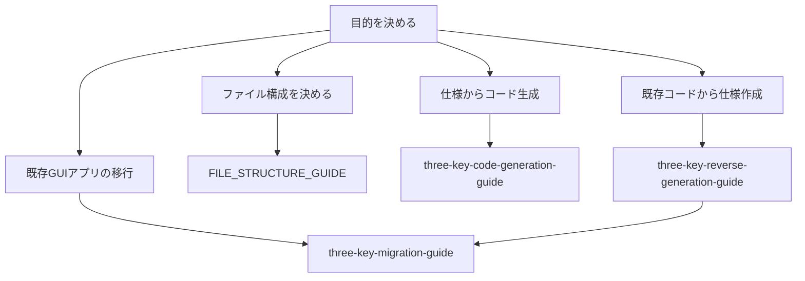

---
genpdf:
  format: book
  title: 三点セット解説書 利用ガイド
  subtitle: 大規模システムへの三点セットの適用
  author: ""
  version: 0.1
  date: 2026-05-27
  font_size: 11pt
  page_numbers: true
  table:
    header_background: "#e8f1ff"
    header_color: "#1f2937"
    border_color: "#cbd5e1"
    border_width: "1px"
    stripe: true
    stripe_background: "#f8fafc"
    cell_padding: "0.45em 0.65em"
    font_size: "0.95em"
    compact: false
    align: left
    header_align: center
    cell_align: left
---

!toc

<div class="page-break"></div>

# 1. この利用ガイドの目的

この利用ガイドは、3冊の解説書を目的に応じて読み分けるための入口である。

各解説書には詳細な手順、判断基準、例、プロンプト例が含まれている。この利用ガイドでは、それらを詳しく繰り返さず、どの文書をどの順番で読めばよいかを説明する。

## 対象読者

- 仕様からコード生成したい人
- 既存コードから仕様を作りたい人
- 既存GUIアプリをQtなどへ移行したい人
- 3冊の解説書の使い分けを知りたい人

<div class="page-break"></div>

# 2. まず読む文書

目的に応じて、最初に読む文書を選ぶ。

| やりたいこと | 最初に読む文書 |
| --- | --- |
| 大規模システムでのファイル構成を決めたい | `FILE_STRUCTURE_GUIDE` |
| 仕様からコードを作りたい | `three-key-code-generation-guide` |
| 既存コードから仕様を作りたい | `three-key-reverse-generation-guide` |
| 既存GUIアプリを移行したい | `three-key-migration-guide` |
| MotifからQtへ移行したい | `three-key-migration-guide` |
| MFCからQtへ移行したい | `three-key-migration-guide` |
| Qtメジャーバージョンアップをしたい | `three-key-migration-guide` |

大規模システムへ適用する場合は、先に `FILE_STRUCTURE_GUIDE` を読み、分割単位とファイル構成を決める。

既存コードから仕様を作り、その後に移行する場合は、先に逆生成の解説書を読み、次にマイグレーションの解説書を読む。



<div class="page-break"></div>

# 3. 3冊の解説書の役割

## FILE_STRUCTURE_GUIDE

大規模システムへ三点セットを分割適用するときのファイル構成を説明する。

主な内容:

- 3つの手法でファイル構成が異なる理由
- 分割単位の決め方
- コード生成、逆生成、マイグレーションそれぞれの構成
- 3つの手法を併用する場合の構成
- 作業用構成と配布用構成の違い

## three-key-code-generation-guide

仕様化前ノートと三点セットをもとに、コード生成へ進む方法を説明する。

主な内容:

- 仕様化前ノートと三点セットの関係
- 規模に応じた仕様化前ノートの使い分け
- 小さく動く単位からのコード生成
- 部分生成したコードを人が組み込む方法
- 生成後レビュー

## three-key-reverse-generation-guide

既存コードから現行仕様候補を抽出し、仕様化前ノートと三点セットへ整理する方法を説明する。

主な内容:

- 逆生成は仕様復元ではなく現行仕様抽出であること
- コード上の事実、推測、バグ候補の分離
- UI仕様候補、UC候補、ビジネス仕様候補の抽出
- 逆生成レビュー
- 仕様化前ノートから三点セットを作る流れ

## three-key-migration-guide

逆生成した仕様や三点セットを使って、既存GUIアプリを移行する方法を説明する。

主な内容:

- マイグレーションでの逆生成の必要度
- 直接変換の問題
- 移行先向けの再設計
- Qtメジャーバージョンアップ
- MotifからQtへの移行
- MFCからQtへの移行

<div class="page-break"></div>

# 4. 基本の流れ

## 新規作成の場合

```text
仕様化前ノート
  ↓
三点セット
  ↓
実装プロンプト
  ↓
コード生成
  ↓
生成後レビュー
```

詳しくは `three-key-code-generation-guide` を参照する。

## 既存コードから仕様を作る場合

```text
既存コード
  ↓
現行仕様候補の抽出
  ↓
仕様化前ノート
  ↓
逆生成レビュー
  ↓
三点セット
```

詳しくは `three-key-reverse-generation-guide` を参照する。

## 既存コードを移行する場合

```text
既存コード
  ↓
現行仕様の抽出
  ↓
仕様化前ノート
  ↓
三点セット
  ↓
移行先向け設計
  ↓
移行先コード生成
  ↓
移行後レビュー
```

詳しくは `three-key-migration-guide` を参照する。

<div class="page-break"></div>

# 5. 仕様化前ノートの使い分け

基本は単一の仕様化前ノートを使う。

経験的には、画面が1つか2つ程度であれば、単一の仕様化前ノートで人が十分レビューできる。ファイルを増やすこと自体にもコストがあるため、小さいアプリで無理に分割する必要はない。

ただし、仕様化前ノートが大きくなる場合、または最初から大きくなることが分かっている場合は、5分割仕様化前ノートを使う。

| 方式 | 向いている場合 |
| --- | --- |
| 単一の仕様化前ノート | 画面が1つか2つ、UCが少ない、1人で全体を見られる |
| 5分割仕様化前ノート | 入力項目、業務ルール、UI、代表例、例外条件が多い |

5分割仕様化前ノートから三点セットを直接生成できる。単一の仕様化前ノートへ戻す必要はない。

<div class="page-break"></div>

# 6. 三点セットの位置づけ

三点セットは、仕様化前ノートを実装、レビュー、テストに使いやすい形へ展開した仕様である。

| 文書 | 役割 |
| --- | --- |
| UC仕様書 | 利用者の目的、利用シナリオ、成功条件、例外条件を整理する |
| UI仕様書 | 画面、入力、表示、操作、エラー表示を整理する |
| ビジネスレイヤー仕様書 | UIに依存しない検証、計算、保存、状態変更を整理する |

三点セットにない仕様をコードへ直接追加しない。意図違いや不足が見つかった場合は、まず仕様化前ノートへ戻し、その後で三点セット、プロンプト、コードへ反映する。

<div class="page-break"></div>

# 7. 目的別の使い方

| 目的 | 読む文書 | 補足 |
| --- | --- | --- |
| 仕様からコードを作りたい | `three-key-code-generation-guide` | 実装プロンプトと生成後レビューも確認する |
| 小さく動く単位でコード生成したい | `three-key-code-generation-guide` | 最小構成から段階的に広げる |
| 部分生成したコードを人が組み込みたい | `three-key-code-generation-guide` | 生成コードを部品として扱う |
| 仕様不明コードから仕様を作りたい | `three-key-reverse-generation-guide` | 事実、推測、バグ候補を分ける |
| MotifからQtへ移行したい | `three-key-migration-guide` | コールバック内部を分類してQt向けに再設計する |
| MFCからQtへ移行したい | `three-key-migration-guide` | メッセージマップ、DDX/DDV、Document/Viewを見る |
| Qtメジャーバージョンアップをしたい | `three-key-migration-guide` | 逆生成を省略できる場合がある |

<div class="page-break"></div>

# 8. PDFの作り方

各解説書はMarkdown版とPDF版を用意する。PDFは `genpdf` の book 形式で生成する。

基本形:

```bash
genpdf --format book 入力.md --output 出力.pdf
```

例:

```bash
genpdf --format book \
  docs/three-key-code-generation/three-key-code-generation-guide.md \
  --output docs/three-key-code-generation/three-key-code-generation-guide.pdf
```

PDFを作るときは、Markdown先頭の `genpdf:` front matter を使う。タイトル、サブタイトル、日付、ページ番号、表スタイルなどは各Markdownに記載する。

<div class="page-break"></div>

# 9. ファイル一覧

## 共通ガイド

- `docs/USER_GUIDE.md`
- `docs/USER_GUIDE.pdf`
- `docs/FILE_STRUCTURE_GUIDE.md`
- `docs/FILE_STRUCTURE_GUIDE.pdf`

## コード生成

- `docs/three-key-code-generation/three-key-code-generation-guide.md`
- `docs/three-key-code-generation/three-key-code-generation-guide.pdf`
- `docs/three-key-code-generation/toc.md`

## 逆生成

- `docs/three-key-reverse-generation/three-key-reverse-generation-guide.md`
- `docs/three-key-reverse-generation/three-key-reverse-generation-guide.pdf`
- `docs/three-key-reverse-generation/toc.md`

## マイグレーション

- `docs/three-key-migration/three-key-migration-guide.md`
- `docs/three-key-migration/three-key-migration-guide.pdf`
- `docs/three-key-migration/toc.md`
