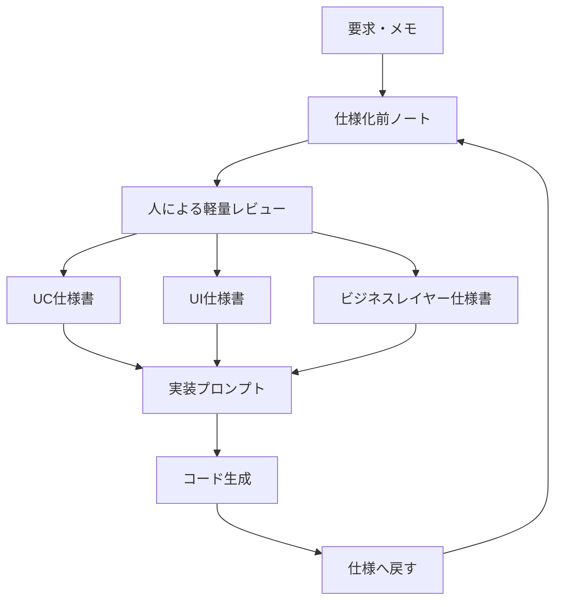
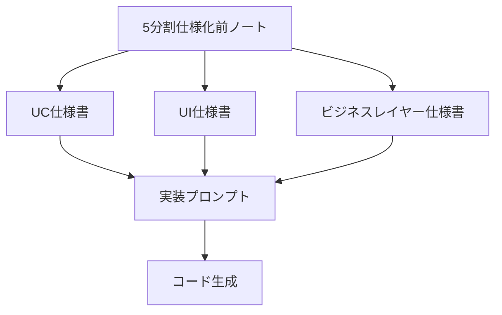
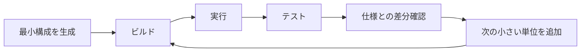
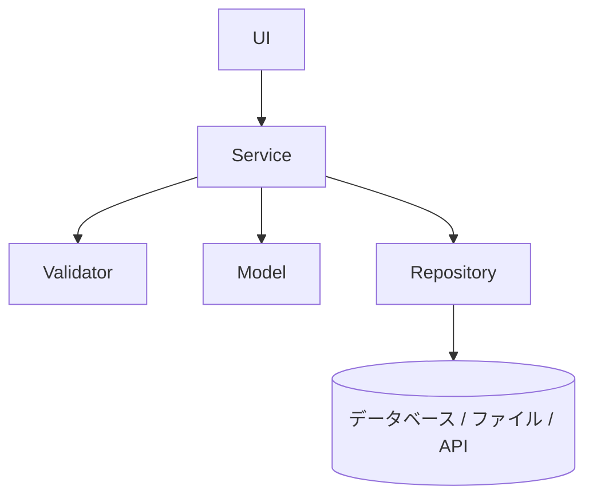

---
genpdf:
  format: book
  title: 仕様化前ノートと三点セットによるコード生成
  subtitle: 大規模システムで人がレビューしやすい仕様から実装へ進む手順
  author: ""
  version: 0.1
  date: 2026-05-27
  font_size: 11pt
  page_numbers: true
  table:
    header_background: "#e8f1ff"
    header_color: "#1f2937"
    border_color: "#cbd5e1"
    border_width: "1px"
    stripe: true
    stripe_background: "#f8fafc"
    cell_padding: "0.45em 0.65em"
    font_size: "0.95em"
    compact: false
    align: left
    header_align: center
    cell_align: left
---

!toc

<div class="page-break"></div>

# 1. この解説書の目的

この解説書は、仕様化前ノートと三点セットを使ってコード生成を行う手順を説明する。

三点セットは、UIがあるシステムで使いやすい既知の整理方法である。利用者の目的を扱うUC仕様書、画面と操作を扱うUI仕様書、UIに依存しない中核処理を扱うビジネスレイヤー仕様書に分けることで、仕様と実装の対応を追いやすくする。

仕様化前ノートは、この解説書で導入する造語である。読者がすでに知っている前提にはしない。仕様化前ノートとは、三点セットへ展開する前に、目的、利用者、対象データ、主要操作、ルール、対象外、未決事項を軽量に整理する文書である。

!callout{type=note title=用語の位置づけ}
  三点セットは既存の開発実務にある考え方と接続しやすい。
  仕様化前ノートは、本書で説明するための新しい名前である。
  そのため、本文では最初にこの用語を定義してから使う。

## 対象読者

- 仕様をもとにAIでコード生成したい人
- 生成コードをレビューする人
- 生成コードを既存システムへ組み込む人
- 大規模システムで仕様とコードの対応を管理したい人

## 対象範囲

この解説書は、仕様化前ノートから三点セットを作り、その三点セットを上位仕様としてコード生成へ進む方法を扱う。

要求定義そのもの、既存コードから三点セットを逆生成する方法、別言語へのマイグレーションは別の解説書で扱う。

<div class="page-break"></div>

# 2. 仕様化前ノートと三点セットの関係

仕様化前ノートは、三点セットの前段に置く軽量な正本である。

三点セットは実装、レビュー、テストに使いやすい形を持つ。一方で、大規模システムでは三点セットの記述量が大きくなり、人が最初から全文レビューするには重い。そこで、先に仕様化前ノートを作り、人が目的や未決事項を確認してから、AIで三点セットへ展開する。



## 役割の違い

| 文書 | 主な役割 | 人が確認する観点 |
| --- | --- | --- |
| 仕様化前ノート | 三点セットへ展開する前の軽量な正本 | 目的、対象、未決事項、対象外が妥当か |
| UC仕様書 | 利用者の目的と利用シナリオを整理する | 目的、成功条件、例外条件が正しいか |
| UI仕様書 | 画面、入力、表示、操作を整理する | 画面操作と表示が利用者に合っているか |
| ビジネスレイヤー仕様書 | UIに依存しない処理を整理する | 検証、計算、保存、状態変更が正しいか |
| 実装プロンプト | 仕様をコード生成へ接続する | 生成範囲、技術、制約が明確か |

三点セットにない仕様をコードへ直接追加してはいけない。実装中に仕様の不足や意図違いが見つかった場合は、まず仕様化前ノートへ戻し、その後で三点セットと実装プロンプトへ反映する。

<div class="page-break"></div>

# 3. 規模に応じた仕様化前ノートの使い方

基本は単一の仕様化前ノートを使う。

経験的には、画面が1つか2つ程度であれば、単一の仕様化前ノートで人が十分レビューできる。ファイルを増やすこと自体にもコストがあるため、小さいアプリで無理に分割する必要はない。

経験的に、仕様化前ノートの記述量は三点セットの約17%程度に収まる。これは、人がレビューする入口として重要である。三点セットが100ページ相当になる場合でも、仕様化前ノートは17ページ程度に圧縮できる可能性がある。

ただし、仕様化前ノートが大きくなりすぎる場合は、1つの巨大な文書にしない。システム全体、業務領域、機能群、画面・UC単位に分けて使う。

!callout{type=important title=大規模での基本方針}
  基本は単一の仕様化前ノートでよい。
  見通しが悪くなったら、仕様化前ノートを大きくするのではなく分割する。
  人は分割された軽量な文書をレビューし、AIが詳細な三点セットへ展開する。

## 単一ノートと5分割ノートの使い分け

| 方式 | 向いている場合 | 判断の目安 |
| --- | --- | --- |
| 単一の仕様化前ノート | 小さいアプリ、中規模でも見通せるアプリ | 画面が1つか2つ、UCが少ない、1人で全体を見られる |
| 5分割仕様化前ノート | 仕様化前ノートが大きい、または大きくなると分かっている場合 | 入力項目、業務ルール、UI、代表例、例外条件が多い |

単一で十分な場合は、単一のまま進める。分割は目的ではなく、レビュー可能な状態を保つための手段である。

## 分割の考え方

```text
system/source_memo.md
  ↓
customer_management/source_memo.md
order_management/source_memo.md
billing/source_memo.md
  ↓
customer_search/source_memo.md
customer_edit/source_memo.md
customer_import/source_memo.md
```

| 単位 | 書く内容 | 三点セット化の単位 |
| --- | --- | --- |
| システム全体 | 目的、利用者種別、主要業務領域、外部システム | 全体索引や共通方針 |
| 業務領域 | 業務目的、主要データ、共通ルール、対象外 | 領域単位の仕様群 |
| 機能群 | 主要操作、状態、入出力、未決事項 | 画面群やUC群 |
| 画面・UC | 入力、表示、操作、検証、例外 | 具体的な三点セット |

共通ルールと個別ルールは分けて書く。権限、日付、金額、入力文字種、監査ログ、エラー表現などは、全画面へ重複して書くより、共通ルールとして扱う方が保守しやすい。

## 5分割仕様化前ノートを使う場合

仕様化前ノートが大きくなる場合、または最初から大きくなることが分かっている場合は、単一の`source_memo.md`ではなく、5分割仕様化前ノートを使う。

5分割仕様化前ノートは、仕様化前ノートを次の観点に分けた正本である。

| ファイル | 役割 |
| --- | --- |
| `index.md` | 全体構成、読み方、生成方針、未決事項の所在 |
| `shared.md` | 共通用語、共通データ、共通エラー、共通表示方針 |
| `01_purpose_scope.md` | 目的、利用者、アプリ種別、スコープ、対象外 |
| `02_input.md` | 入力項目、入力ルール、初期値、入力エラー |
| `03_business_logic.md` | 業務ルール、計算、状態変化、例外条件 |
| `04_ui_operation.md` | 画面、表示、操作、文言、デザイン方針 |
| `05_test_examples.md` | 代表例、期待結果、境界値、テスト観点 |

この場合、単一の`source_memo.md`へ戻さず、`five_source_memos/`配下の分割ノート群を正本として扱う。5分割仕様化前ノートから三点セットを直接生成できる。



5分割仕様化前ノートから三点セットへ直接生成する場合は、反映先を明確にする。

| 5分割ノート | 主な反映先 |
| --- | --- |
| `index.md` | 三点セット全体の概要、参照元、未決事項 |
| `shared.md` | UCの対象データ、UIの共通UI、ビジネスレイヤーの用語・共通エラー |
| `01_purpose_scope.md` | UCの目的、アクター、スコープ、対象外 |
| `02_input.md` | UIの入力項目、ビジネスレイヤーの入力・検証ルール |
| `03_business_logic.md` | UCの業務ルール、ビジネスレイヤーの処理ルール・状態変更 |
| `04_ui_operation.md` | UI仕様、UCの基本フロー、UIとビジネスレイヤーの境界 |
| `05_test_examples.md` | UCの確認観点、ビジネスレイヤーの代表例・期待結果・テスト観点 |

!callout{type=important title=直接生成の検証結果}
  小さな検証では、5分割仕様化前ノートから単一の source_memo.md を経由せずに三点セットを直接生成できた。
  成功の条件は、5分割ノートと三点セットの対応表を作り、漏れ、重複、意味の変化、未決事項の消失を確認することである。

検証例は次の場所に置いている。

```text
docs/three-key-code-generation/verification/five-source-to-specs/
```

<div class="page-break"></div>

# 4. 三点セットの役割

三点セットは、仕様を実装しやすい形に分解するための文書群である。

## UC仕様書

UC仕様書は、利用者の目的、利用シナリオ、成功条件、代替条件、例外条件を整理する。コード生成では、画面や処理を作る理由を示す。

## UI仕様書

UI仕様書は、画面、入力項目、表示項目、操作、エラー表示を整理する。コード生成では、画面部品、イベント、表示状態を作る根拠になる。

## ビジネスレイヤー仕様書

ビジネスレイヤー仕様書は、UIに依存しない検証、計算、保存、更新、削除、状態変更を整理する。コード生成では、サービス、モデル、入力検証、リポジトリなどの生成根拠になる。

## 対応関係

| UC ID | UC | UI | ビジネスレイヤー |
| --- | --- | --- | --- |
| UC-001 | 顧客を検索する | 顧客検索画面、検索ボタン | 検索条件検証、顧客検索 |
| UC-002 | 顧客情報を更新する | 顧客編集画面、保存ボタン | 入力検証、更新可否判定、保存 |
| UC-003 | 顧客一覧を出力する | 一覧画面、CSV出力ボタン | 出力対象抽出、CSV変換 |

三点セットは別々の文書だが、実装では対応表で結びつける必要がある。

<div class="page-break"></div>

# 5. コード生成前の確認

コード生成前には、仕様化前ノートと三点セットが生成に使える状態か確認する。

| 確認項目 | 確認内容 | 不足している場合 |
| --- | --- | --- |
| 仕様化前ノート | レビュー済みか、未決事項が整理されているか | 三点セットへ進まない |
| 三点セット | UC、UI、ビジネスレイヤーがそろっているか | 不足文書を作る |
| 未決事項 | 実装に影響する未決が残っていないか | 生成前に確認する |
| 対象外 | 作らない機能が明記されているか | AIが補完しそうな範囲を止める |
| 実装方式 | 言語、フレームワーク、保存方式、テスト方式が決まっているか | 実装プロンプトを作れない |
| 生成範囲 | 全体、画面、UC、処理のどれを生成するか | 範囲を決め直す |

!callout{type=warning title=生成してはいけない状態}
  保存方式、入力ルール、状態変更、データモデルなど、実装に影響する未決事項が残っている場合は、コード生成へ進まない。
  仮決めで生成する場合は、仮決めであることを仕様へ記録する。

<div class="page-break"></div>

# 6. 実装方式を決める

三点セットは「何を作るか」を扱う。実装方式は「どう作るか」を扱う。

実装方式は三点セットの後で決める。三点セットの中に、特定フレームワーク都合の実装詳細を早く混ぜすぎない。

| 項目 | 例 | 注意点 |
| --- | --- | --- |
| 言語とフレームワーク | C++/Qt、Python、Web、CLI | 技術都合で仕様を変えない |
| UI方式 | デスクトップ、Web、CLI、APIのみ | UI仕様をどう表現するかを決める |
| 保存方式 | 保存なし、JSON、SQLite、データベース、API | 未決のまま生成しない |
| テスト方式 | 単体、統合、UI確認、手動確認 | ビジネスレイヤーは単体テストしやすくする |
| ビルド方式 | CMake、npm、pytest、Makefile | 生成後すぐ確認できるようにする |
| 使わない機能 | データベースなし、QMainWindowなし、設定保存なし | 仕様外の便利機能を防ぐ |

たとえばQtで実装する場合でも、すべての画面に`QMainWindow`を使うとは限らない。メニュー、ツールバー、ステータスバー、中央Widgetという構造が必要な場合だけ使う。

<div class="page-break"></div>

# 7. 実装プロンプトを作る

実装プロンプトは、仕様化前ノート、三点セット、実装方式をコード生成へ接続する文書である。

実装プロンプトは単なる依頼文ではない。AIが参照すべき上位仕様、生成してよい範囲、使う技術、作らない機能を明確にする制御文書である。

## 実装プロンプトに含める内容

| 項目 | 内容 |
| --- | --- |
| 参照する仕様化前ノート | どの`source_memo.md`を正本として扱うか |
| 参照する三点セット | UC、UI、ビジネスレイヤー仕様書の場所 |
| 実装条件 | 言語、フレームワーク、ディレクトリ構成、生成範囲 |
| UI条件 | 画面、入力、表示、操作、エラー表示 |
| ビジネス処理条件 | 検証、計算、状態変更、保存、エラー種別 |
| 保存・永続化条件 | 保存方式、既存API、リポジトリの扱い |
| テスト条件 | テスト対象、テスト方式、代表例 |
| 禁止事項 | 仕様外の機能追加、過剰な抽象化、対象外機能 |

## 短いプロンプト例

```text
次の仕様化前ノートと三点セットを上位仕様として扱い、
UC-001 顧客を検索する処理だけを実装してください。

- 仕様化前ノート: customer_search/source_memo.md
- UC仕様書: customer_search/01_usecase_spec.md
- UI仕様書: customer_search/02_ui_spec.md
- ビジネスレイヤー仕様書: customer_search/03_business_spec.md

実装方式:
- C++/Qt
- QWidget を使う
- ビジネス処理はサービスクラスへ分離する
- 保存処理は今回は実装しない

仕様にない検索条件、編集、削除、設定保存は追加しないでください。
```

<div class="page-break"></div>

# 8. コード生成の単位

コード生成は、生成単位を決めてから行う。

大規模システムでは、全体を一括生成するより、画面、UC、ビジネス処理などの単位へ分ける方がレビューしやすい。

| 生成単位 | 向いている場面 | 主に参照する仕様 |
| --- | --- | --- |
| 画面単位 | 画面の構造や操作感を確認したい | UI仕様書 |
| UC単位 | 利用者の目的に沿った一連の流れを実装したい | UC仕様書、UI仕様書、ビジネスレイヤー仕様書 |
| ビジネス処理単位 | 検証、計算、保存などを先に固めたい | ビジネスレイヤー仕様書 |
| テスト単位 | 既存実装に対する仕様確認を増やしたい | 代表例、期待結果、テスト観点 |

生成単位を決めない依頼は危険である。AIが広い範囲をまとめて作ろうとし、仕様外の機能やレビューしにくい構造が混ざりやすい。

<div class="page-break"></div>

# 9. 小さく動く単位から生成する

最初から完成形を一括生成しない。まず、小さく動くコードを作り、それを確認しながら段階的に広げる。



## 進め方

1. 最小構成の動くコードを生成する。
2. 1画面、1UC、1ビジネス処理から始める。
3. 生成後すぐにビルド、実行、テストで確認する。
4. 動く状態を保ちながら範囲を広げる。
5. 失敗した場合は、直前の仕様、実装プロンプト、生成単位へ戻る。
6. 段階ごとに仕様との差分を確認する。

!callout{type=important title=戻る場所}
  失敗したときにコードだけを場当たり的に直さない。
  仕様が曖昧だったのか、実装プロンプトが広すぎたのか、生成単位が大きすぎたのかを確認する。

<div class="page-break"></div>

# 10. 部分生成したコードを人が組み込む

大規模システムでは、AIにシステム全体を作らせるより、部品としてコードを生成し、人が既存コードや全体設計へ組み込む方が現実的である。

第9章は「小さく動く単位を積み上げる開発プロセス」の話である。この章は「生成コードを完成品ではなく部品として扱う利用方法」の話である。

## 部分生成の単位

| 部品 | 生成例 | 人が確認すること |
| --- | --- | --- |
| UI部品 | 1画面、1ダイアログ、入力フォーム | 既存画面構成と合うか |
| UC部品 | 1つの利用シナリオ | UIとビジネス処理の接続が正しいか |
| ビジネス部品 | 検証、計算、検索、保存 | 業務ルールとテストが正しいか |
| テスト部品 | 単体テスト、代表例テスト | 仕様の期待結果を確認できるか |

生成コードの責務と境界を明確にする。UI部品なら表示と入力取得まで、サービスなら業務処理まで、リポジトリなら保存・取得まで、というように分ける。

組み込み時に修正した内容は、コードだけに残さない。既存APIに合わせて入力項目を変えた、保存方式を変更した、エラー文言を統一した場合は、仕様化前ノート、三点セット、実装プロンプトへ戻す。

<div class="page-break"></div>

# 11. UIコードの生成

UIコードは、UI仕様書をもとに生成する。

UIコードの目的は、画面部品を並べることだけではない。利用者から見える入力、表示、操作、エラー表示を仕様どおりに表現し、ビジネスレイヤーへの入口を作ることである。

## UIコード生成の観点

| 観点 | 内容 |
| --- | --- |
| 画面一覧 | どの画面、ダイアログ、タブを作るか |
| 入力項目 | ラベル、初期値、必須、入力可能範囲 |
| 表示項目 | 一覧、詳細、空状態、未選択状態 |
| 操作 | ボタン、メニュー、ショートカット、選択変更 |
| エラー表示 | 入力エラー、処理失敗、保存失敗 |
| 境界 | UIに業務ルールを書きすぎない |

UIは入力を受け取り、操作を中継し、結果を表示する層である。入力検証や状態変更の本体はビジネスレイヤーへ分離する。

## Qtでの責務分離例

```c++
class CustomerSearchWidget : public QWidget
{
    Q_OBJECT

public:
    explicit CustomerSearchWidget(QWidget* parent = nullptr);

private slots:
    void onSearchClicked();

private:
    SearchCondition currentCondition() const;
    void showResults(const QList<Customer>& customers);
    void showError(const QString& message);

    CustomerSearchService* service;
};
```

この例では、画面は入力取得、操作受付、結果表示を担当する。検索条件の検証や顧客検索そのものは`CustomerSearchService`へ渡す。

<div class="page-break"></div>

# 12. ビジネスレイヤーの生成

ビジネスレイヤーは、UIに依存しない中核処理を実装する場所である。

対象は、データモデル、入力検証、計算処理、状態変更、保存、更新、削除、エラー種別である。

## 責務の分離



| 要素 | 役割 |
| --- | --- |
| Model | 業務上扱うデータを表す |
| Validator | 入力ルールや業務ルール違反を判定する |
| Service | UCに対応する処理の流れを実行する |
| Repository | 保存先や外部APIとの接続を隠蔽する |
| Error | UIに依存しないエラー種別を表す |

ビジネスレイヤーはテスト可能な構造にする。UIを起動しなくても、代表例、境界値、例外条件、状態遷移をテストできることが重要である。

## 検証項目の例

| 種別 | 例 |
| --- | --- |
| 必須 | 顧客名は必須 |
| 文字数 | 顧客名は100文字以内 |
| 数値範囲 | 数量は1以上 |
| 日付範囲 | 開始日は終了日以前 |
| 状態 | 承認済みデータは編集不可 |
| 重複 | 同じ顧客IDは登録不可 |

<div class="page-break"></div>

# 13. UCとコードの対応管理

コード生成では、コードだけでなく、仕様とコードの対応関係も成果物として扱う。

対応表がないと、どの仕様がどのコードに反映されたのか、どの仕様が未実装なのか、生成コードが仕様外のことをしていないかを追いにくい。

## 対応表の例

| UC ID | 仕様化前ノート | UC | UI操作 | ビジネス処理 | コード位置 | テスト |
| --- | --- | --- | --- | --- | --- | --- |
| UC-001 | customer_search/source_memo.md | 顧客を検索する | 検索ボタン | 検索条件検証、顧客検索 | CustomerSearchWidget / CustomerSearchService | CustomerSearchServiceTest |
| UC-002 | customer_edit/source_memo.md | 顧客を更新する | 保存ボタン | 入力検証、更新可否判定、保存 | CustomerEditWidget / CustomerUpdateService | CustomerUpdateServiceTest |

大規模システムでは、対応表が索引になる。仕様化前ノート、三点セット、実装プロンプト、コード、テストを同じIDで追跡する。

<div class="page-break"></div>

# 14. 生成後レビュー

生成後レビューは、コードの品質確認だけではない。仕様とコードの整合確認である。

## レビュー観点

| 観点 | 確認内容 |
| --- | --- |
| ビルド、実行、テスト | 生成コードが確認可能な状態か |
| 仕様化前ノートとの差分 | 上流の目的、対象外、未決事項と矛盾していないか |
| 三点セットとの差分 | UC、UI、ビジネスレイヤー仕様が反映されているか |
| 仕様外の追加 | AIが便利機能を勝手に足していないか |
| 未実装項目 | 仕様にあるがコード化されていないものはないか |
| テスト観点 | 代表例、境界値、例外条件がテストされているか |
| 仕様へ戻す仮決め | 実装中の判断がコードだけに残っていないか |

!callout{type=warning title=仕様外の追加}
  仕様にない検索条件、編集機能、削除機能、設定保存、権限判定、画面遷移が入っていないか確認する。
  正式に採用する場合は、先に仕様化前ノートへ戻す。

レビュー後は、次のどれかに分類する。

| 分類 | 対応 |
| --- | --- |
| 仕様どおり | 対応表に反映済みとして記録する |
| 仕様不足 | 仕様化前ノートへ戻して三点セットへ反映する |
| 生成ミス | 実装プロンプトまたは生成単位を修正する |
| 仕様外追加 | 削除するか、正式採用するなら仕様へ戻す |
| 未実装 | 次の生成単位として管理する |

<div class="page-break"></div>

# 付録A. UC / UI / ビジネスレイヤーに関連する大規模システム事例

この付録では、本文で扱う構成と関連する外部事例を紹介する。

各事例が本文の用語や構成をそのまま採用しているわけではない。そのため、この付録では外部事例に合わせて、UC、UI、ビジネスレイヤー、ビジネスルール、構造化仕様、モデル駆動開発などの一般的な用語で説明する。

## 事例を読むときの観点

| 観点 | 見る内容 |
| --- | --- |
| UC | 利用者の目的や業務要求をどう整理しているか |
| UI | 画面、操作、業務フローとの関係をどう扱っているか |
| ビジネスレイヤー | ルール、検証、処理、データアクセスをどう分離しているか |
| 逆生成 | 既存コードから仕様やルールをどう抽出しているか |
| 移行 | 抽出した仕様を別言語や新アーキテクチャへどうつなげているか |

## UCを大規模要求定義に使った事例

大規模企業で業務要求とユースケース記述を調査した研究がある。ユースケースは、大規模な要求仕様で利用者目的やシナリオを整理する手段として扱われている。

参考: Adopting Use Case Descriptions for Requirements Specification  
https://arxiv.org/abs/2506.13303

## UCとUI設計を結びつけた事例

大規模システムの要求・要件仕様作成では、ドメインやサブシステムへ分解し、UI設計ではユースケースと入力・表示項目の相互作用を考慮する考え方が示されている。

参考: 要求・要件仕様を効率的、高品質に作成する方法  
https://www.mesw.co.jp/business/report/pdf/mss_29_03.pdf

## UI、ビジネスフロー、ビジネスルールを分離した事例

NTTドコモの大規模顧客情報管理の事例では、ビジネスフローとルールを分離し、新しいサービス開発時の影響範囲を局所化したと説明されている。UI、ビジネスフロー、ビジネスルールを分ける実例として参考になる。

参考: 大規模顧客情報管理 / 株式会社NTTドコモ  
https://www.nau.co.jp/case/01/

## レガシーコードからビジネスルールや要求文書を抽出した事例

AveriSourceの州政府機関向け事例では、Model-204のコード420万行以上を解析し、11,000件のビジネスルールを文書化したとされている。既存コードからビジネスルールや要求文書を抽出する事例として参考になる。

参考: AveriSource Accelerates Business Rules Extraction and Modernization Project Delivery  
https://www.averisource.com/case-studies/averisource-accelerates-business-rules-extraction-and-modernization-project-delivery

## 構造化仕様を使って別言語へ移行した事例

イー・ビジネスの基幹レガシーシステムモダナイゼーション事例では、既存COBOLソースから業務ワークフロー・構造化仕様書を逆生成し、それを基にJavaモジュール化への移行基盤を整備したと説明されている。

参考: 基幹レガシーシステムモダナイゼーション  
https://www.e-business.co.jp/case/detail/001/

## モデル駆動開発やローコードによるコード生成事例

モデル駆動開発やローコードの産業事例では、要求やモデルを上位成果物として扱い、実装やコード生成へつなげる考え方が扱われている。仕様やモデルを人が確認し、そこから実装へ進む方法として参考になる。

参考: Model-driven development platform selection: four industry case studies  
https://link.springer.com/article/10.1007/s10270-020-00855-w

## 本文の方法へ取り込める教訓

- 大規模では、全体を一度に扱わず、業務領域や機能群へ分割する。
- 利用者の目的、画面、ビジネスルールは分けて整理する。
- 既存コードから抽出した情報は、完成仕様ではなくレビュー対象として扱う。
- 仕様、コード、テストを対応表で結びつける。
- 別言語や新アーキテクチャへ移行する場合、直接変換より仕様経由の方が判断しやすい。
