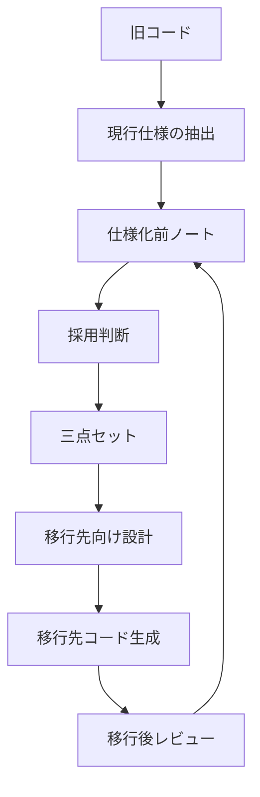

---
genpdf:
  format: book
  title: 逆生成した三点セットによるマイグレーション手順
  subtitle: 仕様経由でGUIアプリを安全に移行するための実務ガイド
  author: ""
  version: 0.1
  date: 2026-05-27
  font_size: 11pt
  page_numbers: true
  table:
    header_background: "#e8f1ff"
    header_color: "#1f2937"
    border_color: "#cbd5e1"
    border_width: "1px"
    stripe: true
    stripe_background: "#f8fafc"
    cell_padding: "0.45em 0.65em"
    font_size: "0.95em"
    compact: false
    align: left
    header_align: center
    cell_align: left
---

!toc

<div class="page-break"></div>

# 1. この解説書の目的

この解説書は、仕様が不明になった既存GUIコードを、仕様経由で移行する手順を説明する。

対象は、Qtメジャーバージョンアップ、MotifからQtへのマイグレーション、MFCからQtへのマイグレーションを中心にする。直接変換ではなく、必要に応じて現行仕様を抽出し、仕様化前ノートと三点セットを経由して、移行先向けに再設計する。

三点セットは、UIがあるシステムで使いやすい既知の整理方法である。UC仕様書、UI仕様書、ビジネスレイヤー仕様書に分けることで、利用者の目的、画面と操作、UIに依存しない処理を分けて扱える。

仕様化前ノートは、本書で使う新しい用語である。移行では、既存コードから抽出した内容をすぐ三点セットへ入れず、まず仕様化前ノートへ整理し、人が採用判断できる状態にする。

!callout{type=important title=本書の立場}
  移行はコードの置換作業だけではない。
  古い構造をそのまま新しいフレームワークへ持ち込まないために、仕様、責務、状態、データアクセスを整理してから移行する。

## 対象範囲

- 既存GUIコードから現行仕様を抽出する。
- 仕様化前ノートと三点セットを使って移行判断を行う。
- 移行先向けのUI、イベント処理、ビジネスレイヤーを再設計する。
- Qt、Motif、MFCの代表的な見方を扱う。

対象外:

- すべてのAPI差分一覧。
- 各フレームワークの入門。
- 完全自動変換ツールの作成。

<div class="page-break"></div>

# 2. マイグレーションの全体像

移行では、既存コードを読んで、現行仕様を抽出し、仕様として採用する内容を決め、移行先向けに再設計する。



## 成果物

| 段階 | 成果物 |
| --- | --- |
| 現行仕様抽出 | 画面一覧、イベント一覧、呼び出し先、コード根拠 |
| 仕様整理 | 仕様化前ノート、必要なら5分割仕様化前ノート |
| 仕様化 | UC仕様書、UI仕様書、ビジネスレイヤー仕様書 |
| 移行設計 | 移行先UI構造、責務分離、データアクセス方針 |
| 実装 | 移行先コード、テスト、ビルド設定 |
| レビュー | 旧コードとの対応表、仕様差分、移行時変更記録 |

<div class="page-break"></div>

# 3. マイグレーションでの逆生成の必要度

すべての移行で同じ重さの逆生成が必要なわけではない。対象ごとに必要度を判断する。

| 対象 | 逆生成の必要度 | 判断 |
| --- | --- | --- |
| Qtメジャーバージョンアップ | 低から中 | ベース設計が共通で、既存仕様やテストを使える場合がある |
| MotifからQt | 高 | コールバック中心でUIと処理が混ざりやすい |
| MFCからQt | 高 | メッセージマップ、DDX/DDV、Document/Viewに仕様が分散する |

## 逆生成が必要な場合

- 仕様書がない。
- UIと業務処理が密結合している。
- テストがない。
- 画面挙動を説明できる人がいない。
- 移行と同時に設計整理を行う。
- バグを引き継がない判断が必要である。

## 逆生成を省略できる場合

- 既存仕様があり、現行コードとの対応も確認できる。
- テストが十分にあり、移行後の確認に使える。
- UI、ビジネスレイヤー、データアクセスが分離されている。
- 変更範囲がAPI差分やビルド方式の更新に限られる。

三点セットを作る粒度も、対象によって変える。Qtメジャーバージョンアップなら問題画面だけでよい場合がある。MotifやMFCからQtへ移る場合は、代表画面から始めて横展開する。

<div class="page-break"></div>

# 4. 直接変換の問題

古いGUIコードをそのまま新しいフレームワークへ置き換えると、古い構造を引きずりやすい。

| 問題 | 内容 |
| --- | --- |
| 古い構造を引きずる | コールバックやメッセージハンドラーの巨大関数がそのまま残る |
| UIと業務処理が混ざる | 入力取得、入力検証、保存、表示更新が1か所に集まる |
| 隠れた仕様を見落とす | 設定、リソース、状態、例外処理が移行されない |
| バグを仕様として移す | たまたま動いている境界値や不具合を固定してしまう |
| 移行先らしくならない | Qtのレイアウト、モデル / ビュー、シグナル / スロットを活かせない |

直接変換は、短期的には動くコードを作りやすい。しかし、保守しにくい「古い設計のQt版」になりやすい。仕様経由の移行では、現行挙動を整理し、採用する仕様と変更する仕様を分ける。

<div class="page-break"></div>

# 5. 移行元コードから現行仕様を抽出する

移行元コードから抽出するのは、完成仕様ではなく現行仕様候補である。

## 抽出する内容

| 観点 | 内容 |
| --- | --- |
| 画面構造 | 画面、ダイアログ、メニュー、タブ、フォーム |
| 入力項目 | 入力欄、選択肢、初期値、入力制限 |
| 表示項目 | ラベル、一覧、結果、状態表示 |
| 操作 | ボタン、メニュー、ショートカット |
| イベント | コールバック、メッセージハンドラー、シグナル / スロット |
| レイアウト | 固定座標、フォーム配置、レイアウト制約 |
| 業務処理 | 入力検証、計算、保存、状態変更 |
| 状態 | グローバル状態、画面状態、データ状態 |
| 外部入出力 | データベース、API、ファイル、設定 |

Qt、Motif、MFCでは見る場所が違う。API名は違っても、画面、入力、操作、呼び出し先、状態を追う考え方は同じである。

<div class="page-break"></div>

# 6. 仕様化前ノートへ整理する

抽出した現行仕様候補は、仕様化前ノートへ整理する。規模が大きい場合は5分割仕様化前ノートを使う。

| 分類 | 書く内容 |
| --- | --- |
| 現行実装から読み取れる挙動 | コード上の事実 |
| 仕様として採用する候補 | 移行先にも引き継ぐ可能性がある挙動 |
| 移行時に変更する候補 | 移行先で設計を変える可能性がある挙動 |
| バグ候補・要確認事項 | 仕様として採用してよいか怪しい挙動 |
| 未決事項 | 業務判断、移行方針、採用判断が必要な事項 |
| コード上の根拠 | ファイル、クラス、関数、行番号、リソース |

!callout{type=warning title=コードを正本にしない}
  移行元コードは根拠ではあるが、正本ではない。
  正本は、人が採用判断した仕様化前ノートと三点セットである。

<div class="page-break"></div>

# 7. 三点セットへ分解する

レビュー済みの仕様化前ノートをもとに、三点セットへ分解する。

| 三点セット | 反映する内容 |
| --- | --- |
| UC仕様書 | 利用者、目的、基本フロー、代替フロー、例外フロー、成功条件 |
| UI仕様書 | 画面、入力、表示、操作、エラー表示、空状態、画面遷移 |
| ビジネスレイヤー仕様書 | 用語、データモデル、入力検証、計算、保存、状態変更、エラー種別 |

対応表も作る。

| UC ID | 旧画面 | 旧操作 | 現行処理 | 移行先UI | 移行先処理 | 判断 |
| --- | --- | --- | --- | --- | --- | --- |
| UC-001 | 顧客検索画面 | 検索 | `searchCustomerCallback` | `CustomerSearchWidget` | `CustomerSearchService` | 採用 |

三点セットへ入れるのは、人が採用した仕様である。バグ候補や推測は、採用判断なしに入れない。

<div class="page-break"></div>

# 8. 仕様として採用するか判断する

移行では、現行挙動をそのまま引き継ぐとは限らない。

| 分類 | 判断 |
| --- | --- |
| 現行挙動 | 現在のコードが実際に行っている挙動 |
| 本来の仕様 | 業務上維持すべき仕様 |
| バグ候補 | 移行で修正する可能性がある挙動 |
| 移行時に変更する仕様 | 移行先で意図的に変える仕様 |
| 移行しない仕様 | 廃止、対象外、後回しにする仕様 |

採用判断は記録する。特に、現行コードではそう動いているがバグに見える挙動を採用する場合は、理由を残す。

<div class="page-break"></div>

# 9. 移行先向けに再設計する

三点セットをもとに、移行先向けに設計し直す。

## 再設計の観点

| 観点 | 方針 |
| --- | --- |
| UI構造 | 移行先フレームワークの標準的な構成へ置き換える |
| イベント処理 | UI操作は薄くし、処理本体をサービスへ分離する |
| ビジネスロジック | 入力検証、計算、状態変更をUIから分ける |
| データアクセス | リポジトリやAPIクライアントへ分離する |
| 状態管理 | グローバル状態やstatic状態を整理する |
| テスト | ビジネスレイヤーを単体テスト可能にする |

移行先がQtの場合、`QWidget`、`QDialog`、`QLayout`、シグナル / スロット、モデル / ビュー、サービス層を使って責務を分ける。

<div class="page-break"></div>

# 10. 移行先コードを生成する

移行先コードは、三点セットと移行先設計を上位仕様として生成する。

| 生成対象 | 内容 |
| --- | --- |
| UIコード | 画面、入力、表示、操作、エラー表示 |
| コントローラー / プレゼンター | UI操作とビジネス処理の接続 |
| サービス | UCに対応する処理の流れ |
| リポジトリ | データベース、API、ファイルアクセス |
| モデル | 業務データ、表示用データ |
| 入力検証 | 必須、範囲、形式、状態による可否 |
| テスト | 代表例、境界値、例外条件 |
| ビルド設定 | CMakeなどのビルド方式 |

生成後は、旧コードとの対応、三点セットとの差分、移行時変更の有無を確認する。

<div class="page-break"></div>

# 11. Qtメジャーバージョンアップ

Qt 5からQt 6のようなメジャーバージョンアップでは、既存コードの設計、画面構造、責務分離、テストが保たれている場合、三点セットの逆生成を省略できる場合がある。

## 逆生成を省略できる場合

- 既存仕様がある。
- テストがある。
- UIとビジネスレイヤーが分離されている。
- 移行内容がAPI差分、非推奨API、モジュール変更、ビルド方式の更新に限られる。

## 逆生成が必要な場合

- 仕様書がない。
- テストがない。
- 画面挙動を説明できない。
- UIと業務処理が密結合している。
- バージョンアップと同時に設計整理を行う。

Qtメジャーバージョンアップでは、全画面を重く逆生成するのではなく、仕様が不明な画面、問題が出た画面、設計整理する画面だけを対象にする選択肢がある。

<div class="page-break"></div>

# 12. MotifからQtへの適用例

MotifからQtへの移行では、直接置換より、現行仕様を抽出してからQt向けに再設計する方が安全である。

## Motifで見るもの

| 観点 | Motif側の手がかり | Qt側の候補 |
| --- | --- | --- |
| 画面 | Widget階層、`XmForm`, `XmRowColumn` | `QWidget`, `QDialog`, `QLayout` |
| 操作 | `XmPushButton`, menu widget | `QPushButton`, `QAction` |
| イベント | `XtAddCallback()` | シグナル / スロット |
| 入力 | `XmTextField`, `XmToggleButton` | `QLineEdit`, `QCheckBox`, `QRadioButton` |
| 一覧 | `XmList` | `QListView`, `QTableView` |
| 描画 | `XmDrawingArea` | `QWidget::paintEvent()` |

Motifのコールバック内部には、入力取得、入力検証、業務処理、エラー表示、画面更新がまとまっていることがある。これをそのままQtのスロットへ移すと、古い構造を引き継ぐ。コールバック内部を分類し、UI、サービス、リポジトリへ分ける。

`QMainWindow`は無条件に使わない。メニュー、ツールバー、ステータスバー、中央Widgetという構造が必要な場合だけ使う。

<div class="page-break"></div>

# 13. MFCからQtへの適用例

MFCからQtへの移行では、メッセージマップ、DDX/DDV、リソーススクリプト、Document/Viewに仕様が分散している。

## MFCで見るもの

| 観点 | MFC側の手がかり | Qt側の候補 |
| --- | --- | --- |
| 画面 | `CDialog`, `CView`, `.rc` | `QWidget`, `QDialog` |
| 操作 | `ON_COMMAND`, `ON_BN_CLICKED` | `QAction`, `QPushButton` |
| 入力同期 | DDX | UI入力取得、表示更新 |
| 入力検証 | DDV | Validator、サービス側入力検証 |
| 状態 | Document/View | モデル、サービス、リポジトリ |
| 一覧 | `CListCtrl` | `QTableView`, `QListView` |

メッセージマップからUC候補を作り、DDX/DDVから入力項目と入力検証候補を抽出する。Document/Viewにある状態やデータ操作は、Qtのモデル / ビューやサービス層へ再設計する。

MFCのハンドラー関数に業務処理が集中している場合は、Qtのスロットへそのまま移さない。UI操作の入口とビジネス処理を分ける。

<div class="page-break"></div>

# 14. 自動変換しにくい項目

GUI移行では、自動変換しにくい項目を先に把握しておく。

| 項目 | 難しい理由 |
| --- | --- |
| `XmForm` attachment | Qtのレイアウト思想と異なる |
| `XmDrawingArea` | 独自描画やXlib処理が混ざりやすい |
| X resource | Qtの設定、スタイル方式と異なる |
| global状態 / static状態 | Qtのオブジェクト設計に合わないことが多い |
| Translation / Action | ショートカットやイベントフィルターへ再設計が必要 |
| MFC message map | Qtのシグナル / スロットとは構造が異なる |
| DDX/DDV | 入力同期と入力検証を分け直す必要がある |
| Document/View | モデル、サービス、リポジトリへ分解が必要 |
| 色、フォント、focus | 見た目と操作感が完全一致しにくい |
| IME、日本語入力 | 実機確認が必要 |
| モーダル / 非モーダル | 挙動差が出やすい |

自動変換しにくい項目は、移行前に仕様化前ノートへリスクとして記録する。

<div class="page-break"></div>

# 15. 移行後レビュー

移行後レビューでは、コードが動くかだけでなく、仕様、旧コード、移行時変更との対応を確認する。

| 観点 | 確認内容 |
| --- | --- |
| 旧コードとの対応 | 旧画面、旧操作、旧処理と対応しているか |
| 三点セットとの差分 | 採用した仕様が反映されているか |
| 移行時変更 | 意図して変えた仕様が記録されているか |
| バグ引き継ぎ | バグ候補をそのまま移していないか |
| テスト観点 | 代表例、境界値、例外条件を確認できるか |
| 仕様へ戻す内容 | 実装中の判断が仕様へ反映されているか |

移行時に決めた内容をコードだけに残さない。正式に採用するなら、仕様化前ノート、三点セット、移行プロンプトへ戻す。

<div class="page-break"></div>

# 16. 大規模移行の進め方

大規模移行では、代表画面で試し、テンプレートを固めてから横展開する。

## 進め方

1. 代表画面を選ぶ。
2. 現行仕様を抽出する。
3. 仕様化前ノートと三点セットを作る。
4. 移行先設計を作る。
5. 移行先コードを生成する。
6. レビューし、テンプレートを固める。
7. 画面群ごとに横展開する。

進捗とリスクは対応表で管理する。

| 移行単位 | 状態 | 主なリスク | 次の確認 |
| --- | --- | --- | --- |
| 顧客検索画面 | 仕様抽出済み | 検索条件の境界値 | 業務担当者確認 |
| 顧客編集画面 | 三点セット作成中 | 保存時の権限 | 権限仕様確認 |

<div class="page-break"></div>

# 17. 移行プロンプト例

## 移行先設計を作るプロンプト

```text
次の仕様化前ノートと三点セットを上位仕様として、
移行先Qt向けの設計案を作成してください。

出力には、UI構造、イベント処理、ビジネスレイヤー、
データアクセス、テスト方針、移行時に変更する仕様を含めてください。
仕様にない機能は追加しないでください。
```

## MotifからQtへ移行するプロンプト

```text
次のMotifコードと三点セットをもとに、Qt向けの実装方針を作成してください。
MotifのWidgetを逐語変換せず、QtのQWidget、QDialog、QLayout、
シグナル / スロット、モデル / ビュー、サービス層へ再設計してください。
コールバック内部の処理は、UI、入力検証、業務処理、保存処理に分類してください。
```

## MFCからQtへ移行するプロンプト

```text
次のMFCコードと三点セットをもとに、Qt向けの実装方針を作成してください。
message map、DDX/DDV、Document/Viewから読み取れる内容を、
UI、入力検証、ビジネスレイヤー、データアクセスに分けてください。
ハンドラー関数の処理をQtのスロットへそのまま移さないでください。
```

## Qtメジャーバージョンアップ用プロンプト

```text
次のQtコードを、指定されたQtバージョンへ更新する観点で確認してください。
三点セットの逆生成が必要な画面と、省略できる画面を分けてください。
API差分、非推奨API、モジュール変更、ビルド方式、テスト影響を列挙してください。
```

<div class="page-break"></div>

# 付録A. GUIマイグレーション関連事例

この付録では、GUIマイグレーションやレガシーコードからの仕様抽出に関連する事例を紹介する。各事例が本書の用語や手順をそのまま採用しているわけではない。

## 事例を読むときの注意

外部事例は、次の観点で読む。

| 観点 | 見る内容 |
| --- | --- |
| 仕様抽出 | 旧コードから何を抽出しているか |
| 再設計 | 旧構造をどこまで変えているか |
| 移行先 | 移行先フレームワークや言語に合わせているか |
| レビュー | 人の採用判断や確認が入っているか |

## 参考事例

- イー・ビジネスの基幹レガシーシステムモダナイゼーション事例では、既存COBOLソースから業務ワークフロー・構造化仕様書を逆生成し、Javaモジュール化への移行基盤を整備したと説明されている。  
  https://www.e-business.co.jp/case/detail/001/

- AveriSourceの事例では、大規模なModel-204コードを解析し、ビジネスルールを文書化したとされている。  
  https://www.averisource.com/case-studies/averisource-accelerates-business-rules-extraction-and-modernization-project-delivery

## 本書の方法へ取り込める教訓

- 旧コードから抽出した内容を完成仕様として扱わない。
- UI、イベント、ビジネスルール、データアクセスを分ける。
- 移行先フレームワークへ逐語変換しない。
- 人の採用判断を挟む。
- 代表画面で型を作ってから横展開する。
