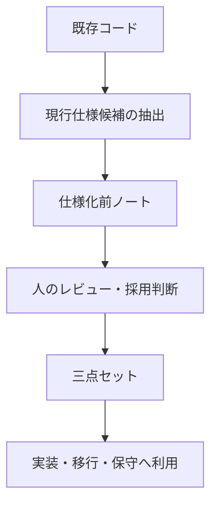
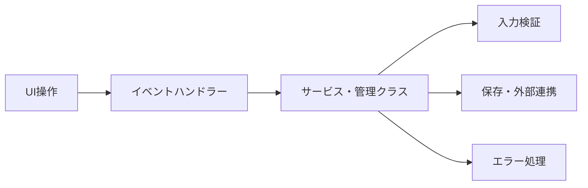

---
genpdf:
  format: book
  title: コードから仕様化前ノートと三点セットを作成する手順
  subtitle: 現行実装から根拠付きの仕様候補を抽出する逆生成ガイド
  author: ""
  version: 0.1
  date: 2026-05-27
  font_size: 11pt
  page_numbers: true
  table:
    header_background: "#e8f1ff"
    header_color: "#1f2937"
    border_color: "#cbd5e1"
    border_width: "1px"
    stripe: true
    stripe_background: "#f8fafc"
    cell_padding: "0.45em 0.65em"
    font_size: "0.95em"
    compact: false
    align: left
    header_align: center
    cell_align: left
---

!toc

<div class="page-break"></div>

# 1. この解説書の目的

この解説書は、既存コードから現行実装として読み取れる仕様候補を抽出し、仕様化前ノートを経由して三点セットへ整理する手順を説明する。

三点セットは、UIがあるシステムで使いやすい既知の整理方法である。UC仕様書、UI仕様書、ビジネスレイヤー仕様書に分けることで、利用者の目的、画面と操作、UIに依存しない処理を分離して扱える。

仕様化前ノートは、本書で使う新しい用語である。逆生成では、コードから読み取った内容をいきなり三点セットへ入れない。まず仕様化前ノートへ整理し、コード上の事実、推測、バグ候補、未決事項を分ける。

!callout{type=important title=逆生成の前提}
  逆生成は「正しい仕様を復元する作業」ではない。
  コードから観測できる現行挙動を根拠付きで抽出し、人が採用判断するための材料を作る作業である。

## 対象読者

- 仕様が不明になった既存コードを調べる人
- レガシーシステムの仕様を再構成したい人
- モダナイゼーションや別言語移行の前に仕様を作りたい人
- AIでコード解析を行い、人がレビューできる形へ整理したい人

## 対象範囲

本書は、コードから現行仕様候補を抽出し、仕様化前ノートまたは5分割仕様化前ノートへ整理し、レビュー後に三点セットへ展開する方法を扱う。

三点セットからコード生成する方法と、別言語へのマイグレーション手順は別の解説書で扱う。

<div class="page-break"></div>

# 2. 逆生成と仕様化前ノートの関係

逆生成では、コードから完成仕様を復元できるわけではない。コードには、バグ、暫定対応、古い仕様、使われなくなった処理、実装都合の制約が混ざっている可能性がある。

そのため、コードから直接三点セットを作るのではなく、まず仕様化前ノートへ整理する。



仕様化前ノートには、現行実装から読み取れる挙動、仕様として採用する候補、推測、バグ候補、未決事項、コード上の根拠を分けて書く。

| 分類 | 扱い |
| --- | --- |
| 現行実装から読み取れる挙動 | コード上の事実として記録する |
| 仕様として採用する候補 | 人が確認する前の候補として扱う |
| 推測 | 推測と明記し、正式仕様と混ぜない |
| バグ候補 | 要確認として分ける |
| 未決事項 | 決定後の反映先を書く |
| コード上の根拠 | ファイル、クラス、関数、行番号を残す |

人が採用判断した内容だけを三点セットへ進める。

<div class="page-break"></div>

# 3. 逆生成の基本方針

逆生成では、コード上の事実と推測を分ける。これが最も重要である。

たとえば、検索ボタンがあり、クリック時に`searchCustomers()`が呼ばれることはコード上の事実である。一方、「利用者は顧客を探したい」は推測を含む。推測は役に立つが、推測であることを明記する。

## 基本方針

| 方針 | 内容 |
| --- | --- |
| 事実と推測を分ける | コードから読めることと、名前から推測したことを混ぜない |
| 完成仕様として扱わない | 逆生成結果はレビュー用の草案である |
| 人のレビューを前提にする | 採用、修正、却下は人が判断する |
| 信頼度を付ける | 高、中、低などで根拠の強さを表す |
| コード上の根拠を残す | 後で確認できるように位置情報を記録する |

信頼度の例:

| 信頼度 | 例 |
| --- | --- |
| 高 | ボタン、イベント接続、呼び出し先が明確 |
| 中 | 処理はあるが、権限や例外条件が不明 |
| 低 | 画面名、関数名、コメントだけから推測 |

逆生成は、それらしい仕様を書く作業ではない。コード上の根拠を持つ現行仕様候補を、人がレビューできる形に整理する作業である。

<div class="page-break"></div>

# 4. 逆生成の入力

逆生成では、単一のUIコードだけを見るのではなく、画面、イベント、呼び出し先、データ、外部入出力を順に追う。

| 入力 | 見る内容 |
| --- | --- |
| UIコード | 画面構造、入力欄、表示項目、ボタン、メニュー |
| イベントハンドラー | 操作から呼ばれる処理 |
| サービス / 管理クラス / リポジトリ | 業務処理、保存先アクセス |
| モデル | データ構造、状態、表示用データ |
| データベースアクセス | 検索、登録、更新、削除、トランザクション |
| API呼び出し | 外部連携、送受信データ、失敗時の扱い |
| ファイル入出力 | CSV、JSON、設定、ログ、インポート、エクスポート |
| 設定ファイル | 初期値、閾値、接続先、機能ON/OFF |
| 画面定義ファイル | `.ui`、QML、resource file、`.rc` など |

## GUIフレームワーク別の入力

| 観点 | Qt | Motif | MFC |
| --- | --- | --- | --- |
| 画面単位 | `QWidget`, `QDialog`, `QMainWindow` | Widget階層, `XmForm`, `XmDialogShell` | `CDialog`, `CView`, `CFrameWnd` |
| 画面定義 | `.ui`, QML | resource file, UIL | `.rc`, dialog resource |
| イベント入口 | シグナル / スロット, `connect()` | `XtAddCallback()` | メッセージマップ |
| 入力項目 | `QLineEdit`, `QComboBox` | `XmTextField`, `XmToggleButton` | Edit Control, Combo Box |
| 一覧 | `QTableView`, `QListView` | `XmList` | `CListCtrl` |

コード要素やAPI名は原文のまま扱う。説明文では、スロット、コールバック、入力検証など、できるだけ日本語の用語を使う。

<div class="page-break"></div>

# 5. 規模に応じた逆生成単位の決め方

逆生成は、最初に単位を決める。大規模な既存コードを一度に解析しようとすると、抽出結果が大きくなりすぎて人がレビューできない。

基本は画面単位で始める。画面が1つか2つで、入力や業務ルールも見通せる場合は、単一の逆生成レビュー用仕様化前ノートで十分である。ファイルを増やすこと自体にもコストがあるため、小さい対象を無理に分割しない。

| 規模 | 推奨単位 | 置き場所 |
| --- | --- | --- |
| 小さい | 画面単位 | 逆生成レビュー用仕様化前ノート |
| 中規模 | 画面または機能群 | 仕様化前ノート、必要なら5分割 |
| 大規模 | 画面群、機能群、業務領域 | 5分割仕様化前ノート、対応表 |

全体を一括逆生成しない。代表画面で型を作り、レビューできる単位で横展開する。

<div class="page-break"></div>

# 6. まず画面単位で分ける

UIがあるシステムでは、利用者の操作は多くの場合、画面、ダイアログ、メニュー、タブ、フォーム、ボタンから始まる。したがって、いきなり業務処理やデータベース処理を追うより、まず画面の入口を整理する。

## 画面一覧表

| 画面ID | 画面名 | コード位置 | 主な操作 | 主なイベント |
| --- | --- | --- | --- | --- |
| UI-001 | 顧客検索画面 | `CustomerSearchWidget.cpp` | 検索、クリア、詳細表示 | `onSearchClicked`, `onClearClicked` |
| UI-002 | 顧客編集画面 | `CustomerEditDialog.cpp` | 保存、キャンセル | `onSaveClicked` |

## フレームワーク別の見方

| 観点 | Qt | Motif | MFC |
| --- | --- | --- | --- |
| メイン画面 | `QMainWindow` | `XmMainWindow` | `CFrameWnd` |
| ダイアログ | `QDialog` | `XmDialogShell` | `CDialog` |
| タブ | `QTabWidget` | `XmNotebook`相当の構成 | PropertySheet / PropertyPage |
| メニュー | `QMenu`, `QAction` | `XmRowColumn`, menu widget | menu resource, `ON_COMMAND` |

画面一覧表は、後続のUI仕様候補、UC候補、ビジネス仕様候補を対応づけるための入口になる。

<div class="page-break"></div>

# 7. UI仕様候補を先に作る

逆生成では、最初からUC仕様やビジネスレイヤー仕様を作ろうとすると、業務目的を推測しすぎる危険がある。UIコードからは、画面名、入力項目、表示項目、操作、画面遷移、エラー表示が比較的読み取りやすい。したがって、まずUI仕様候補を作る。

## 抽出する内容

| 項目 | 内容 |
| --- | --- |
| 画面名 | クラス名、ファイル名、画面タイトル |
| 画面の目的候補 | 画面名や操作から推測できる目的 |
| 入力項目 | 入力欄、選択肢、初期値、入力制限 |
| 表示項目 | ラベル、一覧、詳細、状態表示 |
| 操作 | ボタン、メニュー、ショートカット、選択変更 |
| 入力チェック | UI上の制限と業務上の入力検証候補 |
| 画面遷移 | ダイアログ表示、詳細画面起動、戻り動作 |
| エラー表示 | メッセージボックス、項目近くのエラー、ステータス表示 |
| コード上の根拠 | ファイル、クラス、関数、行番号 |

Qtなら`QLineEdit`、`QComboBox`、`QCheckBox`、`QTableView`、`QMessageBox`が手がかりになる。Motifなら`XmTextField`、`XmToggleButton`、`XmList`、`XmMessageBox`を見る。MFCならEdit Control、Combo Box、Check Box、List Control、`MessageBox`を見る。

UI仕様候補は正式仕様ではない。コードから見える利用者向けの挙動を、根拠付きで整理した候補である。

<div class="page-break"></div>

# 8. イベントからUC候補を作る

UI仕様候補で整理した操作やイベントから、UC候補を作る。ここでも本来のユースケースを断定しない。ボタン、メニュー、ショートカット、イベントハンドラーを起点に、利用目的の候補を整理する。

## イベント入口の例

| フレームワーク | 入口 | UC候補の作り方 |
| --- | --- | --- |
| Qt | `connect(searchButton, &QPushButton::clicked, ...)` | 検索ボタンから「検索する」候補を作る |
| Motif | `XtAddCallback(searchButton, XmNactivateCallback, ...)` | コールバックから操作候補を作る |
| MFC | `ON_BN_CLICKED(IDC_SEARCH, &CSearchDlg::OnSearch)` | message mapから操作候補を作る |

## UC候補の表

| UC候補 | 根拠 | 信頼度 |
| --- | --- | --- |
| 顧客を検索する | 検索ボタンと検索処理がある | 高 |
| 顧客を削除する | 削除ボタンはあるが権限判定が不明 | 中 |
| 顧客を承認する | 画面名から推測。処理内容は未確認 | 低 |

業務目的を推測しすぎない。`executeButton`や`processData()`のような曖昧な名前では、業務目的は分からない。

<div class="page-break"></div>

# 9. 呼び出し先からビジネス仕様候補を抽出する

UIコードだけでは、業務ルールや保存処理の全体は分からない。そこで、イベントハンドラーから、サービス、管理クラス、モデル、リポジトリ、データベースアクセス、API呼び出し、ファイル入出力へ順に追う。



## 抽出する内容

| 項目 | 見る内容 |
| --- | --- |
| スロット / コールバック | UIイベントの入口、入力取得、表示更新 |
| サービス | 業務処理の流れ |
| 入力検証 | 必須、範囲、形式、状態による可否 |
| データベース処理 | 検索、登録、更新、削除、トランザクション |
| ファイル処理 | CSV、JSON、設定、ログ、インポート、エクスポート |
| エラー処理 | 例外、戻り値、メッセージ、ログ、ロールバック |
| 状態変更 | 未処理、編集中、保存済み、承認済み、完了 |

ここで作るのは、ビジネス仕様の完成版ではない。コードから読み取れるビジネス仕様候補である。

<div class="page-break"></div>

# 10. 抽出結果を仕様化前ノートへ整理する

UI仕様候補、UC候補、ビジネス仕様候補として抽出した内容を、仕様化前ノートへ整理する。規模が大きい場合は5分割仕様化前ノートを使う。

## 整理する分類

| 分類 | 書く内容 |
| --- | --- |
| 現行実装から読み取れる挙動 | コード上の事実 |
| 仕様として採用する候補 | 採用可能に見えるが、人の判断前の内容 |
| 推測 | 画面名、関数名、コメントから推測した内容 |
| バグ候補・要確認事項 | 仕様として怪しい挙動 |
| 境界値確認 | 数値、日付、空、NULL、状態、権限 |
| 未決事項 | 業務判断や採用判断が必要な内容 |
| コード上の根拠 | ファイル、クラス、関数、行番号 |

仕様化前ノートは、コードから読めたことを仕様に変換する前の仕分け場所である。ここで分類してから、人が採用判断し、三点セットへ進める。

<div class="page-break"></div>

# 11. UC / UI / ビジネスレイヤー対応表を作る

逆生成では、文書を分けるだけでは不十分である。どのUI操作からどのUC候補が生まれ、その裏でどのビジネス処理が呼ばれ、コード上の根拠がどこにあるのかを対応表で追跡する。

| UC ID | UI画面 | UI操作 | ビジネス処理 | コード位置 | 信頼度 | 未確認事項 |
| --- | --- | --- | --- | --- | --- | --- |
| UC-001 | 顧客検索画面 | 検索ボタン | `CustomerService::searchCustomers` | `CustomerSearchWidget::onSearchClicked` | 高 | 検索条件の上限 |
| UC-002 | 顧客詳細画面 | 削除ボタン | `CustomerService::deleteCustomer` | `CustomerDetailWidget::onDeleteClicked` | 中 | 論理削除か物理削除か |

対応表があることで、人がレビューし、採用、修正、却下を判断しやすくなる。

<div class="page-break"></div>

# 12. 不明仕様を扱う

逆生成では、すべての仕様がコードから分かるわけではない。業務目的、例外業務、権限、運用制約、設計意図などは、コードだけでは分からないことが多い。

## 分かることと分かりにくいこと

| 分類 | 例 |
| --- | --- |
| コードから分かること | 画面構成、入力項目、表示項目、ボタン操作、呼び出し先 |
| コードから分かりにくいこと | 本来の業務目的、例外業務、権限設計の意図、運用制約 |
| 推測として残す項目 | 画面名、関数名、コメントから読める目的候補 |
| 人に確認する項目 | 削除方式、承認済みデータの編集可否、境界値 |
| 未決事項 | 三点セットや実装に影響する未確定事項 |
| バグ候補 | 不自然な境界値、コメントと実装の不一致、使われていない分岐 |

不明なことをAIが補完しない。不明なことは、不明、推測、未決、バグ候補として明示し、人が判断できる状態にする。

<div class="page-break"></div>

# 13. 逆生成レビュー

逆生成レビューの目的は、コードから抽出した内容をそのまま正式仕様にしないことである。

## レビュー観点

| 観点 | 確認内容 |
| --- | --- |
| 現行実装から読み取れる挙動 | コード上の根拠があるか |
| 仕様として採用する挙動 | 人が採用判断したか |
| バグ候補 | 正式仕様へ混ざっていないか |
| 境界値確認 | `>` と `>=`、空、0、1、最大値、最小値など |
| 未決事項 | 三点セット前に決めるものと実装前まででよいものを分けたか |
| 採用判断の記録 | 誰が、どの理由で採用したか |

逆生成レビューは、現行実装から読み取れる挙動を正式仕様へ昇格させてよいか判断する作業である。レビューを通った内容だけを三点セットへ進める。

<div class="page-break"></div>

# 14. 仕様化前ノートから三点セットを作る

逆生成レビューを通った仕様化前ノートをもとに、三点セットを作成する。ここでの正本はコードではなく、レビュー済みの仕様化前ノートである。

5分割仕様化前ノートを使っている場合も、単一の`source_memo.md`へ戻す必要はない。5分割ノート群を正本として、UC仕様書、UI仕様書、ビジネスレイヤー仕様書へ直接展開する。

| 反映先 | 主な内容 |
| --- | --- |
| UC仕様書 | 利用者、目的、UC、基本フロー、代替フロー、例外フロー |
| UI仕様書 | 画面一覧、入力項目、表示項目、操作、エラー表示 |
| ビジネスレイヤー仕様書 | 用語、データモデル、検証、計算、保存、状態変更、エラー種別 |

逆生成由来の推測やバグ候補を、採用判断なしに正式仕様へ混ぜない。

<div class="page-break"></div>

# 15. 大規模システムへの適用

大規模システムでは、代表画面で型を作り、画面単位や機能群単位で横展開する。

## 進め方

1. 代表画面を1つ選ぶ。
2. UI仕様候補、UC候補、ビジネス仕様候補を抽出する。
3. 対応表を作る。
4. 仕様化前ノートへ整理する。
5. 人がレビューする。
6. 型を他の画面へ横展開する。

全体を一括逆生成しない。大規模では、対応表が索引になる。仕様化前ノート、三点セット、コード、テスト、移行先実装を同じIDで追跡する。

<div class="page-break"></div>

# 16. 逆生成プロンプト例

AIに「仕様書を作って」とだけ依頼すると、コード上の事実、推測、バグ候補、正式仕様が混ざりやすい。出力形式、根拠の残し方、推測の扱い、未確認事項の扱いを明確にする。

## UIコードから抽出するプロンプト

```text
以下のUIコードから、現行実装として読み取れる内容だけを抽出してください。
推測した内容は「推測」と明記してください。
コード上の根拠を必ず残してください。

出力形式:
1. 画面概要
2. UI部品一覧
3. 入力項目
4. 表示項目
5. 操作一覧
6. エラー表示
7. コード上の根拠
8. 不明点
```

## イベント追跡用プロンプト

```text
以下のイベント接続、スロット、コールバック、message mapを起点に、
UI操作から呼び出し先までを追跡してください。

出力は、UI操作、呼び出し先、入力、出力、エラー処理、
コード上の根拠、信頼度、未確認事項に分けてください。
```

## Qt / Motif / MFC のコード調査向けの観点

| 対象 | プロンプトで指定する入口 |
| --- | --- |
| Qt | `connect()`、シグナル / スロット、`.ui`、QML、モデル / ビュー |
| Motif | `XtAddCallback()`、Widget階層、resource file、UIL |
| MFC | message map、DDX/DDV、`.rc`、Document/View |

<div class="page-break"></div>

# 付録A. コードから仕様を抽出する関連事例

この付録では、コードから仕様やビジネスルールを抽出する考え方に近い外部事例を紹介する。各事例が本書の用語や手順をそのまま採用しているわけではない。

## 事例を読むときの注意

外部事例は、コードから仕様候補を抽出し、人が確認して次工程へ使うという観点で読む。

| 観点 | 見る内容 |
| --- | --- |
| ビジネスルール抽出 | コードから業務ルールをどう抽出しているか |
| 構造化仕様 | 既存コードをどのような仕様文書へ整理しているか |
| モダナイゼーション | 抽出結果を移行や再設計へどう使っているか |

## 関連事例

- AveriSourceの事例では、大規模なModel-204コードを解析し、ビジネスルールを文書化したとされている。  
  https://www.averisource.com/case-studies/averisource-accelerates-business-rules-extraction-and-modernization-project-delivery

- イー・ビジネスの基幹レガシーシステムモダナイゼーション事例では、既存COBOLソースから業務ワークフロー・構造化仕様書を逆生成し、Javaモジュール化への移行基盤を整備したと説明されている。  
  https://www.e-business.co.jp/case/detail/001/

## 本書の方法へ取り込める教訓

- コードから抽出した内容は完成仕様ではなくレビュー対象である。
- ビジネスルール、UI、データアクセスは分けて扱う。
- コード上の根拠を残す。
- 人の採用判断を挟む。
- 大規模では単位を分けて進める。
- 抽出結果はモダナイゼーションや再実装の前段として使える。
