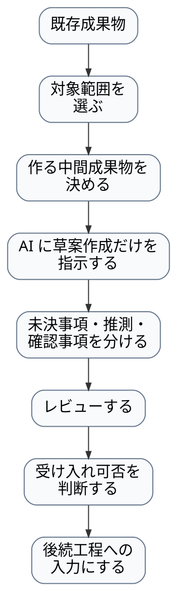

---
genpdf:
  format: book
  title: ウォーターフォール開発への AI ワークフロー部分適用ガイド
  subtitle: 既存工程を置き換えず、AI を使う部分をレビュー可能にする
  author: (株) SRA
  version: 0.1.0
  date: 2026-06-18
  font_size: 12pt
  page_numbers: true
  copyright: 2026 SRA, Inc. All rights reserved.
  table:
    header_background: "#e8f1ff"
    header_color: "#1f2937"
    border_color: "#cbd5e1"
    border_width: "1px"
    stripe: true
    stripe_background: "#f8fafc"
    cell_padding: "0.45em 0.65em"
    font_size: "0.95em"
    compact: false
    align: left
    header_align: center
    cell_align: left
---

# ウォーターフォール開発への AI ワークフロー部分適用ガイド

この文書は、既存のウォーターフォール開発に、AI を用いたアプリ生成ワークフローを部分適用するための説明書である。

目的は、ウォーターフォールを置き換えることではない。
要件定義、設計、実装、試験、承認、変更管理という既存の枠組みを維持したまま、AI を使う部分だけをレビュー可能な中間成果物に分けることである。

## 目次

1. はじめに
2. 基本方針: 既存のウォーターフォールを置き換えない
3. ウォーターフォールに部分適用する考え方
4. このワークフローの位置付け
5. 適用しやすい場面
6. 基本の流れ
7. 成果物の対応関係
8. 工程別の部分適用
9. レビューと承認
10. トレーサビリティ
11. 大規模システムへの適用
12. やってはいけないこと
13. 導入の進め方
14. まとめ

<div class="page-break"></div>

## 1. はじめに

AI は、要求や設計の曖昧な部分をそれらしく補完できる。
そのため、ウォーターフォール開発で AI を使う場合、AI の出力をそのまま正式成果物にしてはいけない。

このガイドでは、次の考え方で AI を使う。

- 既存の工程を壊さない。
- 正式成果物を置き換えない。
- AI を使う対象を小さく切り出す。
- AI の出力を仕様化前ノート、三点セット、実装プロンプトなどの中間成果物に分ける。
- 中間成果物をレビューしてから、既存成果物へ反映する。

対象読者は、ウォーターフォール開発で要件定義、設計、実装、試験、レビュー、品質管理に関わる人である。

<div class="page-break"></div>

## 2. 基本方針: 既存のウォーターフォールを置き換えない

このワークフローは、ウォーターフォール全体を置き換えるものではない。
AI を使う部分だけを、レビューしやすい形に整える補助ワークフローである。

| 方針 | 内容 |
| --- | --- |
| 正式成果物を置き換えない | 要件定義書、基本設計書、詳細設計書、試験仕様書は従来どおり管理する |
| 承認フローを飛ばさない | AI 生成物を正式化する前に人がレビューし、既存の承認手順に乗せる |
| 変更管理を維持する | 仕様変更、設計変更、コード変更は従来の変更管理に従う |
| 分割して適用する | システム全体ではなく、画面単位、機能単位、ユースケース単位で適用する |
| AI の仮決めを防ぐ | 未決事項は未決事項として扱い、AI に勝手に埋めさせない |

基本姿勢は次の通りである。

```text
既存工程は維持する。
AI を使う部分だけを、レビュー可能な中間成果物に分ける。
正式成果物への反映は、人のレビューと承認を通す。
```

<div class="page-break"></div>

## 3. ウォーターフォールに部分適用する考え方

ウォーターフォールでは、工程と成果物が明確である。
そのため、AI ワークフローも工程全体に一括適用せず、既存成果物の一部を入力として使い、限定された対象に適用する。

!dot{scale=0.85}


適用単位は、小さいほど扱いやすい。

| 適用単位 | 例 | 向いている用途 |
| --- | --- | --- |
| 画面単位 | 登録画面、検索画面、確認ダイアログ | UI 仕様、操作フロー、表示条件の整理 |
| 機能単位 | 料金計算、入力検証、保存処理 | ビジネスルール、境界値、例外条件の整理 |
| ユースケース単位 | 申請する、承認する、取消する | 利用者の目的とシナリオの整理 |
| 改修単位 | 既存機能の変更、障害対応 | 影響範囲、既存挙動、仕様反映の確認 |

<div class="page-break"></div>

## 4. このワークフローの位置付け

このワークフローは、AI に自由にコードを書かせる手順ではない。
AI の入力と出力を段階化し、人がレビューできる形にするためのドキュメント駆動の AI ハーネスである。

主な中間成果物は次の通りである。

| 中間成果物 | 役割 | ウォーターフォールでの扱い |
| --- | --- | --- |
| 仕様化前ノート | 要求、前提、未決事項、確認点を整理する | 正式仕様にする前の作業メモ |
| 三点セット | UC仕様書、UI仕様書、ビジネスレイヤー仕様書に分ける | 設計書や試験観点へ反映する補助資料 |
| 実装プロンプト | 実装対象、制約、参照仕様を AI に渡す | AI 生成や実装補助の入力 |
| レビュー結果 | 矛盾、未決事項、推測、仕様外実装を洗い出す | 正式成果物へ反映する前の確認記録 |

この位置付けを明確にしておくと、AI 生成物を正式成果物と混同しにくくなる。

<div class="page-break"></div>

## 5. 適用しやすい場面

ウォーターフォールで部分適用しやすい場面は次である。

| 場面 | 使い方 |
| --- | --- |
| 要件定義後の仕様整理 | 要件定義書から対象機能の仕様化前ノートを作り、レビューする |
| UI 仕様のたたき台作成 | 画面単位で UI仕様書の草案を作り、入力、表示、操作、状態の不足を確認する |
| 詳細設計の補助 | ビジネスレイヤー仕様書の草案を作り、検証、計算、状態変更、例外条件を整理する |
| 既存コードの理解 | ソースコードから逆生成レビュー用の仕様化前ノートを作り、現行挙動とバグ候補を分ける |
| 移植、再実装 | 既存仕様や既存コードから移植・再実装用の仕様化前ノートを作り、維持する仕様と変更する制約を分ける |

最初は、成果物が明確で、影響範囲が小さく、レビュー担当者を置ける対象から試すのがよい。

### 5.1 要件定義後の仕様整理

要件定義書、議事録、要求メモには、目的、利用者、入力、出力、制約が書かれている。
一方で、暗黙の前提、未決事項、担当者の理解に依存した説明も混ざりやすい。
仕様化前ノートを使うと、それらを AI が扱いやすく、人がレビューしやすい形に分けられる。

適用しやすい理由は、要件定義後には材料がある程度そろっているが、まだ詳細設計や実装へ進む前なので、不足や曖昧さを見つけても戻しやすいことである。
この段階で行うのは、仕様化前ノートを作成し、レビューするところまでである。
この段階の成果物は仕様化前ノートであり、三点セットや実装プロンプトは扱わない。

手順は次の通りである。

1. 要件定義書や議事録から対象機能を選ぶ。
2. 対象機能の目的、利用者、入力、出力、制約を抜き出す。
3. 仕様化前ノートを作る。
4. 未決事項、AI が推測した可能性がある事項、確認質問を分ける。
5. 要件定義担当者、業務担当者、設計担当者がレビューする。
6. 仕様化前ノートとして受け入れられるか、要件定義へ戻すかを判断する。
7. 承認された内容だけを正式な要件定義書や次工程への入力へ反映する。

既存工程では、仕様化前ノートを正式要件ではなく、要件レビュー用の補助資料として受け入れる。
AI の追記候補は推薦案であり、要件レビューで承認されるまで正式な要求として扱わない。
レビューで受け入れられた仕様化前ノートだけを、次工程への入力として扱う。

期待する効果は次である。実案件での効果測定結果ではないため、適用時には作成時間、レビュー負荷、検出した不足、後工程への影響を記録して評価する。

- 要件の曖昧さを早い段階で見つけられる。
- AI が勝手に補完しそうな箇所を事前に把握できる。
- 後工程での手戻りを減らしやすい。
- 要件定義書に書くべき確認事項を整理しやすい。
- 次工程に進むための確認事項を整理しやすい。

未決事項が多い場合は、次工程へ進まず、要求定義レビューに戻す。
ここで止まることは、曖昧な要求を次工程へ渡さないための正しい挙動である。

### 5.2 UI 仕様のたたき台作成

画面や操作は、三点セットの中でも UI仕様書と相性がよい。
入力欄、ボタン、表示項目、エラー表示、状態変化を画面単位で整理できる。

適用しやすい理由は、UI はレビュー担当者が見て確認しやすく、画面単位で範囲を切り出しやすいことである。
また、Qt などの UI 実装では、画面仕様が実装構造やテストに直接つながる。
この段階で行うのは、UI仕様書の草案を作成し、レビューするところまでである。
三点セット全体の完成は求めない。
AI への指示は、三点セットの作成ではなく、UI仕様書の草案作成に限定する。
UC仕様書やビジネスレイヤー仕様書が必要になった場合は、この段階では作成せず、確認事項として残す。

手順は次の通りである。

1. 対象画面を選ぶ。
2. 画面設計書、画面イメージ、既存画面、操作説明を入力にする。
3. AI に UI仕様書の草案作成だけを指示する。
4. 既に UC仕様書がある場合は、利用者の操作流れと合っているか確認する。
5. 既にビジネスレイヤー仕様書がある場合は、画面に業務処理を埋め込んでいないか確認する。
6. UC仕様書やビジネスレイヤー仕様書で確認すべきことがあれば、確認事項として残す。
7. 画面設計書や画面レビュー資料へ反映する。

既存工程では、UI仕様書を画面設計書の下書き、または画面レビューの補助資料として受け入れる。
画面遷移、入力制約、表示条件、エラー表示は、従来の画面設計レビューで確定する。
この段階の成果物は UI仕様書の草案であり、三点セット全体の完成物として扱わない。

期待する効果は次である。実案件での効果測定結果ではないため、適用時には作成時間、レビュー負荷、検出した不足、後工程への影響を記録して評価する。

- 画面部品と業務ルールの混在を分けやすい。
- 入力エラー、初期状態、ボタン状態、表示条件の漏れを見つけやすい。
- 後続の UI 実装や UI テストの入力にしやすい。
- 画面設計書のレビュー観点を増やしやすい。

注意点として、画面に見えているものだけで仕様を確定しない。
権限、初期値、非活性条件、エラー時表示、通信中や保存失敗時の状態など、画面だけでは読み取れない条件を確認する。

### 5.3 詳細設計の補助

詳細設計では、計算、検証、状態変更、保存条件、例外処理などが重要になる。
ビジネスレイヤー仕様書を使うと、画面から独立した処理仕様として整理できる。

適用しやすい理由は、詳細設計で必要になる処理条件は、AI が表や箇条書きに変換しやすく、人もレビューしやすいことである。
特に境界値や異常系は、仕様として明示しておくと実装とテストに使いやすい。
この段階で行うのは、ビジネスレイヤー仕様書の草案を作成し、レビューするところまでである。
実装プロンプトやテスト仕様書は、この段階では作らない。
AI への指示は、ビジネスレイヤー仕様書の草案作成に限定する。
UC仕様書や UI仕様書で確認すべきことがあれば、確認事項として残す。

手順は次の通りである。

1. 対象処理を選ぶ。
2. 入力、出力、事前条件、事後条件を整理する。
3. AI にビジネスレイヤー仕様書の草案作成だけを指示する。
4. 正常系、異常系、境界値、状態変更をレビューする。
5. UC仕様書や UI仕様書で確認すべきことがあれば、確認事項として残す。
6. レビューで受け入れられた内容だけを、詳細設計書や処理仕様書へ反映する。

既存工程では、ビジネスレイヤー仕様書を詳細設計書の補助資料として受け入れる。
正式な処理仕様へ反映する前に、設計レビューで承認する。
この段階の成果物はビジネスレイヤー仕様書の草案であり、実装プロンプトやテスト仕様書の完成物として扱わない。

期待する効果は次である。実案件での効果測定結果ではないため、適用時には作成時間、レビュー負荷、検出した不足、後工程への影響を記録して評価する。

- UI と業務処理の責務を分けやすい。
- 後続の実装指示を作るときの確認事項を整理しやすい。
- 後続の単体テスト設計で使う観点を整理しやすい。
- 詳細設計書の抜けや矛盾を見つけやすい。

追加観点として、丸め、負数、0件、空値、上限、下限、日付境界、通貨、単位変換、権限条件を重点的に確認する。
AI はそれらを自然に補完することがあるため、仕様として明示されているかを見る。

### 5.4 既存コードの理解

既存コードから、正式仕様ではなく、レビュー用の現行理解メモとして逆生成レビュー用の仕様化前ノートを作成できる。
これは、現行実装の理解に使える。
ただし、現行実装にはバグ、暫定対応、偶然の挙動、古い仕様が含まれていることがある。

このワークフローでは、既存コードも要求入力の一種として扱う。
人が文章で書いた要求ではなく、実装として残っている事実を入力にするという位置付けである。
そのため、要求 `.txt` からいきなり三点セットを作らず仕様化前ノートを挟むのと同じように、既存コードからも先にレビュー用の現行理解メモを作る。

適用しやすい理由は、既存コードには動いている処理の具体例があり、AI が構造を要約しやすいことである。
一方で、コードから読み取れることと、仕様として正しいことは別である。
この段階で行うのは、逆生成レビュー用の仕様化前ノートを、現行理解メモとして作成し、レビューするところまでである。
既存仕様書や改修設計書への反映は、このレビュー結果を受けた後続工程で行う。
AI への指示は、逆生成レビュー用の仕様化前ノート作成に限定する。
既存コードからいきなり三点セットを逆生成しない。
先に逆生成レビュー用の仕様化前ノートを作り、現行挙動、採用候補、バグ候補、要確認事項を分ける。
AI はコードから本来あるべき仕様を確定できないため、推測した内容は推測として分ける。

!dot{scale=0.78}


手順は次の通りである。

1. 対象コード範囲を決める。
2. 関連する画面、テスト、設計書、障害票を集める。
3. AI に、逆生成レビュー用の仕様化前ノート作成だけを指示する。
4. 現行実装から読み取れる挙動、採用候補にできそうな挙動、バグ候補、要確認事項、AI の推測を分ける。
5. 有識者、保守担当者、設計担当者がレビューする。
6. 現行調査資料として受け入れられるか、追加調査へ戻すかを判断する。

既存工程では、逆生成結果を正式仕様ではなく、現行調査資料として受け入れる。
採用候補にする挙動、修正候補にする挙動、追加調査が必要な挙動を分け、後続のレビューや変更管理へ渡す。

期待する効果は次である。実案件での効果測定結果ではないため、適用時には作成時間、レビュー負荷、検出した不足、後工程への影響を記録して評価する。

- 属人化した既存コードの理解を進めやすい。
- 仕様書と実装の差分を見つけやすい。
- 保守や改修の前提整理に使える。
- 後続の移植や再実装で使う入力資料を整理しやすい。

追加観点として、「現行実装がそうなっている」ことと「仕様として正しい」ことを必ず分ける。
バグを仕様として固定しないため、逆生成結果にはバグ候補と要確認事項を明示する。

### 5.5 移植、再実装

移植や再実装では、元のコードや画面をそのまま写すのではなく、仕様として再整理することが重要である。
最終的に三点セットを中間表現として使う場合でも、まず移植・再実装用の仕様化前ノートで、維持する仕様、変更する制約、廃止する挙動を分ける。

適用しやすい理由は、移植や再実装では「同じ仕様を別の形で作る」ことが目的になりやすく、仕様と実装技術を分ける価値が高いことである。
この段階で行うのは、移植・再実装用の仕様化前ノートを作成し、レビューするところまでである。
三点セットや実装プロンプトは、この段階では作らない。

手順は次の通りである。

1. 移植対象の機能を選ぶ。
2. 既存仕様、既存コード、画面、テストを集める。
3. AI に、移植・再実装用の仕様化前ノートの作成だけを指示する。
4. 維持する仕様、変更する制約、廃止候補、移植先で確認すべき事項を分ける。
5. 元実装由来の制約と、移植先で新たに決める制約を分ける。
6. 移植・再実装用の仕様化前ノートとして受け入れられるか、追加調査へ戻すかを判断する。

既存工程では、移植・再実装用の仕様化前ノートを、移植設計や再実装計画の補助資料として受け入れる。
後続工程で三点セットや移植先設計書を作る場合は、このレビュー結果を入力にする。

期待する効果は次である。実案件での効果測定結果ではないため、適用時には作成時間、レビュー負荷、検出した不足、後工程への影響を記録して評価する。

- 元実装の構造に引きずられにくい。
- 移植先設計で確認すべき事項を整理しやすい。
- 言語や UI 技術が変わっても仕様を保ちやすい。
- 移植対象と移植しない対象を分けやすい。

追加観点として、元実装のバグ、非互換仕様、廃止仕様を持ち込まないように確認する。
後続工程では、移植先で UI あり部分と UI なし部分を分け、UI あり部分は三点セット、UI なしライブラリーは別の仕様化手法を併用する。

<div class="page-break"></div>

## 6. 基本の流れ

既存のウォーターフォール成果物を入力にして、次の流れで部分適用する。
この流れは、5章の各場面に共通する部分適用の流れである。
ここでは、実装プロンプト作成やコード生成まで進むことを前提にしない。
どの中間成果物を作るかは、適用場面ごとに決める。

!dot{scale=0.78}


作る中間成果物の例は次の通りである。

| 場面 | この段階で作る中間成果物 |
| --- | --- |
| 要件定義後の仕様整理 | 仕様化前ノート |
| UI 仕様のたたき台作成 | UI仕様書の草案 |
| 詳細設計の補助 | ビジネスレイヤー仕様書の草案 |
| 既存コードの理解 | 逆生成レビュー用の仕様化前ノート |
| 移植、再実装 | 移植・再実装用の仕様化前ノート |

レビューで不足や矛盾が見つかった場合は、先へ進まず、入力となる既存成果物や中間成果物へ戻す。
レビューで受け入れられた中間成果物は、要件定義書、設計書、三点セット、実装プロンプト、試験仕様書などを作る後続工程の入力にする。
ただし、この章の流れの中でそれらを直接作るとは限らない。

<div class="page-break"></div>

## 7. 成果物の対応関係

AI ワークフローの成果物は、正式成果物を置き換えない。
各中間成果物は、既存のウォーターフォール成果物をレビューしやすくする補助資料であり、正式成果物へ反映する前の中間成果物として扱う。
この表は、5章の部分適用で作る中間成果物に限定する。
実装プロンプト、コード生成、試験仕様書作成は後続工程であり、この表では扱わない。

| 適用場面 | 入力となる既存成果物 | 作る中間成果物 | 既存工程での扱い |
| --- | --- | --- | --- |
| 要件定義後の仕様整理 | 要件定義書、議事録、要求メモ | 仕様化前ノート | 要件レビュー用の補助資料 |
| UI 仕様のたたき台作成 | 画面設計書、画面イメージ、既存画面 | UI仕様書の草案 | 画面設計レビュー用の補助資料 |
| 詳細設計の補助 | 詳細設計書、処理仕様、業務ルール | ビジネスレイヤー仕様書の草案 | 詳細設計レビュー用の補助資料 |
| 既存コードの理解 | 既存コード、画面、テスト、設計書 | 逆生成レビュー用の仕様化前ノート | 現行調査資料 |
| 移植、再実装 | 既存仕様、既存コード、画面、テスト | 移植・再実装用の仕様化前ノート | 移植設計、再実装計画の補助資料 |

正式成果物へ反映するかどうかは、レビュー後に人が判断する。

<div class="page-break"></div>

## 8. 工程別の部分適用

工程ごとの部分適用の使い方は次の通りである。
この章では、5章で整理した中間成果物を作る場面に限定する。

| 工程 | 部分適用の使い方 | この段階で作るもの | 注意点 |
| --- | --- | --- | --- |
| 要件定義後 | 要件定義書や議事録から要求の不足、未決事項、確認点を整理する | 仕様化前ノート | 正式要求として扱う前にレビューする |
| 基本設計 | 画面設計や画面イメージから入力、表示、操作、状態を整理する | UI仕様書の草案 | 三点セット全体を作る段階ではない |
| 詳細設計 | 処理仕様や業務ルールから検証、計算、状態変更、例外条件を整理する | ビジネスレイヤー仕様書の草案 | 実装プロンプトやテスト仕様書は作らない |
| 保守、調査 | 既存コードから現行挙動、採用候補、バグ候補、要確認事項を分ける | 逆生成レビュー用の仕様化前ノート | バグを仕様として固定しない |
| 移植、再実装準備 | 既存仕様や既存コードから維持する仕様、変更する制約、廃止候補を分ける | 移植・再実装用の仕様化前ノート | 元実装のバグや廃止仕様を持ち込まない |

工程ごとに使い方は異なるが、共通する原則は同じである。
AI の出力はレビュー対象であり、正式化には人の判断が必要である。
実装、単体試験、結合試験は、この章では直接の部分適用対象として扱わない。
これらは、レビュー済みの中間成果物を入力として進める後続工程である。

<div class="page-break"></div>

## 9. レビューと承認

AI ワークフローをウォーターフォールに入れる場合、レビューと承認を明確にする必要がある。
ここでのレビュー対象は、5章で作る中間成果物である。
承認は、正式成果物に直接昇格させることではなく、後続工程への入力として使ってよいかを判断することである。

レビューでは、次を確認する。

- 元の要件、設計と矛盾していないか。
- AI が推測で補った仕様が混ざっていないか。
- 未決事項が残っていないか。
- 既存の変更管理に乗せるべき差分がないか。
- 後続工程への入力として使える粒度になっているか。
- 作成対象ではない成果物まで AI が作っていないか。
- バグや偶然の挙動を仕様として固定していないか。

承認の考え方は次の通りである。

| 対象 | 承認前の扱い | 承認後の扱い |
| --- | --- | --- |
| 仕様化前ノート | 要件レビュー用の作業メモ | 要件定義書や次工程への入力候補 |
| UI仕様書の草案 | 画面設計レビュー用の草案 | 画面設計書や次工程への入力候補 |
| ビジネスレイヤー仕様書の草案 | 詳細設計レビュー用の草案 | 詳細設計書や処理仕様書への入力候補 |
| 逆生成レビュー用の仕様化前ノート | 現行理解メモ | 現行調査資料、後続調査や改修検討の入力候補 |
| 移植・再実装用の仕様化前ノート | 移植準備用の作業メモ | 移植設計、再実装計画、後続の三点セット作成への入力候補 |

承認後の中間成果物は、正式成果物そのものではない。
正式成果物へ反映する場合は、従来の要件レビュー、設計レビュー、変更管理に従う。

<div class="page-break"></div>

## 10. トレーサビリティ

ウォーターフォールでは、要件、設計、実装、試験の対応関係が重要である。
AI ワークフローを部分適用する場合も、中間成果物の出所とレビュー結果を追えるようにする。
この章では、実装プロンプト、コード、テストケースまでの追跡を前提にしない。
それらは後続工程で作成する場合に、別途トレーサビリティを確保する。

!dot{scale=0.82}


最低限、次の対応を追えるようにする。

- どの既存成果物を入力にしたか。
- どの対象範囲に適用したか。
- どの中間成果物を作成したか。
- AI が推測した事項、未決事項、確認事項は何か。
- レビューで受け入れた項目、差し戻した項目は何か。
- 後続工程へ渡す入力候補は何か。
- 正式成果物へ反映する場合、どの従来レビューや変更管理に乗せるか。

この対応が追えない場合、中間成果物がどの既存成果物と対象範囲に基づくものか分からなくなる。

<div class="page-break"></div>

## 11. 大規模システムへの適用

大規模システムでは、システム全体に一括適用してはいけない。
サブシステム、画面群、機能、既存コード範囲などの単位に分け、各単位でどの中間成果物を作るかを決める。
分割単位を決める目的は、AI の出力をレビュー可能な大きさに抑えることである。
分割単位が大きすぎる場合は、さらに小さく分ける。

| 分割の観点 | 例 | 作る中間成果物の例 | 注意点 |
| --- | --- | --- | --- |
| サブシステム | 申請、承認、集計、管理 | 仕様化前ノート | 境界と責務を明確にする |
| 画面群 | 登録系、検索系、管理系 | UI仕様書の草案 | 画面間の状態遷移を確認する |
| ユースケース | 申請する、承認する、取消する | 仕様化前ノート、必要に応じて UI仕様書の草案 | 例外フローを落とさない |
| ビジネス機能 | 計算、検証、権限判定 | ビジネスレイヤー仕様書の草案 | 境界値と異常系を確認する |
| 既存コード範囲 | 既存モジュール、既存画面 | 逆生成レビュー用の仕様化前ノート | バグを仕様として固定しない |
| UI なし機能 | ライブラリー、API、バッチ | このワークフローの対象外。別手法を使う | ヘッダー定義、VDM-SL などを検討する |

UI がある部分では、後続工程で三点セットを作る場合がある。
ただし、この章で扱う部分適用では、まず対象範囲ごとの中間成果物を作ってレビューする。
UI がないライブラリーや API は、このワークフローの主対象ではないため、ヘッダー定義、事前条件、事後条件、不変条件、VDM-SL などの別手法を検討する。

<div class="page-break"></div>

## 12. やってはいけないこと

ウォーターフォールで AI ワークフローを使う場合、次を避ける。

| やってはいけないこと | 問題 |
| --- | --- |
| AI が作った中間成果物をそのまま正式成果物にする | 誤り、推測、未決事項が正式化される |
| 未決事項を AI に埋めさせる | 仮決めが中間成果物や正式成果物に混ざる |
| 作成対象ではない成果物まで AI に作らせる | レビュー範囲が崩れ、部分適用ではなくなる |
| 中間成果物をレビューせずに正式成果物へ反映する | AI の推測や未決事項が正式成果物に混ざる |
| 既存の変更管理を飛ばす | 要件、設計、実装、試験の整合が崩れる |
| 大きすぎる範囲を一括で中間成果物化する | レビュー不能な中間成果物になる |
| 既存コードから読み取ったバグを仕様として固定する | 誤った現行挙動が後続工程へ渡る |

AI を使うほど、レビューしやすい単位に分けることが重要になる。

<div class="page-break"></div>

## 13. 導入の進め方

最初から広い範囲に導入しない。
小さな対象を選び、効果と問題を確認しながら広げる。

推奨する進め方は次である。

1. 部分適用する場面を 1 つ選ぶ。
2. 対象範囲を小さく決める。
3. 入力となる既存成果物を集める。
4. 作る中間成果物を 1 つ決める。
5. AI に中間成果物の草案作成だけを指示する。
6. 未決事項、AI の推測、確認事項を分ける。
7. レビューで受け入れ可否を判断する。
8. 後続工程への入力として使えるか確認する。
9. 成功例、失敗例、レビュー観点を記録する。
10. 適用範囲を少しずつ広げる。

導入初期は、生成速度よりも、レビューしやすくなったか、仕様の抜けが見つかったか、既存成果物との対応が取りやすくなったかを評価する。
あわせて、作成対象ではない成果物まで AI が作っていないか、後続工程へ渡す入力として妥当か、レビュー負荷が過大でないかを確認する。

<div class="page-break"></div>

## 14. まとめ

ウォーターフォール開発でも、AI ワークフローは部分適用できる。

重要なのは、既存工程を置き換えないことである。
要件定義書、設計書、試験仕様書、承認、変更管理を維持しながら、AI を使う部分だけをレビュー可能な中間成果物に分ける。

このワークフローは、次の目的で使う。

- 既存成果物を、AI が扱いやすく人がレビューしやすい中間成果物に整理する。
- AI の推測、未決事項、確認事項を見える化する。
- 作成対象ではない成果物まで AI が作らないようにする。
- レビューで中間成果物を受け入れてよいか判断する。
- 後続工程への入力候補を整理する。
- 大規模システムでは、対象範囲をレビュー可能な大きさに分ける。

結論は次の通りである。

```text
ウォーターフォールは維持する。
AI を使う部分だけをハーネス化する。
AI が作る中間成果物はレビューし、正式成果物へ反映する場合は従来の手順に従う。
```
