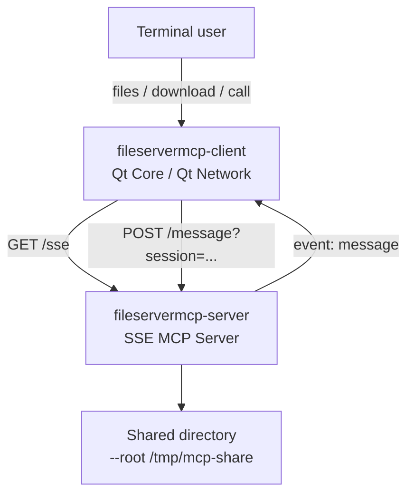
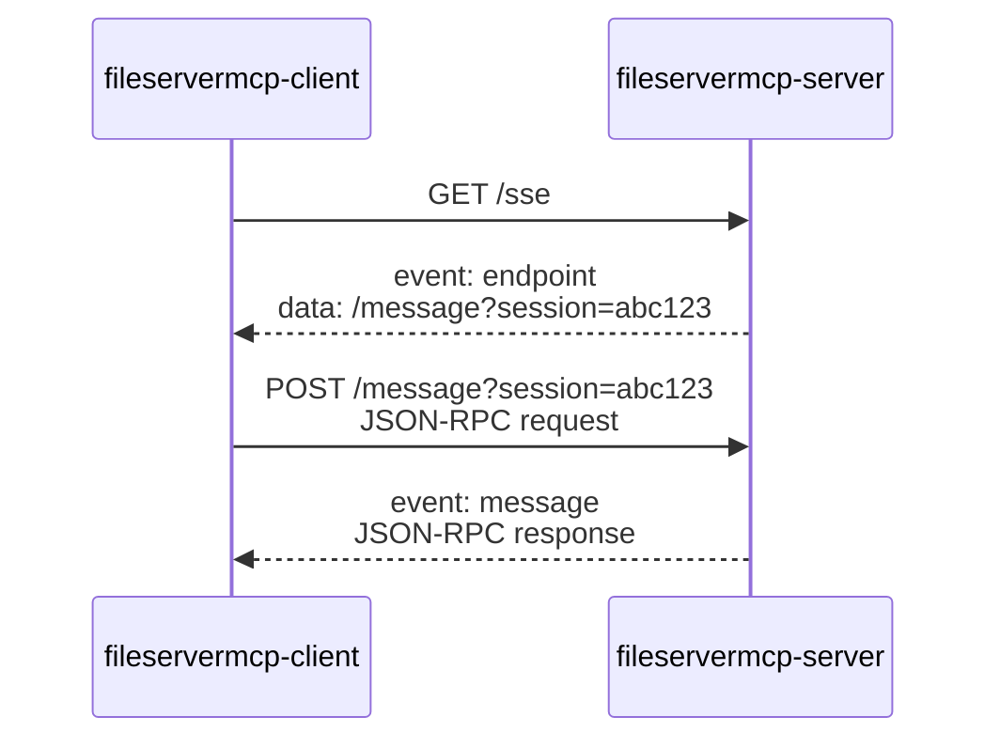
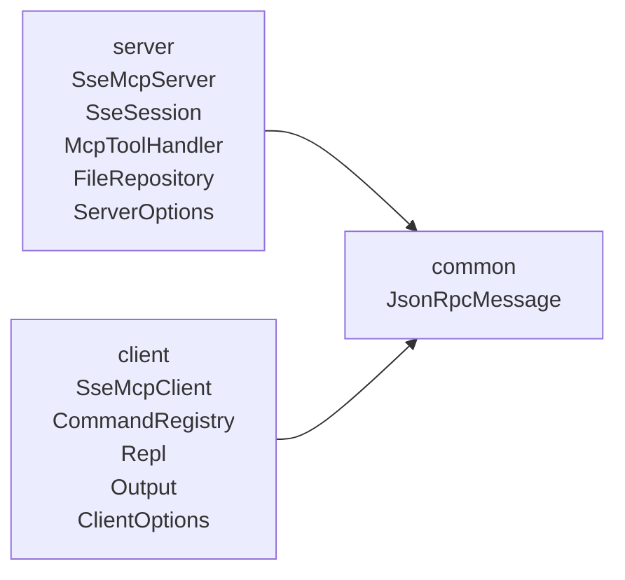
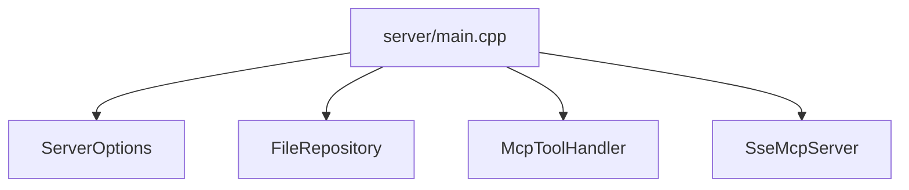

# fileservermcp User Guide

[日本語](USER_GUIDE.md) / [Project](README.en.md)

English guidance corresponding to the Japanese guide revised on November 13, 2026. The commands, JSON examples and section order follow the original. No English PDF is generated.

# Overview

A small Qt Core/Network server and CLI client for learning MCP. This tutorial uses protocol version 2024-11-05 and the legacy HTTP+SSE transport, not Streamable HTTP. It has no authentication, TLS or Origin validation. Use only dummy files in a dedicated directory over loopback. It is not a production file-sharing service. The two executables are `fileservermcp-server` and `fileservermcp-client`. The examples explain responses and message flow as well as commands.

# Try It First

These commands assume built executables on PATH. Otherwise complete Build first and use `./build/fileservermcp-server` and `./build/fileservermcp-client`. Create a directory containing a dummy file, start the server, then run the client in a second terminal. During these operations, the client connects to `/sse`, posts JSON-RPC to the endpoint supplied by the server and receives SSE `message` responses. Output shown below is illustrative.

```sh
mkdir -p /tmp/mcp-share
printf 'hello mcp\n' > /tmp/mcp-share/memo.txt
```

```sh
fileservermcp-server --root /tmp/mcp-share
```

```text
fileservermcp-server listening at http://127.0.0.1:3101/sse
```

```sh
fileservermcp-client files
```

```text
memo.txt    10    2026-05-14T15:18:56
```

```sh
fileservermcp-client download memo.txt ./memo.txt
```

```text
Downloaded memo.txt -> ./memo.txt
```

# Overall Structure

The client and server use Qt Core/Network. HTTP carries MCP JSON-RPC; this is not a conventional REST API. SSE transports server-to-client events, while HTTP POST transports client requests. The default port is 3101, separate from the old Qt Creator example on 3001. `/sse` opens the event stream; `/message` accepts requests. The diagram illustrates the directory specified by `--root`.



# Build

Qt 6 and CMake are required; there is no GUI dependency. The required Qt modules are Core and Network. Run CMake from this project directory. The outputs are `./build/fileservermcp-server` and `./build/fileservermcp-client`. Help output describes the available options and commands.

```sh
cmake -S . -B build
cmake --build build
```

```sh
fileservermcp-server --help
```

```text
Usage: fileservermcp-server --root PATH [options]

Options:
  --root PATH        Directory to expose. Required.
  --host ADDRESS     Listen address. Default: 127.0.0.1
  --port PORT        Listen port. Default: 3101
  --max-size BYTES   Maximum downloadable file size. Default: 10485760
  -h, --help         Show this help.
```

```sh
fileservermcp-client --help
```

```text
Usage: fileservermcp-client [options] [command]

Options:
  --url URL          SSE URL. Default: http://127.0.0.1:3101/sse
  --json             Print JSON output.
  --timeout SECONDS  Request timeout. Default: 10
  -h, --help         Show this help.

Commands:
  status
  tools
  files
  download NAME [PATH]
  call TOOL [JSON]
```

# Server Usage

The server exposes ordinary files directly inside the selected root. Subdirectories, symbolic links, writing, deletion and uploads are not supported.

## Basic Startup

Start the server with the root directory. The listening message reports the URL to use from the client.

```sh
fileservermcp-server --root /tmp/mcp-share
```

```text
fileservermcp-server listening at http://127.0.0.1:3101/sse
```

```text
http://127.0.0.1:3101/sse
```

## Change the Port

Specify another port when the default port is unavailable. The client URL must use the same port.

```sh
fileservermcp-server --root /tmp/mcp-share --port 3110
```

```text
fileservermcp-server listening at http://127.0.0.1:3110/sse
```

```sh
fileservermcp-client --url http://127.0.0.1:3110/sse files
```

## Startup Options

| Option | Default | Meaning |
|---|---|---|
| `--root PATH` | none | Required directory to expose |
| `--host ADDRESS` | `127.0.0.1` | Listening address; loopback is the tutorial default |
| `--port PORT` | `3101` | Listening port |
| `--max-size BYTES` | `10485760` | Maximum file size returned by `download_file` |

## Change the Maximum Size

The default size limit is about 10 MB. The example rejects files larger than 1 MB. The tutorial returns each complete file as a base64 string in a single response, rather than streaming chunks.

```sh
fileservermcp-server --root /tmp/mcp-share --max-size 1048576
```

# How SSE MCP Works

The two directions use different HTTP mechanisms. Connect to `/sse`, receive an endpoint, POST JSON-RPC there, and read responses from SSE `message` events. The sequence diagram preserves this flow.



## The endpoint Event

The server supplies a session-specific endpoint such as `/message?session=abc123`. The client uses that endpoint for requests belonging to this session.

```text
event: endpoint
data: /message?session=abc123
```

## initialize

After connection, the client sends an MCP initialize request. The response identifies the protocol, server and available capabilities. Obtain the actual tool list separately with `tools/list`.

```json
{
  "jsonrpc": "2.0",
  "id": 1,
  "method": "initialize",
  "params": {
    "protocolVersion": "2024-11-05",
    "capabilities": {},
    "clientInfo": {
      "name": "fileservermcp-client",
      "version": "0.1.0"
    }
  }
}
```

```json
{
  "jsonrpc": "2.0",
  "id": 1,
  "result": {
    "protocolVersion": "2024-11-05",
    "serverInfo": {
      "name": "fileservermcp",
      "version": "0.1.0"
    },
    "capabilities": {
      "tools": {}
    }
  }
}
```

## tools/list

Ask for the published MCP tools. The tutorial exposes `list_files` and `download_file`, with their input schemas.

```json
{
  "jsonrpc": "2.0",
  "id": 2,
  "method": "tools/list"
}
```

```json
{
  "jsonrpc": "2.0",
  "id": 2,
  "result": {
    "tools": [
      {
        "name": "list_files",
        "description": "List regular files in the server root directory."
      },
      {
        "name": "download_file",
        "description": "Read one file from the server root as base64."
      }
    ]
  }
}
```

## tools/call

Invoke a tool through the MCP method `tools/call`. Put its name in `params.name`. The client command `files` invokes `list_files` through this method.

```json
{
  "jsonrpc": "2.0",
  "id": 3,
  "method": "tools/call",
  "params": {
    "name": "list_files",
    "arguments": {}
  }
}
```

# Provided MCP Tools

| Tool | Purpose | Argument |
|---|---|---|
| `list_files` | List ordinary files directly in the root | none |
| `download_file` | Return a named file as base64 | `name` |

## list_files

Returns files directly inside the root directory. The response contains `name` (filename), `size` (bytes) and `modified` (Qt ISO date/time). The command and JSON below are examples.

```sh
fileservermcp-client call list_files '{}'
```

```json
{
    "files": [
        {
            "modified": "2026-05-14T15:18:56",
            "name": "memo.txt",
            "size": 10
        }
    ]
}
```

## download_file

Reads the named file and returns its contents in `dataBase64`, alongside `mimeType`, `name` and `size`. For example, `hello mcp\n` is encoded as `aGVsbG8gbWNwCg==`. For ordinary use, the client command `download` decodes this field and writes a local file.

```sh
fileservermcp-client call download_file '{"name":"memo.txt"}'
```

```json
{
    "dataBase64": "aGVsbG8gbWNwCg==",
    "mimeType": "text/plain",
    "name": "memo.txt",
    "size": 10
}
```

# Client Usage

The CLI supports one-shot commands and a REPL. It uses Qt Core/Network, not Qt GUI.

## Global Options

| Option | Default | Meaning |
|---|---|---|
| `--url URL` | `http://127.0.0.1:3101/sse` | SSE server URL |
| `--json` | false | Show results as JSON |
| `--timeout SECONDS` | 10 | Request timeout in seconds |
| `--help` | | Show help |

## Check the Connection

Use `status` to connect to `/sse` and initialize MCP. If connection fails, check the URL, port and whether the server is running.

```sh
fileservermcp-client status
```

```text
Connected: http://127.0.0.1:3101/sse
```

## List Tools

Use `tools` to inspect tool names, descriptions and input schemas.

```sh
fileservermcp-client tools
```

```json
{
    "tools": [
        {
            "description": "List regular files in the server root directory.",
            "inputSchema": {
                "properties": {},
                "type": "object"
            },
            "name": "list_files"
        },
        {
            "description": "Read one file from the server root as base64.",
            "inputSchema": {
                "properties": {
                    "name": {
                        "type": "string"
                    }
                },
                "required": [
                    "name"
                ],
                "type": "object"
            },
            "name": "download_file"
        }
    ]
}
```

## List Files

Use `files` for a human-readable list, or `--json files` for JSON. It invokes `list_files`.

```sh
fileservermcp-client files
```

```text
memo.txt    10    2026-05-14T15:18:56
```

```sh
fileservermcp-client --json files
```

```json
{
    "files": [
        {
            "modified": "2026-05-14T15:18:56",
            "name": "memo.txt",
            "size": 10
        }
    ]
}
```

## Download

Without a destination path, the client saves to the current directory. Supply a path to choose the destination. Existing local files are rejected rather than silently overwritten.

```sh
fileservermcp-client download memo.txt
```

```text
Downloaded memo.txt -> memo.txt
```

```sh
fileservermcp-client download memo.txt /tmp/downloaded-memo.txt
```

```text
Downloaded memo.txt -> /tmp/downloaded-memo.txt
```

```sh
fileservermcp-client download memo.txt /tmp/downloaded-memo.txt
```

```text
Error: output file already exists: /tmp/downloaded-memo.txt
```

## Call an Arbitrary Tool

Use `call TOOL [JSON]` to inspect MCP tool calls directly. This is useful for learning the underlying protocol.

```sh
fileservermcp-client call list_files '{}'
```

```json
{
    "files": [
        {
            "modified": "2026-05-14T15:18:56",
            "name": "memo.txt",
            "size": 10
        }
    ]
}
```

```sh
fileservermcp-client call download_file '{"name":"memo.txt"}'
```

```json
{
    "dataBase64": "aGVsbG8gbWNwCg==",
    "mimeType": "text/plain",
    "name": "memo.txt",
    "size": 10
}
```

# REPL

Start the client without command arguments to enter interactive mode. REPL commands begin with a dot. Use `.files`, `.download NAME [PATH]`, `.call TOOL [JSON]`, `.?` or `.help`, and `.q` to quit. This is a simple environment for repeating MCP operations.

```sh
fileservermcp-client
```

```text
File Server MCP Client
FSMCP> .? for help
FSMCP>
```

```text
FSMCP> .files
memo.txt    10    2026-05-14T15:18:56
```

```text
FSMCP> .download memo.txt ./memo.txt
Downloaded memo.txt -> ./memo.txt
```

```text
FSMCP> .call list_files {}
{
    "files": [
        {
            "modified": "2026-05-14T15:18:56",
            "name": "memo.txt",
            "size": 10
        }
    ]
}
```

```text
FSMCP> .q
```

# Command Summary

| One-shot command | REPL command | MCP operation |
|---|---|---|
| `status` | `.status` | SSE connection and `initialize` |
| `tools` | `.tools` | `tools/list` |
| `files` | `.files` | `tools/call` of `list_files` |
| `download NAME [PATH]` | `.download NAME [PATH]` | `tools/call` of `download_file` |
| `call TOOL [JSON]` | `.call TOOL [JSON]` | Arbitrary tool invocation |
| none | `.?`, `.help` | Client-side help |
| none | `.q` | Exit |

`files` and `download` are convenience commands; `call` exposes the tool invocation.

# Command and Response Examples

These are illustrative command/response pairs. Output timestamps and session identifiers vary.

## Start on the Default Port

Start the server, then initialize the client using the reported endpoint.

```sh
fileservermcp-server --root /tmp/mcp-share
```

```text
fileservermcp-server listening at http://127.0.0.1:3101/sse
```

## Start on Another Port

Set the server port and use the matching port in the client URL.

```sh
fileservermcp-server --root /tmp/mcp-share --port 3110
```

```text
fileservermcp-server listening at http://127.0.0.1:3110/sse
```

```sh
fileservermcp-client --url http://127.0.0.1:3110/sse files
```

```text
memo.txt    10    2026-05-14T15:18:56
```

## Missing File

A request for a nonexistent file returns an error from `download_file` as JSON-RPC. The client displays the error object.

```sh
fileservermcp-client download missing.txt
```

```text
Error: {"code":-32004,"message":"file not found"}
```

## Invalid Filename

Names containing `/`, `\` or `..` are rejected. The example attempts to access a file outside the root.

```sh
fileservermcp-client download ../secret.txt
```

```text
Error: {"code":-32602,"message":"invalid file name"}
```

## File Exceeds the Size Limit

The server in this example has a 16-byte limit. Downloading a larger file fails. This tutorial does not split a large file into chunks.

```sh
fileservermcp-server --root /tmp/mcp-share --max-size 16
```

```sh
fileservermcp-client download large.bin
```

```text
Error: {"code":-32004,"message":"file is larger than max-size"}
```

# Implementation Structure

Headers and sources are divided into `common`, `server` and `client`. Work is delegated to focused classes instead of being concentrated in `main.cpp`.



## Directory Layout

The source archive and checkout share the following structure.

```text
fileservermcp/
  include/
    common/
    server/
    client/
  src/
    common/
    server/
    client/
```

## Server Classes

| Class | Responsibility |
|---|---|
| `ServerOptions` | Parse `--root`, `--host`, `--port`, `--max-size` |
| `FileRepository` | List files, validate names and read contents |
| `McpToolHandler` | Handle `initialize`, `tools/list`, `tools/call` |
| `SseSession` | Represent one SSE connection |
| `SseMcpServer` | Handle `/sse` and `/message` using `QTcpServer` |

## Client Classes

| Class | Responsibility |
|---|---|
| `ClientOptions` | Parse `--url`, `--json`, `--timeout` |
| `SseMcpClient` | SSE connection, endpoint reception, JSON-RPC POST and response reception |
| `CommandRegistry` | Register `status`, `tools`, `files`, `download`, `call` |
| `Repl` | Interactive input loop |
| `Output` | JSON and human-readable output |

## The Role of main.cpp

The server entry point parses options, creates the main objects and starts listening. The client entry point similarly parses options, creates a client and selects one-shot or REPL execution.



# Security and Limits

This is a learning implementation, without authentication, TLS or Origin validation. Use dummy files over loopback. Operations are read-only; only regular files directly in `--root` are exposed. Subdirectories and symbolic links are excluded. Names containing `/`, `\` or `..`, and files larger than `--max-size`, are rejected. These restrictions make behavior easier to understand, not production-ready. A production design needs measures such as chunking, authentication, access control and audit logs.

# Troubleshooting

Use the reported error and the following checks to identify the failing layer.

## Cannot Connect

Check that the server is running, the client `--url` is correct, and the URL port matches `--port`. Check whether `127.0.0.1` or `localhost` is appropriate for the environment.

```sh
fileservermcp-client status
```

```text
Error: Connection refused
```

## Port Already in Use

If listening fails, choose another port and update the client URL to match.

```sh
fileservermcp-server --root /tmp/mcp-share --port 3110
```

```sh
fileservermcp-client --url http://127.0.0.1:3110/sse status
```

## File Not Listed

Check that the file is in the specified root, directly inside it, readable and not a symbolic link. Subdirectories are not searched.

## Qt Locale Warning

The warning indicates a non-UTF-8 locale. In the documented trial the command still ran, but set the terminal locale to UTF-8 where necessary.

```text
Detected locale "C" with character encoding "US-ASCII", which is not UTF-8.
Qt depends on a UTF-8 locale, and has switched to "UTF-8" instead.
```

# Comparison with Qt Creator MCP

This server is not Qt Creator MCP Server. It illustrates a similar legacy SSE transport. The old Qt Creator example uses port 3001 for IDE operations such as build, run, debug and files; this tutorial uses port 3101 for `list_files` and `download_file`. `qtcreatormcp` is an IDE-client example; `fileservermcp-client` is the tutorial client. Current Qt Creator settings must be checked separately. `/sse` is a transport entry point, not a tool name. The MCP operations are JSON-RPC methods such as `initialize`, `tools/list` and `tools/call`.

# Appendix: JSON-RPC and SSE Examples

Illustrative wire-level exchanges are shown below. Session identifiers are examples.

## SSE Connection

The client opens an SSE stream and receives an endpoint event.

```http
GET /sse HTTP/1.1
Host: 127.0.0.1:3101
Accept: text/event-stream
```

```text
event: endpoint
data: /message?session=abc123
```

## tools/call list_files

POST a JSON-RPC request to the endpoint supplied for the session. The response returns through the SSE stream.

```json
{
  "jsonrpc": "2.0",
  "id": 3,
  "method": "tools/call",
  "params": {
    "name": "list_files",
    "arguments": {}
  }
}
```

```text
event: message
data: {"jsonrpc":"2.0","id":3,"result":{"files":[{"name":"memo.txt","size":10,"modified":"2026-05-14T15:18:56"}]}}
```

## tools/call download_file

The response carries base64 data and file metadata. The client decodes `dataBase64` and saves the resulting bytes.

```json
{
  "jsonrpc": "2.0",
  "id": 4,
  "method": "tools/call",
  "params": {
    "name": "download_file",
    "arguments": {
      "name": "memo.txt"
    }
  }
}
```

```json
{
  "jsonrpc": "2.0",
  "id": 4,
  "result": {
    "name": "memo.txt",
    "size": 10,
    "mimeType": "text/plain",
    "dataBase64": "aGVsbG8gbWNwCg=="
  }
}
```
