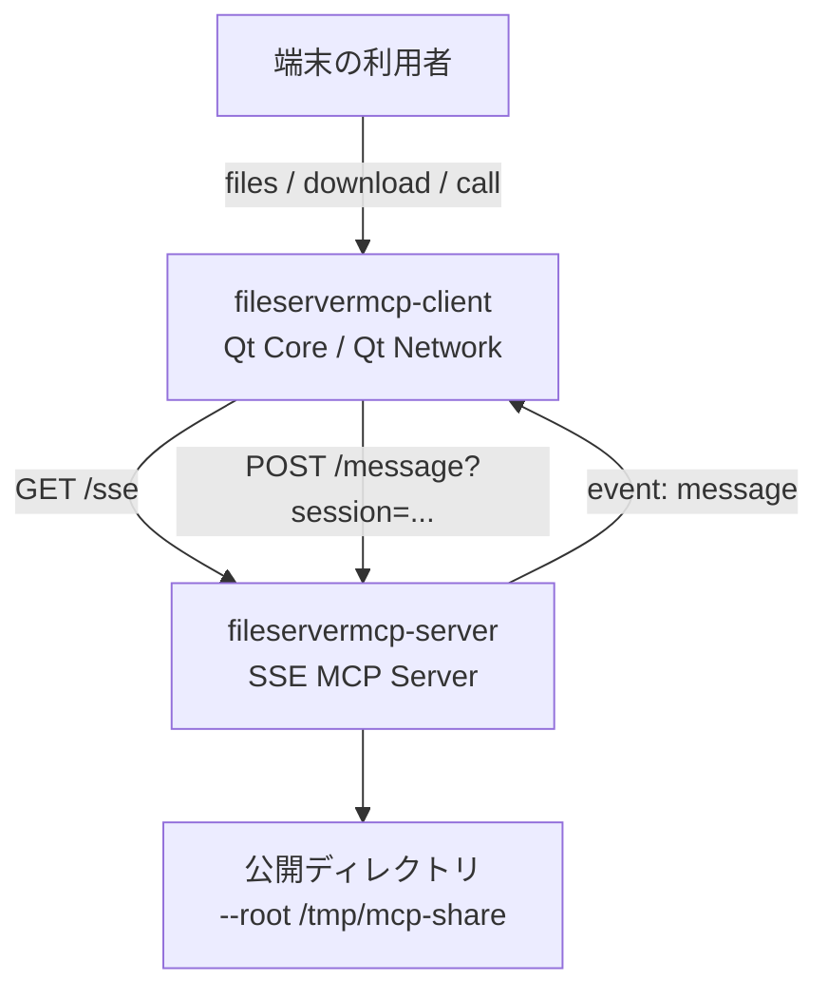
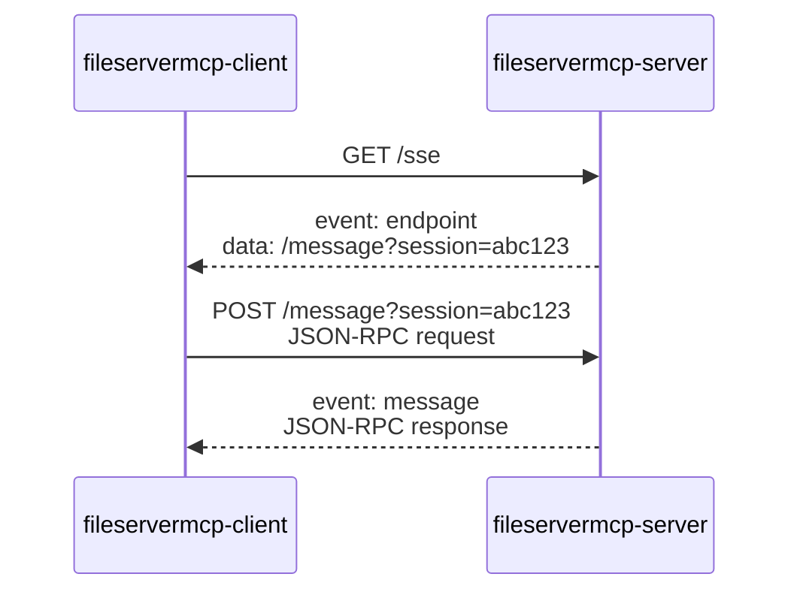
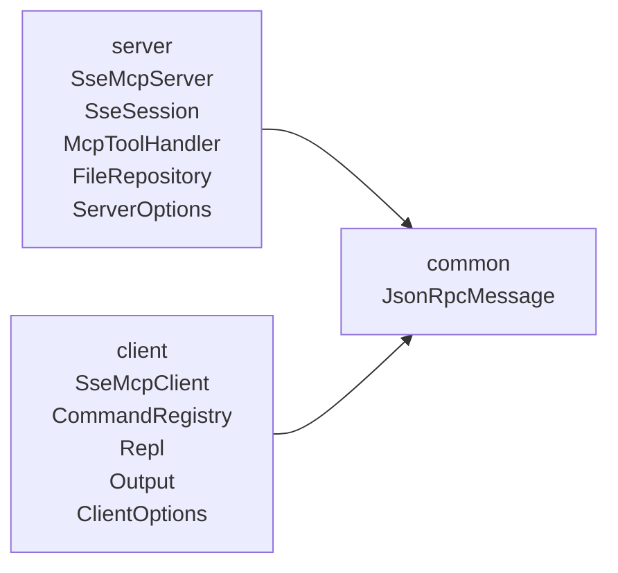
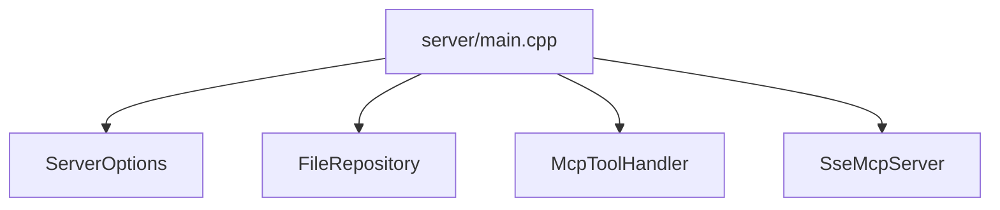

---
genpdf:
  format: book
  title: fileservermcp ユーザーガイド
  subtitle: SSE MCP ファイルダウンロードサーバー
  author: (株) SRA
  version: 0.1.0
  date: 2026-05-18
  toc: true
  font_size: 12pt
  page_numbers: true
  table:
    header_background: "#e8f1ff"
    header_color: "#1f2937"
    border_color: "#cbd5e1"
    border_width: "1px"
    stripe: true
    stripe_background: "#f8fafc"
    cell_padding: "0.45em 0.65em"
    font_size: "0.95em"
    compact: false
    align: left
    header_align: center
    cell_align: left
---

!toc

<div class="page-break"></div>

# 概要

`fileservermcp` は、MCP の仕組みを練習するための小さなファイルダウンロードサーバーです。

この教材はprotocol version 2024-11-05の旧HTTP+SSE transportを扱います。現在のStreamable HTTPとは入口やメッセージの運び方が異なります。認証・TLS・Origin検証などの保護を備えた実用サーバーではありません。ダミーファイルだけを専用ディレクトリへ置き、ループバック接続で試してください。

目的は、本格的なファイル共有サーバーを作ることではありません。Qt Creator MCP Server と同じように、`http://127.0.0.1:3101/sse` のような URL に接続し、SSE transport で MCP の `initialize`、`tools/list`、`tools/call` がどのように流れるかを確認することです。

このリポジトリでは、次の 2 つの実行ファイルを作成します。

| 実行ファイル | 役割 |
|---|---|
| `fileservermcp-server` | SSE MCP サーバー。公開ディレクトリ直下のファイル一覧取得とダウンロードを提供します。 |
| `fileservermcp-client` | Qt Core/Network 製の CLI クライアント。サーバーに SSE で接続し、MCP tool を呼び出します。 |

このガイドでは、コマンドを実行したときに何が起きるかを、レスポンス例と MCP メッセージの形を対応づけて説明します。


<div class="page-break"></div>

# まず動かしてみる

以下はビルド済みの実行ファイルをPATHから実行できる場合の例です。未ビルドなら先に「ビルド方法」を実施し、`./build/fileservermcp-server` と `./build/fileservermcp-client` を使います。

最初に、公開するディレクトリを用意します。

```sh
mkdir -p /tmp/mcp-share
printf 'hello mcp\n' > /tmp/mcp-share/memo.txt
```

サーバーを起動します。

```sh
fileservermcp-server --root /tmp/mcp-share
```

出力例:

```text
fileservermcp-server listening at http://127.0.0.1:3101/sse
```

別の端末で、クライアントからファイル一覧を取得します。

```sh
fileservermcp-client files
```

出力例:

```text
memo.txt    10    2026-05-14T15:18:56
```

ファイルをダウンロードします。

```sh
fileservermcp-client download memo.txt ./memo.txt
```

出力例:

```text
Downloaded memo.txt -> ./memo.txt
```

この短い操作の中で、クライアントは `/sse` に接続し、サーバーから通知された `/message?session=...` に JSON-RPC request を POST し、レスポンスを SSE の `message` イベントとして受け取っています。


<div class="page-break"></div>

# 全体構成

`fileservermcp` は、Qt Creator MCP Server の動きを小さくした練習用構成です。



通信は HTTP 上で行いますが、普通の REST API ではありません。MCP の JSON-RPC メッセージを、SSE と HTTP POST の組み合わせで運びます。

| 要素 | 内容 |
|---|---|
| MCP | `initialize`、`tools/list`、`tools/call` などの JSON-RPC メッセージの約束事 |
| SSE | サーバーからクライアントへイベントを流す HTTP の仕組み |
| `/sse` | クライアントがサーバーからのレスポンスを受け取る接続 |
| `/message` | クライアントがサーバーへ JSON-RPC request を送る入口 |

Qt Creator MCP Server では、接続 URL が `http://127.0.0.1:3001/sse` のようになります。このサンプルでは Qt Creator と衝突しないよう、デフォルトポートを `3101` にしています。


<div class="page-break"></div>

# ビルド方法

前提は Qt 6 と CMake です。GUI は使わないため、必要な Qt モジュールは `Core` と `Network` です。

```sh
cmake -S . -B build
cmake --build build
```

生成される実行ファイル:

| パス | 説明 |
|---|---|
| `./build/fileservermcp-server` | SSE MCP サーバー |
| `./build/fileservermcp-client` | CLI/REPL クライアント |

ヘルプを確認します。

```sh
fileservermcp-server --help
```

出力例:

```text
Usage: fileservermcp-server --root PATH [options]

Options:
  --root PATH        Directory to expose. Required.
  --host ADDRESS     Listen address. Default: 127.0.0.1
  --port PORT        Listen port. Default: 3101
  --max-size BYTES   Maximum downloadable file size. Default: 10485760
  -h, --help         Show this help.
```

クライアント側のヘルプ:

```sh
fileservermcp-client --help
```

出力例:

```text
Usage: fileservermcp-client [options] [command]

Options:
  --url URL          SSE URL. Default: http://127.0.0.1:3101/sse
  --json             Print JSON output.
  --timeout SECONDS  Request timeout. Default: 10
  -h, --help         Show this help.

Commands:
  status
  tools
  files
  download NAME [PATH]
  call TOOL [JSON]
```


<div class="page-break"></div>

# サーバーの使い方

サーバーは、指定した公開ディレクトリの直下にある通常ファイルだけを扱います。サブディレクトリ、シンボリックリンク、書き込み、削除、アップロードは扱いません。

## 基本起動

```sh
fileservermcp-server --root /tmp/mcp-share
```

出力例:

```text
fileservermcp-server listening at http://127.0.0.1:3101/sse
```

この状態で、クライアントは次の URL に接続します。

```text
http://127.0.0.1:3101/sse
```

## ポートを変更する

Qt Creator MCP Server が `3001` を使っている場合でも、このサーバーのデフォルトは `3101` なので衝突しません。さらに別のポートにしたい場合は `--port` を指定します。

```sh
fileservermcp-server --root /tmp/mcp-share --port 3110
```

出力例:

```text
fileservermcp-server listening at http://127.0.0.1:3110/sse
```

この場合、クライアントにも同じ URL を指定します。

```sh
fileservermcp-client --url http://127.0.0.1:3110/sse files
```

## 起動オプション

| オプション | 既定値 | 説明 |
|---|---:|---|
| `--root PATH` | なし | 公開ディレクトリ。必須です。 |
| `--host ADDRESS` | `127.0.0.1` | 待ち受けアドレス。練習用のため localhost を既定にしています。 |
| `--port PORT` | `3101` | 待ち受けポート。 |
| `--max-size BYTES` | `10485760` | `download_file` で返す最大ファイルサイズ。 |

## 最大サイズを変更する

デフォルトでは、`download_file` で返せるファイルサイズは約 10 MB です。

```sh
fileservermcp-server --root /tmp/mcp-share --max-size 1048576
```

この例では、1 MB を超えるファイルのダウンロードを拒否します。練習用の実装ではファイルを base64 文字列として一度に返すため、サイズ上限を設けています。


<div class="page-break"></div>

# SSE MCP の仕組み

SSE 版 MCP では、クライアントからサーバーへ送る通信と、サーバーからクライアントへ返す通信が分かれています。



`/sse` は、サーバーからクライアントへイベントを返すための接続です。接続は開いたままになります。

`/message?session=...` は、クライアントからサーバーへ JSON-RPC request を送るための入口です。クライアントは `/sse` で受け取った `endpoint` イベントから、この URL を知ります。

## endpoint イベント

クライアントが `/sse` に接続すると、サーバーは最初に `endpoint` イベントを返します。

```text
event: endpoint
data: /message?session=abc123
```

これは「このセッションで request を送るときは、この URL に POST してください」という通知です。

## initialize

接続後、クライアントは MCP の初期化 request を送ります。

```json
{
  "jsonrpc": "2.0",
  "id": 1,
  "method": "initialize",
  "params": {
    "protocolVersion": "2024-11-05",
    "capabilities": {},
    "clientInfo": {
      "name": "fileservermcp-client",
      "version": "0.1.0"
    }
  }
}
```

サーバーのレスポンス例:

```json
{
  "jsonrpc": "2.0",
  "id": 1,
  "result": {
    "protocolVersion": "2024-11-05",
    "serverInfo": {
      "name": "fileservermcp",
      "version": "0.1.0"
    },
    "capabilities": {
      "tools": {}
    }
  }
}
```

ここで分かることは、サーバーが MCP tool を提供できることです。実際の tool 一覧は、次の `tools/list` で取得します。

## tools/list

`tools/list` は、サーバーが公開している MCP tool の一覧を取得します。

```json
{
  "jsonrpc": "2.0",
  "id": 2,
  "method": "tools/list"
}
```

レスポンス例:

```json
{
  "jsonrpc": "2.0",
  "id": 2,
  "result": {
    "tools": [
      {
        "name": "list_files",
        "description": "List regular files in the server root directory."
      },
      {
        "name": "download_file",
        "description": "Read one file from the server root as base64."
      }
    ]
  }
}
```

`fileservermcp` が提供する tool は、`list_files` と `download_file` の 2 つだけです。

## tools/call

tool を実行するときは、MCP method としては常に `tools/call` を使います。どの tool を実行するかは `params.name` に入れます。

```json
{
  "jsonrpc": "2.0",
  "id": 3,
  "method": "tools/call",
  "params": {
    "name": "list_files",
    "arguments": {}
  }
}
```

つまり、クライアントの `files` コマンドは、内部的には `tools/call` で `list_files` を呼び出しています。


<div class="page-break"></div>

# 提供 MCP Tools

| Tool | 役割 | 引数 |
|---|---|---|
| `list_files` | 公開ディレクトリ直下の通常ファイル一覧を返します。 | なし |
| `download_file` | 指定ファイルを base64 で返します。 | `name` |

## list_files

`list_files` は、公開ディレクトリ直下のファイル一覧を返します。

直接呼び出す場合:

```sh
fileservermcp-client call list_files '{}'
```

出力例:

```json
{
    "files": [
        {
            "modified": "2026-05-14T15:18:56",
            "name": "memo.txt",
            "size": 10
        }
    ]
}
```

レスポンスの各フィールド:

| フィールド | 意味 |
|---|---|
| `name` | ファイル名 |
| `size` | ファイルサイズ。単位はバイトです。 |
| `modified` | 更新日時。Qt の ISO 形式です。 |

## download_file

`download_file` は、指定ファイルを読み込み、base64 文字列として返します。

直接呼び出す場合:

```sh
fileservermcp-client call download_file '{"name":"memo.txt"}'
```

出力例:

```json
{
    "dataBase64": "aGVsbG8gbWNwCg==",
    "mimeType": "text/plain",
    "name": "memo.txt",
    "size": 10
}
```

`dataBase64` はファイルの中身です。`hello mcp\n` を base64 にすると、`aGVsbG8gbWNwCg==` になります。

実用的なクライアントコマンドとしては、`download` を使います。`download` は `download_file` の結果から `dataBase64` を取り出し、ローカルファイルとして保存します。


<div class="page-break"></div>

# クライアントの使い方

クライアントは Qt GUI ではなく、Qt Core/Network だけで作られた CLI です。単発実行と REPL の両方を持ちます。

## グローバルオプション

| オプション | 既定値 | 説明 |
|---|---:|---|
| `--url URL` | `http://127.0.0.1:3101/sse` | 接続先 SSE URL |
| `--json` | false | コマンド結果を JSON 表示します。 |
| `--timeout SECONDS` | `10` | request のタイムアウト秒数 |
| `-h`, `--help` | なし | ヘルプ表示 |

## 接続確認

```sh
fileservermcp-client status
```

出力例:

```text
Connected: http://127.0.0.1:3101/sse
```

`status` は、内部で `/sse` 接続と `initialize` を行います。接続できない場合は、URL、ポート、サーバーの起動状態を確認します。

## tool 一覧を表示する

```sh
fileservermcp-client tools
```

出力例:

```json
{
    "tools": [
        {
            "description": "List regular files in the server root directory.",
            "inputSchema": {
                "properties": {},
                "type": "object"
            },
            "name": "list_files"
        },
        {
            "description": "Read one file from the server root as base64.",
            "inputSchema": {
                "properties": {
                    "name": {
                        "type": "string"
                    }
                },
                "required": [
                    "name"
                ],
                "type": "object"
            },
            "name": "download_file"
        }
    ]
}
```

ここでは、サーバーが公開している tool 名と入力 schema を確認できます。

## ファイル一覧

```sh
fileservermcp-client files
```

出力例:

```text
memo.txt    10    2026-05-14T15:18:56
```

`--json` を指定すると、tool の結果を JSON として確認できます。

```sh
fileservermcp-client --json files
```

出力例:

```json
{
    "files": [
        {
            "modified": "2026-05-14T15:18:56",
            "name": "memo.txt",
            "size": 10
        }
    ]
}
```

## ダウンロード

保存先を省略すると、カレントディレクトリに同名で保存します。

```sh
fileservermcp-client download memo.txt
```

出力例:

```text
Downloaded memo.txt -> memo.txt
```

保存先を明示する場合:

```sh
fileservermcp-client download memo.txt /tmp/downloaded-memo.txt
```

出力例:

```text
Downloaded memo.txt -> /tmp/downloaded-memo.txt
```

既存ファイルがある場合は、誤って上書きしないように拒否します。

```sh
fileservermcp-client download memo.txt /tmp/downloaded-memo.txt
```

出力例:

```text
Error: output file already exists: /tmp/downloaded-memo.txt
```

## 任意 tool を直接呼び出す

`call` は MCP tool を直接呼び出すための低レベルコマンドです。MCP の練習では、このコマンドが役に立ちます。

```sh
fileservermcp-client call list_files '{}'
```

出力例:

```json
{
    "files": [
        {
            "modified": "2026-05-14T15:18:56",
            "name": "memo.txt",
            "size": 10
        }
    ]
}
```

`download_file` を直接呼び出す例:

```sh
fileservermcp-client call download_file '{"name":"memo.txt"}'
```

出力例:

```json
{
    "dataBase64": "aGVsbG8gbWNwCg==",
    "mimeType": "text/plain",
    "name": "memo.txt",
    "size": 10
}
```


<div class="page-break"></div>

# REPL

引数なしで起動すると、対話モードになります。

```sh
fileservermcp-client
```

出力例:

```text
File Server MCP Client
FSMCP> .? for help
FSMCP>
```

REPL では、コマンド名の先頭に `.` を付けます。

```text
FSMCP> .files
memo.txt    10    2026-05-14T15:18:56
```

ダウンロード:

```text
FSMCP> .download memo.txt ./memo.txt
Downloaded memo.txt -> ./memo.txt
```

直接 tool 呼び出し:

```text
FSMCP> .call list_files {}
{
    "files": [
        {
            "modified": "2026-05-14T15:18:56",
            "name": "memo.txt",
            "size": 10
        }
    ]
}
```

終了:

```text
FSMCP> .q
```

REPL は MCP の流れを何度も試すための簡易環境です。


<div class="page-break"></div>

# コマンド一覧

| 単発コマンド | REPL コマンド | MCP 上の動き |
|---|---|---|
| `status` | `.status` | `/sse` 接続と `initialize` |
| `tools` | `.tools` | `tools/list` |
| `files` | `.files` | `tools/call` で `list_files` |
| `download NAME [PATH]` | `.download NAME [PATH]` | `tools/call` で `download_file` |
| `call TOOL [JSON]` | `.call TOOL [JSON]` | 任意の MCP tool を `tools/call` |
| なし | `.?`, `.help` | クライアント内ヘルプ |
| なし | `.q` | クライアント終了 |

`files` や `download` は使いやすいコマンドです。`call` は MCP tool 呼び出しを直接確認するためのコマンドです。


<div class="page-break"></div>

# コマンド例とレスポンス

## サーバーをデフォルトポートで起動する

```sh
fileservermcp-server --root /tmp/mcp-share
```

レスポンス:

```text
fileservermcp-server listening at http://127.0.0.1:3101/sse
```

見るべき点は URL です。クライアントはこの URL に接続します。

## サーバーを別ポートで起動する

```sh
fileservermcp-server --root /tmp/mcp-share --port 3110
```

レスポンス:

```text
fileservermcp-server listening at http://127.0.0.1:3110/sse
```

クライアント側:

```sh
fileservermcp-client --url http://127.0.0.1:3110/sse files
```

レスポンス:

```text
memo.txt    10    2026-05-14T15:18:56
```

サーバーとクライアントでポートを合わせる必要があります。

## 存在しないファイル

```sh
fileservermcp-client download missing.txt
```

レスポンス:

```text
Error: {"code":-32004,"message":"file not found"}
```

これは `download_file` tool が返した JSON-RPC error です。クライアントはエラーオブジェクトを文字列として表示します。

## 不正なファイル名

```sh
fileservermcp-client download ../secret.txt
```

レスポンス:

```text
Error: {"code":-32602,"message":"invalid file name"}
```

`../secret.txt` は公開ディレクトリの外へ出ようとする指定なので拒否されます。このサーバーは練習用ですが、最低限の安全対策として `/`、`\`、`..` を含むファイル名を受け付けません。

## サイズ上限を超えるファイル

サーバーを 16 バイト上限で起動します。

```sh
fileservermcp-server --root /tmp/mcp-share --max-size 16
```

大きなファイルをダウンロードしようとすると、次のようになります。

```sh
fileservermcp-client download large.bin
```

レスポンス:

```text
Error: {"code":-32004,"message":"file is larger than max-size"}
```

練習用実装ではチャンク分割をしていないため、大きなファイルは扱わない方針です。


<div class="page-break"></div>

# 実装構成

ソースコードは `include/` と `src/` に分かれています。`main.cpp` に処理を詰め込まず、機能ごとにクラスを分けています。



## ディレクトリ構成

```text
fileservermcp/
  include/
    common/
    server/
    client/
  src/
    common/
    server/
    client/
```

## サーバー側クラス

| クラス | 役割 |
|---|---|
| `ServerOptions` | `--root`、`--host`、`--port`、`--max-size` を解析します。 |
| `FileRepository` | 公開ディレクトリの一覧取得、ファイル名検証、ファイル読み込みを行います。 |
| `McpToolHandler` | `initialize`、`tools/list`、`tools/call` を処理します。 |
| `SseSession` | 1 つの SSE 接続を表します。 |
| `SseMcpServer` | `QTcpServer` で `/sse` と `/message` を処理します。 |

## クライアント側クラス

| クラス | 役割 |
|---|---|
| `ClientOptions` | `--url`、`--json`、`--timeout` を解析します。 |
| `SseMcpClient` | `/sse` 接続、`endpoint` 受信、JSON-RPC POST、`message` 受信を担当します。 |
| `CommandRegistry` | `status`、`tools`、`files`、`download`、`call` を登録します。 |
| `Repl` | 対話モードの入力ループです。 |
| `Output` | JSON 表示と人間向け表示をまとめます。 |

## main.cpp の役割

サーバー側の `main.cpp` は、オプションを読み、主要クラスを作り、listen を開始するだけです。



クライアント側の `main.cpp` も、オプション解析、クライアント作成、単発実行と REPL の分岐だけを行います。


<div class="page-break"></div>

# セキュリティと制限

このサーバーは練習用です。ただし、ファイルを扱うため最低限の制限を入れています。

| 項目 | 内容 |
|---|---|
| 待ち受け | 既定では `127.0.0.1` のみ |
| 操作 | 読み取り専用 |
| 対象 | `--root` 直下の通常ファイルのみ |
| サブディレクトリ | 非対応 |
| シンボリックリンク | 対象外 |
| ファイル名 | `/`、`\`、`..` を含む名前は拒否 |
| サイズ | `--max-size` を超えるファイルは拒否 |

この設計は、練習用として挙動を分かりやすくするためです。本格的なファイルサーバーにする場合は、チャンク分割、認証、アクセス制御、監査ログなどが必要になります。


<div class="page-break"></div>

# トラブルシューティング

## 接続できない

```sh
fileservermcp-client status
```

出力例:

```text
Error: Connection refused
```

確認すること:

| 確認項目 | 内容 |
|---|---|
| サーバー起動 | `fileservermcp-server` が起動しているか |
| URL | クライアントの `--url` が正しいか |
| ポート | サーバーの `--port` と URL のポートが一致しているか |
| host | `127.0.0.1` と `localhost` の指定が環境に合っているか |

## ポートが使われている

サーバー起動時に listen できない場合は、別ポートを指定します。

```sh
fileservermcp-server --root /tmp/mcp-share --port 3110
```

クライアントも同じポートにします。

```sh
fileservermcp-client --url http://127.0.0.1:3110/sse status
```

## ファイルが表示されない

`files` で期待したファイルが出ない場合は、次を確認します。

| 原因 | 説明 |
|---|---|
| ディレクトリ違い | `--root` で指定した場所にファイルがあるか |
| サブディレクトリ内 | このサーバーは root 直下しか見ません。 |
| 読み取り不可 | ファイルまたはディレクトリの権限を確認します。 |
| シンボリックリンク | 練習用実装では対象外です。 |

## Qt の locale 警告

環境によっては、Qt が次の警告を出す場合があります。

```text
Detected locale "C" with character encoding "US-ASCII", which is not UTF-8.
Qt depends on a UTF-8 locale, and has switched to "UTF-8" instead.
```

これは locale が UTF-8 ではないことを示す警告です。今回の動作確認では、警告が出てもコマンド自体は実行できます。必要に応じて、端末の locale を UTF-8 に設定してください。


<div class="page-break"></div>

# Qt Creator MCP との比較

`fileservermcp` は Qt Creator MCP Server そのものではありません。ただし、SSE transport の考え方を理解するために、似た形にしています。

| 項目 | Qt Creator MCP | fileservermcp |
|---|---|---|
| 既定 URL | `http://127.0.0.1:3001/sse` | `http://127.0.0.1:3101/sse` |
| transport | SSE | SSE |
| 主な tool | build、run、debug、file 操作など | `list_files`、`download_file` |
| 対象 | Qt Creator の機能 | 公開ディレクトリのファイル |
| クライアント例 | `qtcreatormcp` | `fileservermcp-client` |
| 目的 | IDE 操作 | MCP/SSE の練習 |

重要なのは、URL の `/sse` は MCP tool 名ではないという点です。`/sse` は MCP メッセージを運ぶための transport の入口です。実際の MCP 操作は、`initialize`、`tools/list`、`tools/call` のような JSON-RPC method として流れます。


<div class="page-break"></div>

# 付録: JSON-RPC と SSE の例

## SSE 接続

クライアント:

```http
GET /sse HTTP/1.1
Host: 127.0.0.1:3101
Accept: text/event-stream
```

サーバー:

```text
event: endpoint
data: /message?session=abc123
```

## tools/call list_files

クライアントは `/message?session=abc123` に POST します。

```json
{
  "jsonrpc": "2.0",
  "id": 3,
  "method": "tools/call",
  "params": {
    "name": "list_files",
    "arguments": {}
  }
}
```

サーバーは `/sse` 側に返します。

```text
event: message
data: {"jsonrpc":"2.0","id":3,"result":{"files":[{"name":"memo.txt","size":10,"modified":"2026-05-14T15:18:56"}]}}
```

## tools/call download_file

request:

```json
{
  "jsonrpc": "2.0",
  "id": 4,
  "method": "tools/call",
  "params": {
    "name": "download_file",
    "arguments": {
      "name": "memo.txt"
    }
  }
}
```

response:

```json
{
  "jsonrpc": "2.0",
  "id": 4,
  "result": {
    "name": "memo.txt",
    "size": 10,
    "mimeType": "text/plain",
    "dataBase64": "aGVsbG8gbWNwCg=="
  }
}
```

このレスポンスを受け取ったクライアントは、`dataBase64` をデコードしてファイルに保存します。
